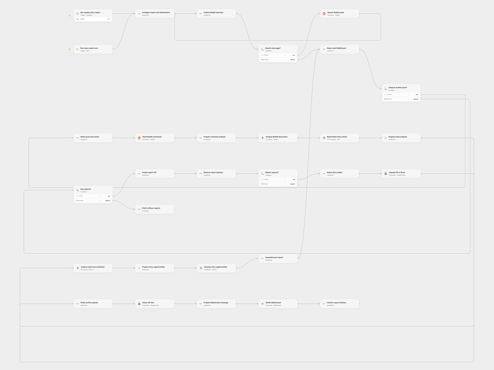

# Reddit Trending Stories to Mattermost

Analyze trending Reddit-linked news and share a ZIP of story reports.

<!-- template-actions:start -->
 
<!-- template-actions:end -->

<picture>
  <source media="(prefers-color-scheme: dark)" srcset="preview-dark.png">
  
</picture>

## Setup

Connect Reddit, Gemini, Google Drive and Mattermost. In Open Flow set the newline-separated topics, Drive folder ID and Mattermost channel ID in Configure topics and destinations, bind JINA_API_KEY, and enable persistent State. In n8n set topics, Drive folder, Data Table with item_key and status text columns, the Mattermost webhook URL and Header Auth credentials for Jina and Gemini. The schedule runs Monday at 06:00 UTC in Open Flow; configure the n8n instance timezone to UTC for the same schedule.

## Use

The workflow searches each topic, selects link posts with more than 100 upvotes, retains the most-upvoted post per URL, and reads comments and the linked news article. Three analyses use the discussion, article and engagement metrics to create one report per post. Reports are combined into a ZIP, uploaded to Drive, shared with anyone holding the link and announced in Mattermost. No notification is sent when no posts qualify. Reddit comments and article text are sent to Gemini. Check the resulting reports and share only material suitable for a public link.

A delivery of unknown outcome stays pending. Inspect Drive permissions and Mattermost before retrying. For Open Flow enter the pending key in ack; choose confirmed only after all effects are complete, or absent only after verifying no prior effects remain. Clear the recovery fields afterwards. For n8n reconcile the Data Table row before removing a pending checkpoint. Avoid overlapping runs. Each date is delivered once; use a different date for another run.

Inspiration &amp; credits

Search the configured topics, use Jina JSON responses and Gemini, retain per-post association, and add a delivery checkpoint.

Adapted from [Automatic Weekly Digital PR Stories Suggestions](https://github.com/Zie619/n8n-workflows/blob/ae8cf6dc5b873cbb4f74587aa9180ed3a9f70682/workflows/Code/1875_Code_Schedule_Automate_Scheduled.json) in [Zie619/n8n-workflows](https://github.com/Zie619/n8n-workflows). Attribution: Zie619 / n8n-workflows.

The collection’s [MIT notice](https://github.com/Zie619/n8n-workflows/blob/94007c1445d9258a7da116646b79473e7c7c3282/LICENSE) is pinned at a later revision. This is the collection notice at that revision; it does not establish a separate original template author's license. Our changes are listed above; see [repository licensing](../../README.md#licensing).

> MIT License
>
> Copyright (c) 2025 Zie619
>
> Permission is hereby granted, free of charge, to any person obtaining a copy
> of this software and associated documentation files (the "Software"), to deal
> in the Software without restriction, including without limitation the rights
> to use, copy, modify, merge, publish, distribute, sublicense, and/or sell
> copies of the Software, and to permit persons to whom the Software is
> furnished to do so, subject to the following conditions:
>
> The above copyright notice and this permission notice shall be included in all
> copies or substantial portions of the Software.
>
> THE SOFTWARE IS PROVIDED "AS IS", WITHOUT WARRANTY OF ANY KIND, EXPRESS OR
> IMPLIED, INCLUDING BUT NOT LIMITED TO THE WARRANTIES OF MERCHANTABILITY,
> FITNESS FOR A PARTICULAR PURPOSE AND NONINFRINGEMENT. IN NO EVENT SHALL THE
> AUTHORS OR COPYRIGHT HOLDERS BE LIABLE FOR ANY CLAIM, DAMAGES OR OTHER
> LIABILITY, WHETHER IN AN ACTION OF CONTRACT, TORT OR OTHERWISE, ARISING FROM,
> OUT OF OR IN CONNECTION WITH THE SOFTWARE OR THE USE OR OTHER DEALINGS IN THE
> SOFTWARE.

fflate 0.7.4 license:
MIT License

Copyright (c) 2020 Arjun Barrett

Permission is hereby granted, free of charge, to any person obtaining a copy
of this software and associated documentation files (the "Software"), to deal
in the Software without restriction, including without limitation the rights
to use, copy, modify, merge, publish, distribute, sublicense, and/or sell
copies of the Software, and to permit persons to whom the Software is
furnished to do so, subject to the following conditions:

The above copyright notice and this permission notice shall be included in all
copies or substantial portions of the Software.

THE SOFTWARE IS PROVIDED "AS IS", WITHOUT WARRANTY OF ANY KIND, EXPRESS OR
IMPLIED, INCLUDING BUT NOT LIMITED TO THE WARRANTIES OF MERCHANTABILITY,
FITNESS FOR A PARTICULAR PURPOSE AND NONINFRINGEMENT. IN NO EVENT SHALL THE
AUTHORS OR COPYRIGHT HOLDERS BE LIABLE FOR ANY CLAIM, DAMAGES OR OTHER
LIABILITY, WHETHER IN AN ACTION OF CONTRACT, TORT OR OTHERWISE, ARISING FROM,
OUT OF OR IN CONNECTION WITH THE SOFTWARE OR THE USE OR OTHER DEALINGS IN THE
SOFTWARE.

