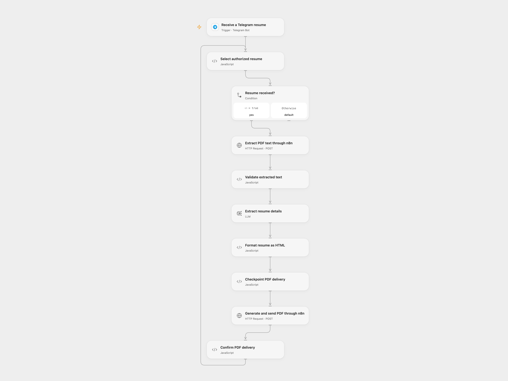

# Reformat a Telegram Resume PDF

Extract a resume PDF sent to a Telegram bot, format its details, and return a new PDF.

<picture>
  <source media="(prefers-color-scheme: dark)" srcset="preview-dark.png">
  
</picture>

[Open Flow JSON](templates/reformat-telegram-resume-pdf.openflow.json) · [n8n JSON](templates/reformat-telegram-resume-pdf.n8n.json)

## Setup

Import the supplied n8n workflow and connect the Telegram nodes to your bot. Configure a reachable [Gotenberg](https://gotenberg.dev/) service in both PDF conversion nodes. For Open Flow, disable **Telegram trigger**, enable **Resume text webhook** and **Resume delivery webhook**, activate n8n, and set their production URLs in the two Open Flow HTTP nodes. Connect Telegram, select an AI model, set the allowed numeric chat ID in **Select authorized resume**, enable persistent State, and prevent overlapping runs. Restrict access to both relay URLs.

For direct n8n use, enable **Telegram trigger**, disable the two relay webhooks, set the authorized chat ID in **Auth**, and connect the OpenAI and Telegram credentials. A bot supports only one active webhook, so activate one format.

## Behavior

Send a PDF resume to the bot from the configured chat. The workflow extracts readable text, asks the model for structured resume details, formats the result as HTML, converts it to PDF with Gotenberg, and sends the PDF back to that chat. Scanned PDFs without readable text may fail. Review the result because model extraction can omit or misinterpret details. Resume text is sent to the configured model and n8n/Gotenberg services.

If PDF delivery is uncertain, inspect the Telegram chat before entering the update ID in **Select authorized resume** to acknowledge it. The command is treated as handled and queued resumes continue. Do not automatically replay an uncertain document send.

Inspiration &amp; credits

## Changes to the source

- Supply n8n binary relays for PDF extraction and delivery while Open Flow performs the AI extraction and formatting.
- Configure the private chat ID and repair the parsed-data mapping for the direct n8n path.

Adapted from [Extract and reformat a resume from a Telegram PDF](https://github.com/Zie619/n8n-workflows/blob/ae8cf6dc5b873cbb4f74587aa9180ed3a9f70682/workflows/Telegram/0462_Telegram_Code_Create_Webhook.json) in [Zie619/n8n-workflows](https://github.com/Zie619/n8n-workflows). The source export does not identify a separate template author or license.

The collection’s [MIT notice](https://github.com/Zie619/n8n-workflows/blob/94007c1445d9258a7da116646b79473e7c7c3282/LICENSE) is pinned at a later revision. This is the collection notice at that revision; it does not establish a separate original template author's license. Our changes are listed above; see [repository licensing](../../README.md#licensing).

> MIT License
>
> Copyright (c) 2025 Zie619
>
> Permission is hereby granted, free of charge, to any person obtaining a copy
> of this software and associated documentation files (the "Software"), to deal
> in the Software without restriction, including without limitation the rights
> to use, copy, modify, merge, publish, distribute, sublicense, and/or sell
> copies of the Software, and to permit persons to whom the Software is
> furnished to do so, subject to the following conditions:
>
> The above copyright notice and this permission notice shall be included in all
> copies or substantial portions of the Software.
>
> THE SOFTWARE IS PROVIDED "AS IS", WITHOUT WARRANTY OF ANY KIND, EXPRESS OR
> IMPLIED, INCLUDING BUT NOT LIMITED TO THE WARRANTIES OF MERCHANTABILITY,
> FITNESS FOR A PARTICULAR PURPOSE AND NONINFRINGEMENT. IN NO EVENT SHALL THE
> AUTHORS OR COPYRIGHT HOLDERS BE LIABLE FOR ANY CLAIM, DAMAGES OR OTHER
> LIABILITY, WHETHER IN AN ACTION OF CONTRACT, TORT OR OTHERWISE, ARISING FROM,
> OUT OF OR IN CONNECTION WITH THE SOFTWARE OR THE USE OR OTHER DEALINGS IN THE
> SOFTWARE.

