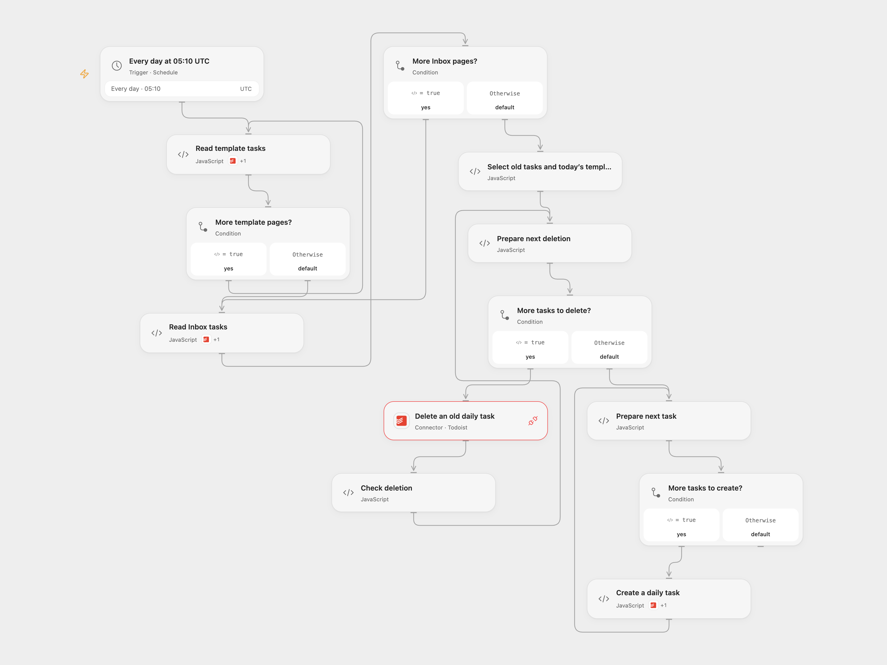

# Refresh Daily Todoist Tasks

Delete old daily tasks and copy today’s matching task templates to your Todoist Inbox.

<picture>
  <source media="(prefers-color-scheme: dark)" srcset="preview-dark.png">
  
</picture>

[Open Flow JSON](templates/refresh-daily-todoist-tasks.openflow.json) · [n8n JSON](templates/refresh-daily-todoist-tasks.n8n.json)

## Setup

Configure both Todoist project IDs and use the same Todoist personal API token for the two reading nodes, deletion request, and creation node. The token must have permission to delete tasks. Allow Provider API Request access for **Delete an old daily task**; the standard Todoist OAuth connection requests read/write without the separate deletion scope. Set the same IDs and Todoist credentials in n8n. Review the Inbox tasks tagged daily before activation: those tasks will be deleted. Activate one format.

Template descriptions use for example `days:mon,tues; due:8am`. The due time is optional; supported weekday names are sun, mon, tues, wed, thurs, fri and sat.

## Behavior

At 05:10 UTC daily, the workflow reads all pages of both projects, selects templates matching the UTC weekday, deletes Inbox tasks bearing the daily label, then creates the matching tasks with that label. Template content and description are copied; optional due times use UTC. n8n runs at a fixed second within the minute; Open Flow runs at the minute boundary.

An invalid page or template stops before deletions. Neither format automatically retries failed reads or writes. A failed deletion or creation stops later writes; earlier changes remain. Check Todoist before retrying an uncertain write. Changes during a run can affect results. Avoid overlapping runs: one run can delete daily tasks created by another. Open Flow collects both projects in run state, which must fit the host execution limits.

## Changes to the source

- Replace private IDs and credentials, use UTC and current Todoist API pagination. The source export schedules both branches at 05:10 despite their different node names; deletion now completes before creation to avoid a race. The source inherited its n8n instance timezone and configured Todoist node retries; the templates disable those retries.

Source and license

Adapted from [Automatically create daily list of todos in Todoist](https://github.com/Zie619/n8n-workflows/blob/ae8cf6dc5b873cbb4f74587aa9180ed3a9f70682/workflows/Code/0446_Code_Todoist_Create_Scheduled.json) in [Zie619/n8n-workflows](https://github.com/Zie619/n8n-workflows). The matching [n8n listing](https://n8n.io/workflows/2149-automatically-create-daily-list-of-todos-in-todoist/) credits Mutasem. No separate original template license was found.

The collection’s [MIT notice](https://github.com/Zie619/n8n-workflows/blob/94007c1445d9258a7da116646b79473e7c7c3282/LICENSE) is pinned at a later revision. This is the collection notice at that revision; it does not establish a separate original template author's license. Our changes are listed above; see [repository licensing](../../README.md#licensing).

> MIT License
>
> Copyright (c) 2025 Zie619
>
> Permission is hereby granted, free of charge, to any person obtaining a copy
> of this software and associated documentation files (the "Software"), to deal
> in the Software without restriction, including without limitation the rights
> to use, copy, modify, merge, publish, distribute, sublicense, and/or sell
> copies of the Software, and to permit persons to whom the Software is
> furnished to do so, subject to the following conditions:
>
> The above copyright notice and this permission notice shall be included in all
> copies or substantial portions of the Software.
>
> THE SOFTWARE IS PROVIDED "AS IS", WITHOUT WARRANTY OF ANY KIND, EXPRESS OR
> IMPLIED, INCLUDING BUT NOT LIMITED TO THE WARRANTIES OF MERCHANTABILITY,
> FITNESS FOR A PARTICULAR PURPOSE AND NONINFRINGEMENT. IN NO EVENT SHALL THE
> AUTHORS OR COPYRIGHT HOLDERS BE LIABLE FOR ANY CLAIM, DAMAGES OR OTHER
> LIABILITY, WHETHER IN AN ACTION OF CONTRACT, TORT OR OTHERWISE, ARISING FROM,
> OUT OF OR IN CONNECTION WITH THE SOFTWARE OR THE USE OR OTHER DEALINGS IN THE
> SOFTWARE.

