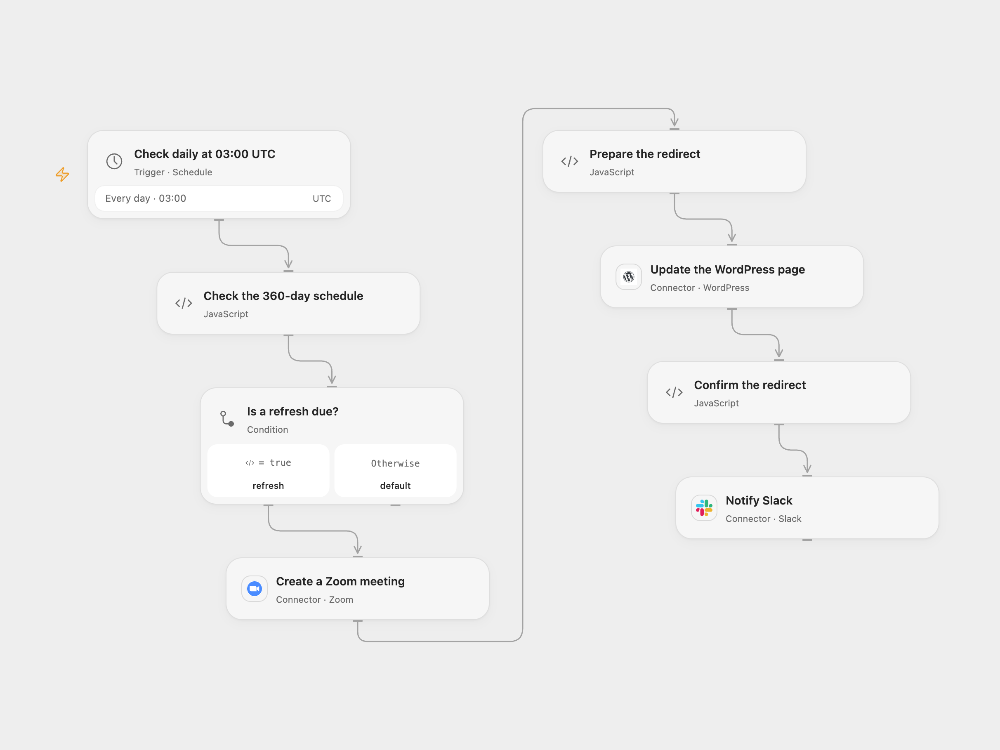

# Refresh a Zoom Meeting Redirect Page

Create a recurring Zoom meeting, update a WordPress redirect page, and notify Slack every 360 days.

<picture>
  <source media="(prefers-color-scheme: dark)" srcset="preview-dark.png">
  
</picture>

[Open Flow JSON](templates/refresh-zoom-meeting-redirect-page.openflow.json) · [n8n JSON](templates/refresh-zoom-meeting-redirect-page.n8n.json)

## Setup

Connect Zoom, WordPress and Slack. Set the UTC starting date in **Check the 360-day schedule**, the actual WordPress page ID in **Update the WordPress page**, and the Slack channel. Configure a page whose contents may be replaced and a WordPress account and site that preserve HTML meta refresh tags. Confirm the published page and theme actually perform the redirect. The default Zoom meeting is recurring without a fixed time, with participants muted on entry, participant video enabled and join before host requested. Zoom account settings such as Waiting Room may override these options.

In n8n, set the same start date in **Check the 360-day schedule**, connect Zoom, WordPress and Slack credentials, set the page ID and Slack channel, and activate one format.

## Behavior

At 03:00 UTC on the chosen start date and every 360 UTC calendar days after it, the workflow creates one Zoom meeting, replaces the WordPress page content with a meta refresh to its join URL, checks the returned page content, and posts the URL to Slack. A daily schedule checks whether the date is due; a missed run is not replayed automatically. Both formats use the connected Zoom user. The join URL is published on the page and shared in Slack.

An error stops later steps; earlier changes remain. A lost response can hide a successful create or update, so inspect Zoom, WordPress and Slack before retrying. A successful page update response does not guarantee a visitor’s browser or site theme will execute the redirect.

Inspiration &amp; credits

## Changes to the source

- Use an explicit UTC start date and 360-day interval. The original n8n schedule depends on activation, instance timezone, its day-of-year recurrence calculation, and an unspecified minute. The n8n template uses a fixed second within 03:00; Open Flow uses the minute boundary.
- Replace private page/channel values with configuration, preserve the source meeting options, and check that the returned page contains the intended redirect before posting to Slack. Remove the automatic n8n workflow link from the Slack message.

Adapted from [Use a custom URL for recurring Zoom meetings](https://github.com/Zie619/n8n-workflows/blob/ae8cf6dc5b873cbb4f74587aa9180ed3a9f70682/workflows/Schedule/0631_Schedule_Wordpress_Automate_Scheduled.json) in [Zie619/n8n-workflows](https://github.com/Zie619/n8n-workflows). The matching [n8n listing](https://n8n.io/workflows/2543-use-a-custom-url-for-recurring-zoom-meetings/) credits Eric. No separate original template license was found.

The collection’s [MIT notice](https://github.com/Zie619/n8n-workflows/blob/94007c1445d9258a7da116646b79473e7c7c3282/LICENSE) is pinned at a later revision. This is the collection notice at that revision; it does not establish a separate original template author's license. Our changes are listed above; see [repository licensing](../../README.md#licensing).

> MIT License
>
> Copyright (c) 2025 Zie619
>
> Permission is hereby granted, free of charge, to any person obtaining a copy
> of this software and associated documentation files (the "Software"), to deal
> in the Software without restriction, including without limitation the rights
> to use, copy, modify, merge, publish, distribute, sublicense, and/or sell
> copies of the Software, and to permit persons to whom the Software is
> furnished to do so, subject to the following conditions:
>
> The above copyright notice and this permission notice shall be included in all
> copies or substantial portions of the Software.
>
> THE SOFTWARE IS PROVIDED "AS IS", WITHOUT WARRANTY OF ANY KIND, EXPRESS OR
> IMPLIED, INCLUDING BUT NOT LIMITED TO THE WARRANTIES OF MERCHANTABILITY,
> FITNESS FOR A PARTICULAR PURPOSE AND NONINFRINGEMENT. IN NO EVENT SHALL THE
> AUTHORS OR COPYRIGHT HOLDERS BE LIABLE FOR ANY CLAIM, DAMAGES OR OTHER
> LIABILITY, WHETHER IN AN ACTION OF CONTRACT, TORT OR OTHERWISE, ARISING FROM,
> OUT OF OR IN CONNECTION WITH THE SOFTWARE OR THE USE OR OTHER DEALINGS IN THE
> SOFTWARE.

