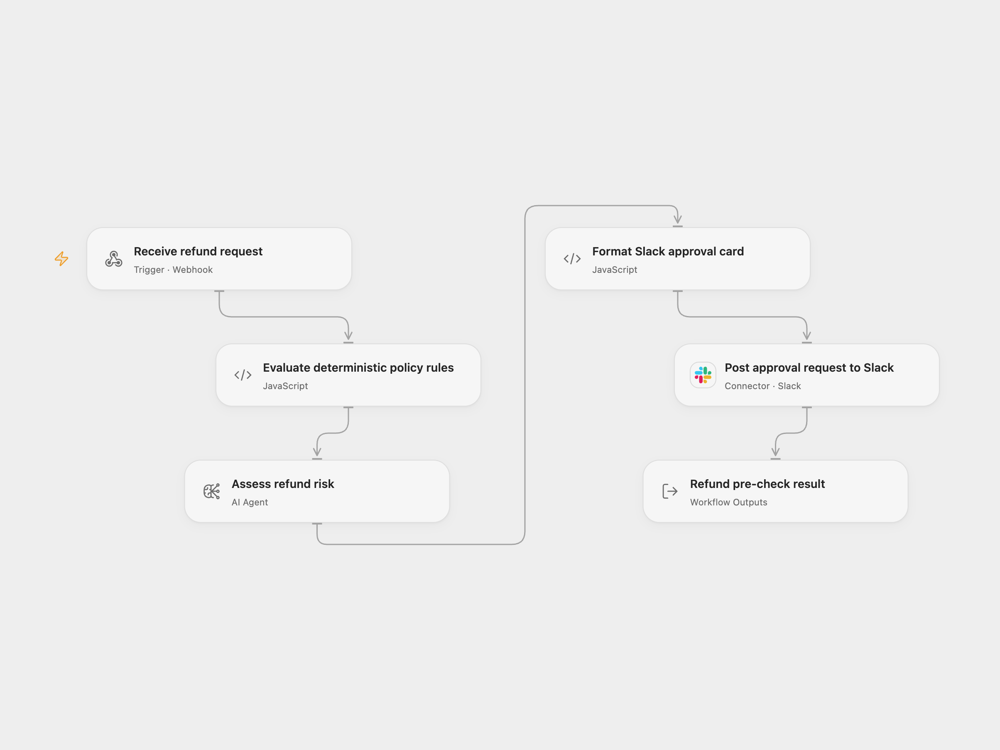

# Refund Policy Pre-Check & Approval

Validate incoming refund requests against deterministic policy rules, score risk with AI, and post an approval summary to Slack.

<picture>
  <source media="(prefers-color-scheme: dark)" srcset="preview-dark.png">
  
</picture>

## Requirements

- Slack connection with chat:write permission and access to the finance approval channel
- Configured AI model on the Open Flow AI Agent node
- Webhook caller sending orderId, customerEmail, amountUsd, daysSincePurchase, and reason

## Template

- Open Flow: [templates/refund-policy-precheck.openflow.json](templates/refund-policy-precheck.openflow.json)

## Setup

1. Import `templates/refund-policy-precheck.openflow.json` into Open Flow.
2. Replace any placeholder values (such as `YOUR_SLACK_CHANNEL_ID` or `YOUR_GATEWAY_MODEL_ID`) with your own configuration.
3. Connect your required integrations (for example, Slack) and run or activate the workflow trigger.
