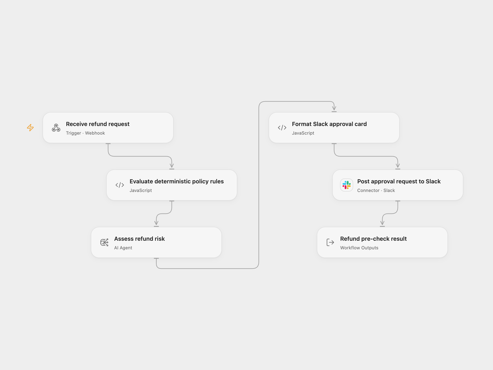

# 返金ポリシーの事前チェックと承認

受信した返金リクエストを確定的なポリシールールで検証し、AI でリスクを評価して、承認用の概要を Slack に投稿します。

<!-- template-actions:start -->

<!-- template-actions:end -->

<picture>
  <source media="(prefers-color-scheme: dark)" srcset="../../preview-dark.png">
  
</picture>

## 前提条件

- chat:write 権限を持ち、経理の承認チャンネルにアクセスできる Slack 接続
- Open Flow AI Agent ノードに設定済みの AI モデル
- orderId、customerEmail、amountUsd、daysSincePurchase、reason を送信する Webhook 呼び出し元

## セットアップ

1. `templates/refund-policy-precheck.openflow.json` を Open Flow にインポートします。
2. プレースホルダー値（`YOUR_SLACK_CHANNEL_ID` や `YOUR_GATEWAY_MODEL_ID` など）をご自身の設定に置き換えます。
3. 必要な連携（Slack など）を接続し、ワークフローのトリガーを実行または有効化します。
