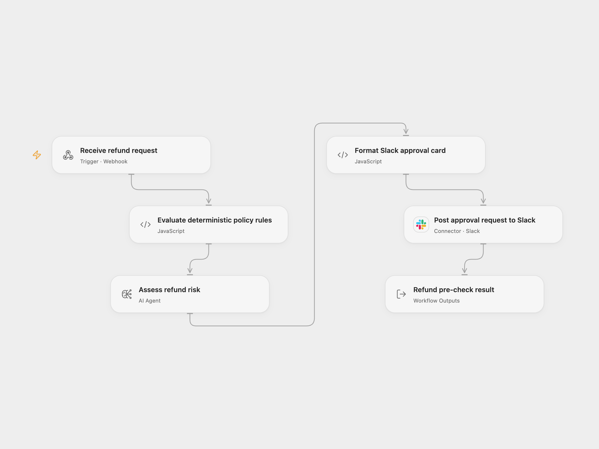

# 退款政策预检与审批

按确定性政策规则校验退款申请，用 AI 评估风险，并将审批摘要发送到 Slack。

<!-- template-actions:start -->

<!-- template-actions:end -->

<picture>
  <source media="(prefers-color-scheme: dark)" srcset="../../preview-dark.png">
  
</picture>

## 前提条件

- 具有 chat:write 权限并可访问财务审批频道的 Slack 连接
- 已在 Open Flow AI Agent 节点上配置 AI 模型
- 由 Webhook 调用方发送 orderId、customerEmail、amountUsd、daysSincePurchase 和 reason

## 配置步骤

1. 将 `templates/refund-policy-precheck.openflow.json` 导入 Open Flow。
2. 将占位值（如 `YOUR_SLACK_CHANNEL_ID` 或 `YOUR_GATEWAY_MODEL_ID`）替换为你自己的配置。
3. 连接所需的集成（例如 Slack），然后运行或启用工作流触发器。
