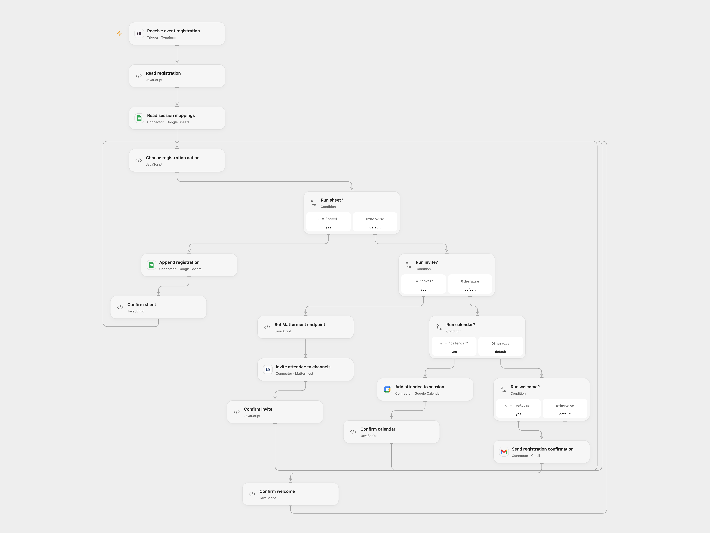

# Register Event Attendees and Invite to Channels

Record a registration, invite the attendee to selected session channels and add them to calendar events.

<!-- template-actions:start -->
 
<!-- template-actions:end -->

<picture>
  <source media="(prefers-color-scheme: dark)" srcset="preview-dark.png">
  
</picture>

## Setup

Configure the Typeform with the three source questions, including a multi-select sessions question. Connect Typeform, Google Sheets, Mattermost, Google Calendar and Gmail. In **Read session mappings**, use a sheet with headers Session, Mattermost Channel ID and Google Calendar Event ID. Configure the same spreadsheet, calendar and Mattermost team IDs in **Choose registration action**. The Attendees sheet uses six columns: Name, Email, Sessions, Submitted At, Response ID and Notes. Enable persistent State and prevent overlapping runs.

The Mattermost server must support the team invite endpoint with channel IDs and graceful responses, have email invitations enabled, and grant the token account invite_user, add_user_to_team and the appropriate manage-channel-members permission for every selected channel. The server can silently remove unauthorized channels; verify those permissions before use.

## Behavior

Each response maps each selected session to one channel and one Calendar event. It appends one registration, sends one Mattermost invitation listing those channels, adds the attendee to each corresponding event without replacing existing guests, and sends one confirmation email. The invitation is not an account or membership confirmation: the attendee must accept it. Mattermost may schedule invitation reminders. The workflow never sends a password. Registration data is stored in Sheets and execution history.

If any write is uncertain, inspect the relevant service before retrying. In Open Flow enter the exact pending key and confirmed or absent in **Choose registration action**, replay the same response, then clear the fields.

In n8n

In n8n configure the same form, Sheets, Mattermost server and credential, team, Calendar and Gmail; select one Data Table with item_key and status text columns in every checkpoint. Enable **Attendee Registrations** only when running the n8n format. Run one format only. Avoid concurrent edits to the same Calendar events while this workflow runs. In n8n inspect the pending Data Table row and mark it done only if the action happened, or delete it only after verifying it did not.

Inspiration &amp; credits

Restore the session lookup, use a Mattermost invitation in place of a predictable emailed password, preserve existing Calendar attendees and send one confirmation per registration.

Adapted from [Event registration and session onboarding](https://github.com/Zie619/n8n-workflows/blob/ae8cf6dc5b873cbb4f74587aa9180ed3a9f70682/workflows/Googlecalendar/1116_GoogleCalendar_GoogleSheets_Create_Triggered.json) in [Zie619/n8n-workflows](https://github.com/Zie619/n8n-workflows). The source export does not identify a separate template author or license.

The collection’s [MIT notice](https://github.com/Zie619/n8n-workflows/blob/94007c1445d9258a7da116646b79473e7c7c3282/LICENSE) is pinned at a later revision. This is the collection notice at that revision; it does not establish a separate original template author's license. Our changes are listed above; see [repository licensing](../../README.md#licensing).

> MIT License
>
> Copyright (c) 2025 Zie619
>
> Permission is hereby granted, free of charge, to any person obtaining a copy
> of this software and associated documentation files (the "Software"), to deal
> in the Software without restriction, including without limitation the rights
> to use, copy, modify, merge, publish, distribute, sublicense, and/or sell
> copies of the Software, and to permit persons to whom the Software is
> furnished to do so, subject to the following conditions:
>
> The above copyright notice and this permission notice shall be included in all
> copies or substantial portions of the Software.
>
> THE SOFTWARE IS PROVIDED "AS IS", WITHOUT WARRANTY OF ANY KIND, EXPRESS OR
> IMPLIED, INCLUDING BUT NOT LIMITED TO THE WARRANTIES OF MERCHANTABILITY,
> FITNESS FOR A PARTICULAR PURPOSE AND NONINFRINGEMENT. IN NO EVENT SHALL THE
> AUTHORS OR COPYRIGHT HOLDERS BE LIABLE FOR ANY CLAIM, DAMAGES OR OTHER
> LIABILITY, WHETHER IN AN ACTION OF CONTRACT, TORT OR OTHERWISE, ARISING FROM,
> OUT OF OR IN CONNECTION WITH THE SOFTWARE OR THE USE OR OTHER DEALINGS IN THE
> SOFTWARE.

