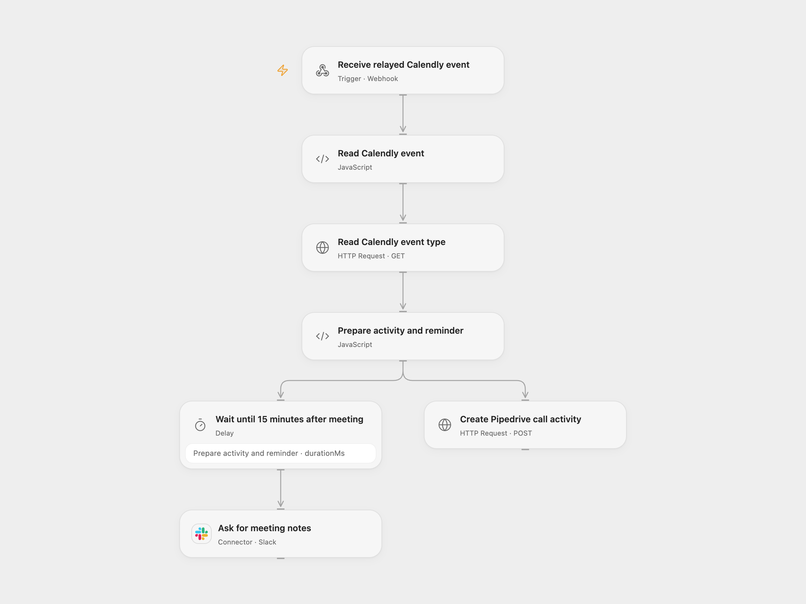

# Remind Calendly Meeting Feedback

Create a Pipedrive call activity and ask for meeting notes in Slack after a Calendly meeting.

<picture>
  <source media="(prefers-color-scheme: dark)" srcset="preview-dark.png">
  
</picture>

[Open Flow JSON](templates/remind-calendly-meeting-feedback.openflow.json) · [n8n JSON](templates/remind-calendly-meeting-feedback.n8n.json)

## Setup and use

Import n8n, connect Calendly and configure its invitee.created trigger. Configure **Execution mode** as n8n or openflow; in openflow mode set the relay URL and deploy the Open Flow workflow. In Open Flow bind CALENDLY_TOKEN with event type read access and PIPEDRIVE_TOKEN as secret Variables. In n8n configure HTTP Bearer Auth for Calendly and HTTP Header Auth named x-api-token with the Pipedrive API token. Connect Slack and set the destination channel in either format. Set the call notes URL. Use one execution mode.

## Behavior

For each created invitee, the workflow reads its Calendly event type, creates a Pipedrive call activity with meeting name, invitee and start time, and asks the first assigned host in Slack to add notes 15 minutes after the scheduled end. Meetings already past that time send the reminder immediately. It handles Calendly's current event payload; cancellation and rescheduling do not cancel an already scheduled reminder. The Calendly trigger and relay acknowledge before downstream work and do not validate the sender. Restrict access and inspect execution history. Pipedrive and Slack writes are separate; inspect both services before retrying an uncertain execution.

Inspiration &amp; credits

## Changes to the source

- Map current Calendly event payloads and read event type details. Use Pipedrive API v2 in both formats, add an optional relay, and replace the original channel and notes link with configuration.

Adapted from [Calendly meeting feedback reminder](https://github.com/Zie619/n8n-workflows/blob/ae8cf6dc5b873cbb4f74587aa9180ed3a9f70682/workflows/Wait/0092_Wait_Datetime_Automate_Triggered.json) in [Zie619/n8n-workflows](https://github.com/Zie619/n8n-workflows). The source export does not identify a separate template author or license.

The collection’s [MIT notice](https://github.com/Zie619/n8n-workflows/blob/94007c1445d9258a7da116646b79473e7c7c3282/LICENSE) is pinned at a later revision. This is the collection notice at that revision; it does not establish a separate original template author's license. Our changes are listed above; see [repository licensing](../../README.md#licensing).

> MIT License
>
> Copyright (c) 2025 Zie619
>
> Permission is hereby granted, free of charge, to any person obtaining a copy
> of this software and associated documentation files (the "Software"), to deal
> in the Software without restriction, including without limitation the rights
> to use, copy, modify, merge, publish, distribute, sublicense, and/or sell
> copies of the Software, and to permit persons to whom the Software is
> furnished to do so, subject to the following conditions:
>
> The above copyright notice and this permission notice shall be included in all
> copies or substantial portions of the Software.
>
> THE SOFTWARE IS PROVIDED "AS IS", WITHOUT WARRANTY OF ANY KIND, EXPRESS OR
> IMPLIED, INCLUDING BUT NOT LIMITED TO THE WARRANTIES OF MERCHANTABILITY,
> FITNESS FOR A PARTICULAR PURPOSE AND NONINFRINGEMENT. IN NO EVENT SHALL THE
> AUTHORS OR COPYRIGHT HOLDERS BE LIABLE FOR ANY CLAIM, DAMAGES OR OTHER
> LIABILITY, WHETHER IN AN ACTION OF CONTRACT, TORT OR OTHERWISE, ARISING FROM,
> OUT OF OR IN CONNECTION WITH THE SOFTWARE OR THE USE OR OTHER DEALINGS IN THE
> SOFTWARE.

