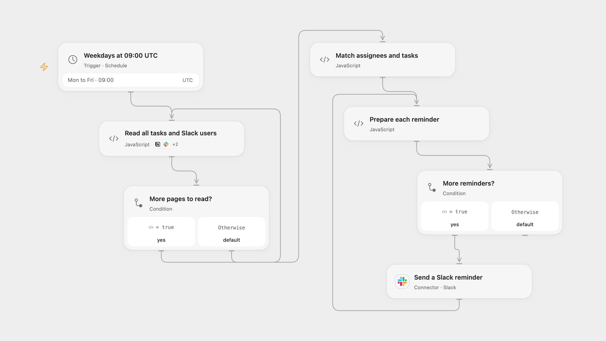

# Remind Notion Assignees in Slack

Send weekday Slack reminders for incomplete Notion database tasks assigned to two configured people.

<picture>
  <source media="(prefers-color-scheme: dark)" srcset="preview-dark.png">
  
</picture>

[Open Flow JSON](templates/remind-notion-assignees-in-slack.openflow.json) · [n8n JSON](templates/remind-notion-assignees-in-slack.n8n.json)

## Setup

Connect Notion and Slack. In **Read all tasks and Slack users**, configure the Notion data source ID. In **Match assignees and tasks**, enter two distinct Notion user IDs and the corresponding exact Slack full names. Share the data source with the Notion connection. It must have Task (title), Status (status or select), Due (date), and Notion User (people) properties. Slack needs users:read and chat:write. In n8n, configure the database ID in **Read tasks**, Slack credentials in **Read Slack users** and **Send a Slack reminder**, and the same two mappings in **Match assignees and tasks**. Activate one format.

## Behavior

At 09:00 UTC on weekdays the workflow reads the task data and Slack users, matches each incomplete task to the first configured assignee on the task, and sends one Slack message with its title and due date. Tasks marked Done are excluded. Duplicate or missing configured Slack names stop the run before sending. Task properties and assigned user IDs must be available; incomplete tasks with malformed properties or 25 or more assignees stop before sending because Notion can truncate people properties. No matching tasks means no message.

A failed or uncertain Slack write may have succeeded; inspect Slack before repeating the run. Earlier messages remain if a later send fails. No automatic write retries or cross-run deduplication are added. Large data sets must fit the execution platform limits. Open Flow runs on the minute boundary; n8n uses a fixed second within the minute.

Inspiration &amp; credits

## Changes to the source

- Replace private email and name values with two Notion user IDs and Slack full names. Use stable Notion IDs for assignment matching and stop on ambiguous Slack names.
- Read complete pages and validate associations before sending. Put the task title and due date in the message text instead of the source attachment. Set UTC explicitly instead of relying on the n8n instance timezone.

Adapted from [Automated Notion Task Reminders via Slack](https://github.com/Zie619/n8n-workflows/blob/ae8cf6dc5b873cbb4f74587aa9180ed3a9f70682/workflows/Filter/0612_Filter_Slack_Send_Scheduled.json) in [Zie619/n8n-workflows](https://github.com/Zie619/n8n-workflows). The source credits [Optimus Agency](https://optimus01.co.za/) for the original workflow. No separate original template license is stated.

The collection’s [MIT notice](https://github.com/Zie619/n8n-workflows/blob/94007c1445d9258a7da116646b79473e7c7c3282/LICENSE) is pinned at a later revision. This is the collection notice at that revision; it does not establish a separate original template author's license. Our changes are listed above; see [repository licensing](../../README.md#licensing).

> MIT License
>
> Copyright (c) 2025 Zie619
>
> Permission is hereby granted, free of charge, to any person obtaining a copy
> of this software and associated documentation files (the "Software"), to deal
> in the Software without restriction, including without limitation the rights
> to use, copy, modify, merge, publish, distribute, sublicense, and/or sell
> copies of the Software, and to permit persons to whom the Software is
> furnished to do so, subject to the following conditions:
>
> The above copyright notice and this permission notice shall be included in all
> copies or substantial portions of the Software.
>
> THE SOFTWARE IS PROVIDED "AS IS", WITHOUT WARRANTY OF ANY KIND, EXPRESS OR
> IMPLIED, INCLUDING BUT NOT LIMITED TO THE WARRANTIES OF MERCHANTABILITY,
> FITNESS FOR A PARTICULAR PURPOSE AND NONINFRINGEMENT. IN NO EVENT SHALL THE
> AUTHORS OR COPYRIGHT HOLDERS BE LIABLE FOR ANY CLAIM, DAMAGES OR OTHER
> LIABILITY, WHETHER IN AN ACTION OF CONTRACT, TORT OR OTHERWISE, ARISING FROM,
> OUT OF OR IN CONNECTION WITH THE SOFTWARE OR THE USE OR OTHER DEALINGS IN THE
> SOFTWARE.

