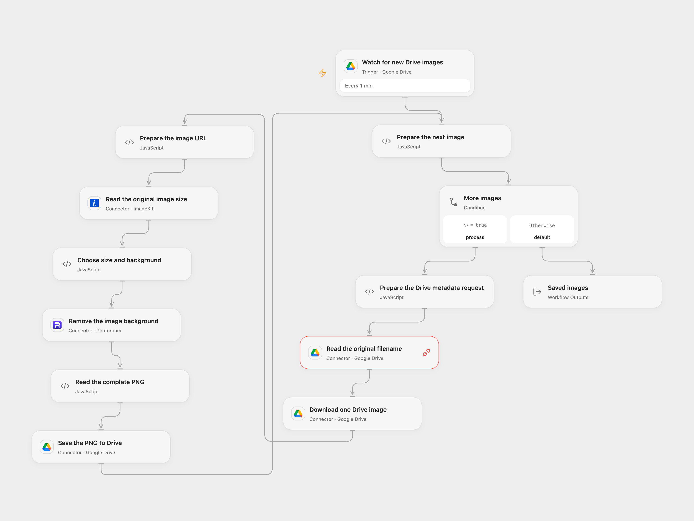

# Remove Background from Drive Images

Remove backgrounds from new Drive images and save PNGs to a chosen folder.

<picture>
  <source media="(prefers-color-scheme: dark)" srcset="preview-dark.png">
  
</picture>

[Open Flow JSON](templates/remove-background-from-drive-images.openflow.json) · [n8n JSON](templates/remove-background-from-drive-images.n8n.json)

## Setup

Connect the same Google Drive account on the trigger, filename lookup, download and upload. The filename lookup uses the Google Drive Proxy with access to the file metadata. Connect ImageKit and Photoroom. Set separate input and output folder IDs so output uploads do not trigger the workflow again. Set the HTTP host for **Read the complete PNG** to the hostname of your deployment's connector transit URL. ImageKit and Photoroom receive the transit URL to each downloaded image; anyone able to access that URL can retrieve the image while it remains available.

In **Choose size and background**, keep the input dimensions or set a fixed width and height. Set background color on **Remove the image background**, such as white or transparent, and fractional padding, for example 0.05. In n8n configure Drive credentials and the Photoroom API key in Config, and choose the corresponding folder URLs and settings. Activate one format to avoid duplicate output files.

## Behavior

Each new file is downloaded and its original dimensions are read. Photoroom removes the background with the chosen size, color and padding. A PNG named BG-Removed- plus the input basename is uploaded to the output folder. The source uses the original upload filename and removes the last dot-separated extension; an input without an extension yields BG-Removed-.png.

Open Flow uses ImageKit for dimensions and connector transit URLs for both input and result; n8n sends its binary directly. Open Flow checks the returned byte count and Drive receipt and stops after an error. Inspect the output folder before replaying an uncertain upload. Open Flow starts a new poll checkpoint at activation and processes received files sequentially; n8n uses its own poll checkpoint. Neither format guarantees exactly-once output. Complete images must fit Open Flow's HTTP and Code budgets. ImageKit may reject unsupported files. If original dimensions are selected, missing dimensions stop processing.

Inspiration &amp; credits

Adapted from [Automatic Background Removal for Images in Google Drive](https://github.com/enescingoz/awesome-n8n-templates/blob/827110332c21cbe000ab13f6d292d5adb1f1f8db/Google_Drive_and_Google_Sheets/Automatic%20Background%20Removal%20for%20Images%20in%20Google%20Drive.json) in [enescingoz/awesome-n8n-templates](https://github.com/enescingoz/awesome-n8n-templates).

Source collection notice: © 2024–2026 Enes Cingoz, [CC BY 4.0](https://github.com/enescingoz/awesome-n8n-templates/blob/827110332c21cbe000ab13f6d292d5adb1f1f8db/LICENSE). The source export does not identify a separate template author or license. See [repository licensing](../../README.md#licensing) for the scope of OOMOL contributions and third-party material.

