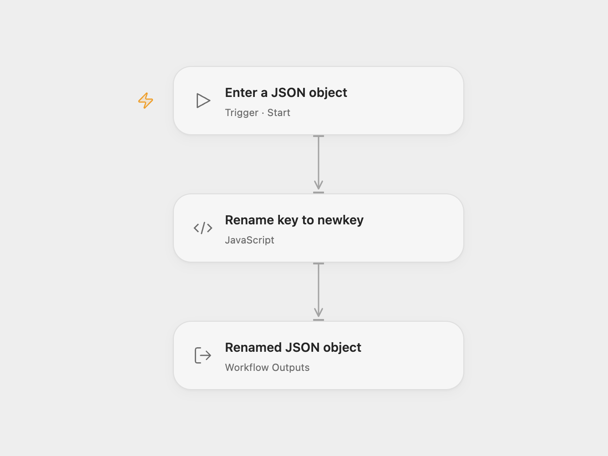

# Rename JSON Key

Rename the top-level field `key` to `newkey` in a JSON object. For example, `{"key":"somevalue"}` becomes `{"newkey":"somevalue"}`.

<picture>
  <source media="(prefers-color-scheme: dark)" srcset="preview-dark.png">
  
</picture>

[Open Flow JSON](templates/rename-json-key.openflow.json) · [n8n JSON](templates/rename-json-key.n8n.json)

## Use

In Open Flow, run with **Record** containing a JSON object. The **Record** output contains the transformed object. In n8n, edit **Set** to supply the fields, then run manually; **Rename Keys** returns the transformed item. The source example uses `key` with the value `somevalue`. No account or external service is required.

For reuse, provide one object to the Open Flow Start input. In n8n, connect your actual upstream items to **Rename Keys** in place of the **Set** demonstration. That node processes each incoming item separately; an empty item list produces no items. The template does not fetch, store or send the object.

At the rename step, the value, including null, an array or a nested object, is kept without conversion. Other fields remain. When `key` is absent, the object is unchanged. When `newkey` already exists, the source value replaces it. This template performs one fixed top-level rename; it does not recursively rename matching nested fields.

Inspiration &amp; credits

## Changes to the source

- Accept a JSON object through Open Flow’s Start input in place of the editable n8n Set example.
- Keep the source rename, overwrite and missing-field behavior. The n8n Set and Rename Keys nodes retain their native versions and configuration.

Adapted from [Rename Keys workflow](https://github.com/Zie619/n8n-workflows/blob/ae8cf6dc5b873cbb4f74587aa9180ed3a9f70682/workflows/Manual/1045_Manual_Renamekeys_Automate_Triggered.json) in [Zie619/n8n-workflows](https://github.com/Zie619/n8n-workflows). The source export does not identify a separate template author or license.

The collection’s [MIT notice](https://github.com/Zie619/n8n-workflows/blob/94007c1445d9258a7da116646b79473e7c7c3282/LICENSE) is pinned at a later revision. This is the collection notice at that revision; it does not establish a separate original template author's license. Our changes are listed above; see [repository licensing](../../README.md#licensing).

> MIT License
>
> Copyright (c) 2025 Zie619
>
> Permission is hereby granted, free of charge, to any person obtaining a copy
> of this software and associated documentation files (the "Software"), to deal
> in the Software without restriction, including without limitation the rights
> to use, copy, modify, merge, publish, distribute, sublicense, and/or sell
> copies of the Software, and to permit persons to whom the Software is
> furnished to do so, subject to the following conditions:
>
> The above copyright notice and this permission notice shall be included in all
> copies or substantial portions of the Software.
>
> THE SOFTWARE IS PROVIDED "AS IS", WITHOUT WARRANTY OF ANY KIND, EXPRESS OR
> IMPLIED, INCLUDING BUT NOT LIMITED TO THE WARRANTIES OF MERCHANTABILITY,
> FITNESS FOR A PARTICULAR PURPOSE AND NONINFRINGEMENT. IN NO EVENT SHALL THE
> AUTHORS OR COPYRIGHT HOLDERS BE LIABLE FOR ANY CLAIM, DAMAGES OR OTHER
> LIABILITY, WHETHER IN AN ACTION OF CONTRACT, TORT OR OTHERWISE, ARISING FROM,
> OUT OF OR IN CONNECTION WITH THE SOFTWARE OR THE USE OR OTHER DEALINGS IN THE
> SOFTWARE.

