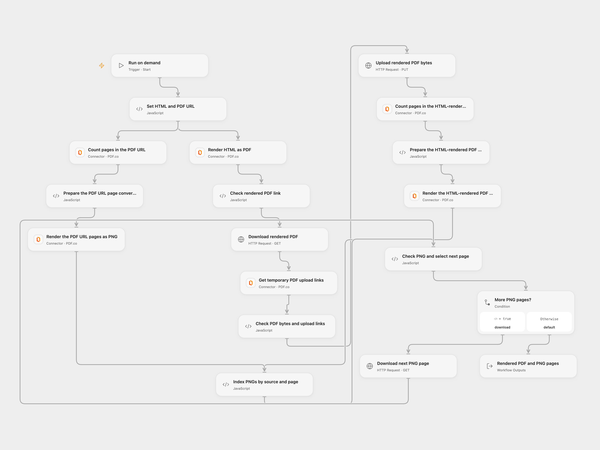

# Render HTML and PDF Pages as PNGs

Turn HTML and a PDF URL into PNG images, with one file per page from each document.

<!-- template-actions:start -->
 
<!-- template-actions:end -->

<picture>
  <source media="(prefers-color-scheme: dark)" srcset="preview-dark.png">
  
</picture>

## Setup

1. In **Set HTML and PDF URL**, enter your HTML and a PDF URL that PDF.co can download directly over HTTPS.
2. Select the same PDF.co connection in the conversion, page count, and temporary upload-link nodes. Enable **Provider API Request** access for the page count, upload-link, and PNG conversion nodes.
3. Run the workflow manually.

## Behavior

The workflow renders your HTML to a PDF, downloads the PDF bytes, and uploads them to PDF.co temporary storage for page conversion. It also converts the PDF at your URL. Both conversions check the PDF's page count before downloading one PNG per page.

The **Rendered PDF and PNG pages** output includes the generated PDF and page records with a source, a one-based page number, and a downloadable PNG. A download failure or an incomplete page list fails the run. Use PDFs that fit the deployment's artifact limits and complete within PDF.co's synchronous request timeout.

In n8n

In **Set HTML and PDF URL**, change the sample HTML and PDF URL. Use a **Header Auth** credential with header name `x-api-key` for each PDF.co API call. The file transfer nodes use the temporary URLs returned by PDF.co.

Run manually. **Check PNG pages** returns one item per page with `binary.data`, `source`, `page`, and `pageCount`. Find the generated PDF in **Download rendered PDF**.

Inspiration &amp; credits

Adapted from [Convert HTML and PDF files to PNG images](https://github.com/Zie619/n8n-workflows/blob/ae8cf6dc5b873cbb4f74587aa9180ed3a9f70682/workflows/Manual/0909_Manual_Stickynote_Process_Triggered.json) in [Zie619/n8n-workflows](https://github.com/Zie619/n8n-workflows). Attribution: CustomJS (original workflow) / Zie619 (collection). See the [original CustomJS template](https://n8n.io/workflows/3870-convert-html-and-pdf-files-to-png-images-with-customjs-pdf-toolkit/).

The collection’s [MIT notice](https://github.com/Zie619/n8n-workflows/blob/94007c1445d9258a7da116646b79473e7c7c3282/LICENSE) is pinned at a later revision. This is the collection notice at that revision; it does not establish a separate original template author's license. Our changes are listed above; see [repository licensing](../../README.md#licensing).

> MIT License
>
> Copyright (c) 2025 Zie619
>
> Permission is hereby granted, free of charge, to any person obtaining a copy
> of this software and associated documentation files (the "Software"), to deal
> in the Software without restriction, including without limitation the rights
> to use, copy, modify, merge, publish, distribute, sublicense, and/or sell
> copies of the Software, and to permit persons to whom the Software is
> furnished to do so, subject to the following conditions:
>
> The above copyright notice and this permission notice shall be included in all
> copies or substantial portions of the Software.
>
> THE SOFTWARE IS PROVIDED "AS IS", WITHOUT WARRANTY OF ANY KIND, EXPRESS OR
> IMPLIED, INCLUDING BUT NOT LIMITED TO THE WARRANTIES OF MERCHANTABILITY,
> FITNESS FOR A PARTICULAR PURPOSE AND NONINFRINGEMENT. IN NO EVENT SHALL THE
> AUTHORS OR COPYRIGHT HOLDERS BE LIABLE FOR ANY CLAIM, DAMAGES OR OTHER
> LIABILITY, WHETHER IN AN ACTION OF CONTRACT, TORT OR OTHERWISE, ARISING FROM,
> OUT OF OR IN CONNECTION WITH THE SOFTWARE OR THE USE OR OTHER DEALINGS IN THE
> SOFTWARE.

