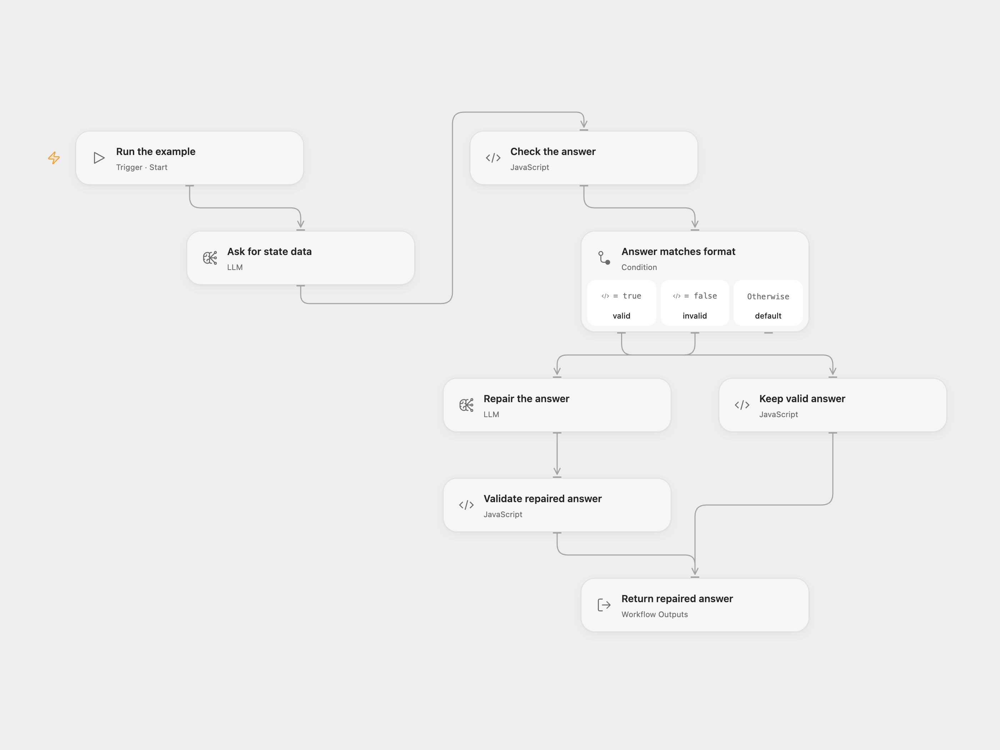

# Repair Structured State Data with AI

Ask a model for state and city data and repair an answer that does not match the required JSON format.

<picture>
  <source media="(prefers-color-scheme: dark)" srcset="preview-dark.png">
  
</picture>

[Open Flow JSON](templates/repair-structured-state-data-with-ai.openflow.json) · [n8n JSON](templates/repair-structured-state-data-with-ai.n8n.json)

## Setup and use

Configure the language model on both model nodes. Run manually to ask for the five largest US states by area and the three largest cities and populations for each. Both calls use gpt-4o-mini-2024-07-18; configure a compatible replacement before its [January 14, 2027 shutdown](https://developers.openai.com/api/docs/deprecations/).

## Behavior

The workflow validates the requested JSON structure. If the first answer is invalid, a second model call receives the malformed answer and error and attempts one repair. An invalid repair fails the run. Models can return inaccurate or outdated geographic data even when the format is valid; verify facts against an authoritative source.

Inspiration &amp; credits

## Changes to the source

- Correct the source schema's invalid city property definitions and represent all five requested states as an array with three cities each.
- Make the example prompt and model choice explicit. Open Flow checks the output in Code and uses a separate conditional repair step.

Adapted from [Automatic output parser example](https://github.com/Zie619/n8n-workflows/blob/ae8cf6dc5b873cbb4f74587aa9180ed3a9f70682/workflows/Manual/0323_Manual_Stickynote_Process_Triggered.json) in [Zie619/n8n-workflows](https://github.com/Zie619/n8n-workflows). The source export does not identify a separate template author or license.

The collection’s [MIT notice](https://github.com/Zie619/n8n-workflows/blob/94007c1445d9258a7da116646b79473e7c7c3282/LICENSE) is pinned at a later revision. This is the collection notice at that revision; it does not establish a separate original template author's license. Our changes are listed above; see [repository licensing](../../README.md#licensing).

> MIT License
>
> Copyright (c) 2025 Zie619
>
> Permission is hereby granted, free of charge, to any person obtaining a copy
> of this software and associated documentation files (the "Software"), to deal
> in the Software without restriction, including without limitation the rights
> to use, copy, modify, merge, publish, distribute, sublicense, and/or sell
> copies of the Software, and to permit persons to whom the Software is
> furnished to do so, subject to the following conditions:
>
> The above copyright notice and this permission notice shall be included in all
> copies or substantial portions of the Software.
>
> THE SOFTWARE IS PROVIDED "AS IS", WITHOUT WARRANTY OF ANY KIND, EXPRESS OR
> IMPLIED, INCLUDING BUT NOT LIMITED TO THE WARRANTIES OF MERCHANTABILITY,
> FITNESS FOR A PARTICULAR PURPOSE AND NONINFRINGEMENT. IN NO EVENT SHALL THE
> AUTHORS OR COPYRIGHT HOLDERS BE LIABLE FOR ANY CLAIM, DAMAGES OR OTHER
> LIABILITY, WHETHER IN AN ACTION OF CONTRACT, TORT OR OTHERWISE, ARISING FROM,
> OUT OF OR IN CONNECTION WITH THE SOFTWARE OR THE USE OR OTHER DEALINGS IN THE
> SOFTWARE.

