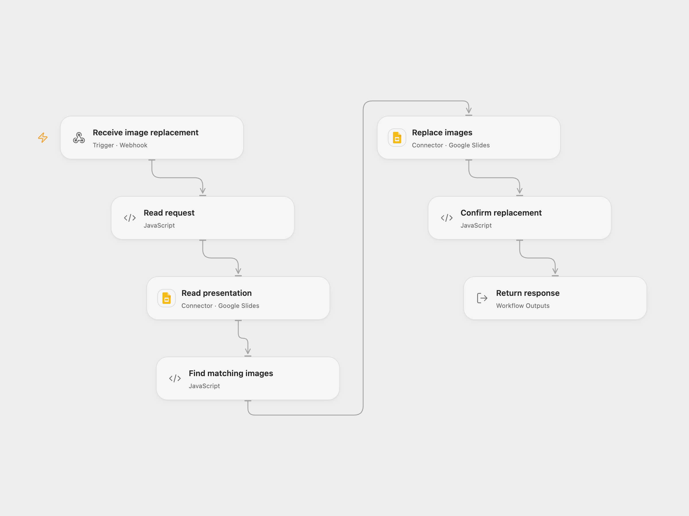

# Replace Google Slides Images by Alt Text

Replace matching images across a Google Slides presentation using an image URL.

<picture>
  <source media="(prefers-color-scheme: dark)" srcset="preview-dark.png">
  
</picture>

[Open Flow JSON](templates/replace-google-slides-images-by-alt-text.openflow.json) · [n8n JSON](templates/replace-google-slides-images-by-alt-text.n8n.json)

## Setup

Connect Google Slides with read and edit permission for the presentation. Set each target image's alt-text description to a unique key. Deploy the webhook and POST JSON with presentation_id, image_key and image_url. Google Slides must be able to fetch the image URL. In n8n connect both Google Slides HTTP nodes and deploy its webhook.

## Behavior

The workflow finds all images whose alt-text description equals image_key and replaces each with a center-cropped image, retaining the key. A successful response confirms the update. Open Flow submits all matching replacements in a single atomic batch and fails when none match. The endpoint does not authenticate callers; restrict access appropriately. If the update's result is unknown, inspect the presentation before retrying.

Inspiration &amp; credits

## Changes to the source

- Use the Google Slides connector and a single batch for all matching images in Open Flow.

Adapted from [Dynamically Replace Images in Google Slides](https://github.com/Zie619/n8n-workflows/blob/ae8cf6dc5b873cbb4f74587aa9180ed3a9f70682/workflows/Code/0491_Code_Webhook_Monitor_Webhook.json) in [Zie619/n8n-workflows](https://github.com/Zie619/n8n-workflows). The source identifies its author as The n8Ninja; it does not identify a separate template license.

The collection’s [MIT notice](https://github.com/Zie619/n8n-workflows/blob/94007c1445d9258a7da116646b79473e7c7c3282/LICENSE) is pinned at a later revision. This is the collection notice at that revision; it does not establish a separate original template author's license. Our changes are listed above; see [repository licensing](../../README.md#licensing).

> MIT License
>
> Copyright (c) 2025 Zie619
>
> Permission is hereby granted, free of charge, to any person obtaining a copy
> of this software and associated documentation files (the "Software"), to deal
> in the Software without restriction, including without limitation the rights
> to use, copy, modify, merge, publish, distribute, sublicense, and/or sell
> copies of the Software, and to permit persons to whom the Software is
> furnished to do so, subject to the following conditions:
>
> The above copyright notice and this permission notice shall be included in all
> copies or substantial portions of the Software.
>
> THE SOFTWARE IS PROVIDED "AS IS", WITHOUT WARRANTY OF ANY KIND, EXPRESS OR
> IMPLIED, INCLUDING BUT NOT LIMITED TO THE WARRANTIES OF MERCHANTABILITY,
> FITNESS FOR A PARTICULAR PURPOSE AND NONINFRINGEMENT. IN NO EVENT SHALL THE
> AUTHORS OR COPYRIGHT HOLDERS BE LIABLE FOR ANY CLAIM, DAMAGES OR OTHER
> LIABILITY, WHETHER IN AN ACTION OF CONTRACT, TORT OR OTHERWISE, ARISING FROM,
> OUT OF OR IN CONNECTION WITH THE SOFTWARE OR THE USE OR OTHER DEALINGS IN THE
> SOFTWARE.

