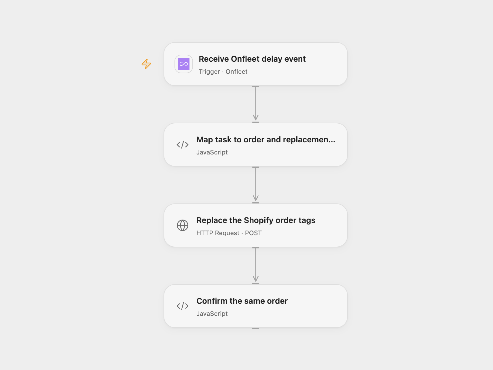

# Replace Shopify Order Tags for Onfleet Delays

Replace the configured Shopify order tags when its mapped Onfleet task is delayed.

<!-- template-actions:start -->
 
<!-- template-actions:end -->

<picture>
  <source media="(prefers-color-scheme: dark)" srcset="preview-dark.png">
  
</picture>

## Setup

Connect Onfleet in **Receive Onfleet delay event** (**trigger** is preconfigured to `taskDelayed`). In **Map task to order and replacement tags**, configure `taskOrders` (mapping Onfleet task IDs to Shopify order GraphQL IDs like `gid://shopify/Order/123456`) and `tags`. Create a Secret Variable for your Shopify Admin API access token and bind it to **Replace the Shopify order tags**, and set your Shopify GraphQL endpoint URL.

## Behavior

When an Onfleet task is delayed, **Map task to order and replacement tags** resolves the matching Shopify order ID and replacement tags, **Replace the Shopify order tags** updates the order via the Shopify Admin API, and **Confirm the same order** verifies the returned order ID matches.

In n8n

Import the n8n workflow, connect Onfleet and Shopify credentials, and configure the target Shopify order ID and tags in **Shopify**.

Inspiration &amp; credits

## Changes to the source

- Require an explicit Onfleet task-to-Shopify order mapping and replacement tags instead of the source's empty fields.

Adapted from [Updating Shopify tags on Onfleet events](https://github.com/Zie619/n8n-workflows/blob/ae8cf6dc5b873cbb4f74587aa9180ed3a9f70682/workflows/Shopify/0185_Shopify_Onfleet_Automation_Triggered.json) in [Zie619/n8n-workflows](https://github.com/Zie619/n8n-workflows). The source export does not identify a separate template author or license.

The collection’s [MIT notice](https://github.com/Zie619/n8n-workflows/blob/94007c1445d9258a7da116646b79473e7c7c3282/LICENSE) is pinned at a later revision. This is the collection notice at that revision; it does not establish a separate original template author's license. Our changes are listed above; see [repository licensing](../../README.md#licensing).

> MIT License
>
> Copyright (c) 2025 Zie619
>
> Permission is hereby granted, free of charge, to any person obtaining a copy
> of this software and associated documentation files (the "Software"), to deal
> in the Software without restriction, including without limitation the rights
> to use, copy, modify, merge, publish, distribute, sublicense, and/or sell
> copies of the Software, and to permit persons to whom the Software is
> furnished to do so, subject to the following conditions:
>
> The above copyright notice and this permission notice shall be included in all
> copies or substantial portions of the Software.
>
> THE SOFTWARE IS PROVIDED "AS IS", WITHOUT WARRANTY OF ANY KIND, EXPRESS OR
> IMPLIED, INCLUDING BUT NOT LIMITED TO THE WARRANTIES OF MERCHANTABILITY,
> FITNESS FOR A PARTICULAR PURPOSE AND NONINFRINGEMENT. IN NO EVENT SHALL THE
> AUTHORS OR COPYRIGHT HOLDERS BE LIABLE FOR ANY CLAIM, DAMAGES OR OTHER
> LIABILITY, WHETHER IN AN ACTION OF CONTRACT, TORT OR OTHERWISE, ARISING FROM,
> OUT OF OR IN CONNECTION WITH THE SOFTWARE OR THE USE OR OTHER DEALINGS IN THE
> SOFTWARE.

