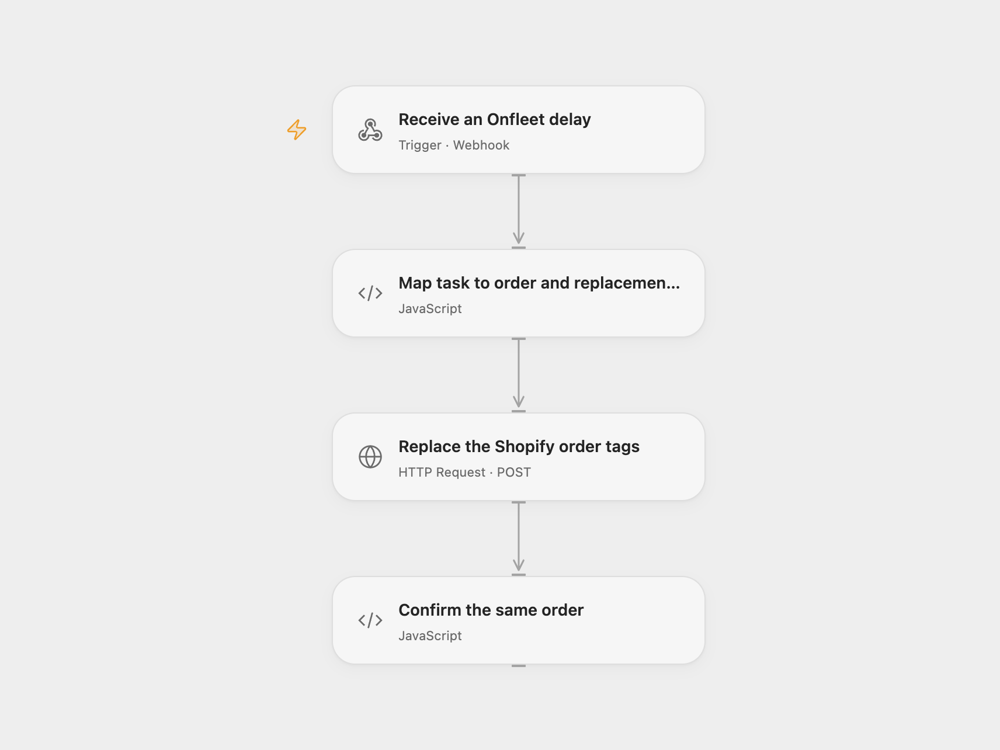

# Replace Shopify Order Tags for Onfleet Delays

Replace the configured Shopify order tags when its mapped Onfleet task is delayed.

<picture>
  <source media="(prefers-color-scheme: dark)" srcset="preview-dark.png">
  
</picture>

[Open Flow JSON](templates/replace-shopify-order-tags-for-onfleet-delays.openflow.json) · [n8n JSON](templates/replace-shopify-order-tags-for-onfleet-delays.n8n.json)

## Setup

Bind the Shopify Admin API token with order write access as Secret Variable `SHOPIFY_ADMIN_TOKEN` and set your shop URL in **Replace the Shopify order tags**. In **Map task to order and replacement tags**, replace the example mapping with entries from Onfleet task ID to Shopify order GraphQL ID, such as `gid://shopify/Order/123`, and set the complete replacement tags array. Each task must have its own correct mapping. The source leaves the order ID and tags unspecified.

For Open Flow, deploy the webhook and import the provided n8n workflow. Connect the Onfleet Trigger with its signing secret, set **Choose delivery mode** to `relay`, and set the Open Flow URL in **Forward event to Open Flow**. Onfleet validates its webhook with GET and sends events by POST; the relay handles registration and forwards the complete event. Restrict access to the Open Flow URL, which does not authenticate the relay.

For direct n8n processing, set **Choose delivery mode** to `direct`, connect the Onfleet Trigger with its signing secret, configure the task-to-order mapping and tags in **Map task to order and replacement tags**, set your Shopify Admin GraphQL URL in **Replace Shopify tags**, and use a header credential named `X-Shopify-Access-Token` with order write access. Activate one format.

## Behavior

A delayed task updates the mapped order. The configured array **replaces all existing tags**, matching the source's update operation; include every tag you intend to retain. Unknown tasks, missing mappings and invalid events stop before the Shopify write. A webhook acknowledgment does not confirm an update. If an update result is uncertain, inspect the order before replaying; no automatic replay or deduplication is added.

Inspiration &amp; credits

## Changes to the source

- Require an explicit Onfleet task-to-Shopify order mapping and replacement tags instead of the source's empty fields.
- Open Flow uses an n8n relay for Onfleet registration; both formats use Shopify Admin GraphQL.

Adapted from [Updating Shopify tags on Onfleet events](https://github.com/Zie619/n8n-workflows/blob/ae8cf6dc5b873cbb4f74587aa9180ed3a9f70682/workflows/Shopify/0185_Shopify_Onfleet_Automation_Triggered.json) in [Zie619/n8n-workflows](https://github.com/Zie619/n8n-workflows). The source export does not identify a separate template author or license.

The collection’s [MIT notice](https://github.com/Zie619/n8n-workflows/blob/94007c1445d9258a7da116646b79473e7c7c3282/LICENSE) is pinned at a later revision. This is the collection notice at that revision; it does not establish a separate original template author's license. Our changes are listed above; see [repository licensing](../../README.md#licensing).

> MIT License
>
> Copyright (c) 2025 Zie619
>
> Permission is hereby granted, free of charge, to any person obtaining a copy
> of this software and associated documentation files (the "Software"), to deal
> in the Software without restriction, including without limitation the rights
> to use, copy, modify, merge, publish, distribute, sublicense, and/or sell
> copies of the Software, and to permit persons to whom the Software is
> furnished to do so, subject to the following conditions:
>
> The above copyright notice and this permission notice shall be included in all
> copies or substantial portions of the Software.
>
> THE SOFTWARE IS PROVIDED "AS IS", WITHOUT WARRANTY OF ANY KIND, EXPRESS OR
> IMPLIED, INCLUDING BUT NOT LIMITED TO THE WARRANTIES OF MERCHANTABILITY,
> FITNESS FOR A PARTICULAR PURPOSE AND NONINFRINGEMENT. IN NO EVENT SHALL THE
> AUTHORS OR COPYRIGHT HOLDERS BE LIABLE FOR ANY CLAIM, DAMAGES OR OTHER
> LIABILITY, WHETHER IN AN ACTION OF CONTRACT, TORT OR OTHERWISE, ARISING FROM,
> OUT OF OR IN CONNECTION WITH THE SOFTWARE OR THE USE OR OTHER DEALINGS IN THE
> SOFTWARE.

