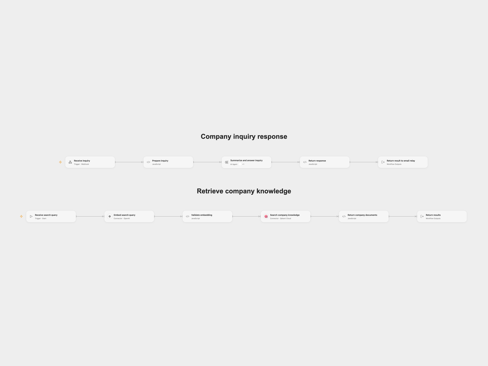

# Reply to Company Inquiries with Knowledge

Summarize company inquiries and send knowledge-grounded replies through IMAP and SMTP.

<!-- template-actions:start -->
[](https://openflow.run/templates/reply-company-inquiries-with-knowledge/) [](templates/reply-company-inquiries-with-knowledge.n8n.json)
<!-- template-actions:end -->

<picture>
  <source media="(prefers-color-scheme: dark)" srcset="preview-dark.png">
  
</picture>

## Setup

Configure IMAP and SMTP credentials, a Data Table with item_key and status text columns, and an AI model. Configure Qdrant and OpenAI with an existing company-knowledge collection whose documents use text-embedding-3-large with 1536 dimensions and content/metadata payloads. The separate Drive indexing and collection refresh from the source are not included.

For Open Flow import **Company inquiry response** and **Retrieve company knowledge**, publish the retrieval workflow and refresh the tool. Deploy the webhook behind an authenticated gateway or private network, and configure its URL in the n8n relay. Enable only one IMAP trigger: the native mode or the disabled Open Flow relay trigger. For native mode configure Qdrant and OpenAI credentials.

## Behavior

Summarize each email and classify company information requests. The agent retrieves relevant knowledge and prepares a concise reply; other emails receive no response. The relay sends through SMTP. An uncertain send leaves a pending message ID: inspect the sent mailbox and reconcile the Data Table record before retrying. Avoid concurrent processing of the same mailbox. Email and retrieved content are sent to the configured model. Review generated responses and knowledge for accuracy.

<details>
<summary>Inspiration &amp; credits</summary>

Adapted from [AI-Powered Email Automation for Business: Summarize & Respond with RAG](https://github.com/enescingoz/awesome-n8n-templates/blob/827110332c21cbe000ab13f6d292d5adb1f1f8db/OpenAI_and_LLMs/AI-Powered%20Email%20Automation%20for%20Business_%20Summarize%20%26%20Respond%20with%20RAG.json) in [enescingoz/awesome-n8n-templates](https://github.com/enescingoz/awesome-n8n-templates).

Source collection notice: © 2024–2026 Enes Cingoz, [CC BY 4.0](https://github.com/enescingoz/awesome-n8n-templates/blob/827110332c21cbe000ab13f6d292d5adb1f1f8db/LICENSE). The source export does not identify a separate template author or license. See [repository licensing](../../README.md#licensing) for the scope of OOMOL contributions and third-party material.


Changes: isolate the inquiry response, replace unavailable models, repair text summarization, align embeddings, use n8n as the IMAP/SMTP relay, and add send checkpoints.

Collection license notice:

```text
Creative Commons Attribution 4.0 International License

Copyright (c) 2024-2026 Enes Cingoz

You are free to:

  Share - copy and redistribute the material in any medium or format
  Adapt - remix, transform, and build upon the material for any purpose,
  even commercially.

Under the following terms:

  Attribution - You must give appropriate credit, provide a link to the
  license, and indicate if changes were made. You may do so in any
  reasonable manner, but not in any way that suggests the licensor
  endorses you or your use.

  No additional restrictions - You may not apply legal terms or
  technological measures that legally restrict others from doing
  anything the license permits.

Notices:

  You do not have to comply with the license for elements of the
  material in the public domain or where your use is permitted by an
  applicable exception or limitation.

  No warranties are given. The license may not give you all of the
  permissions necessary for your intended use. For example, other rights
  such as publicity, privacy, or moral rights may limit how you use the
  material.

For the full license text, see:
https://creativecommons.org/licenses/by/4.0/legalcode
```

</details>
