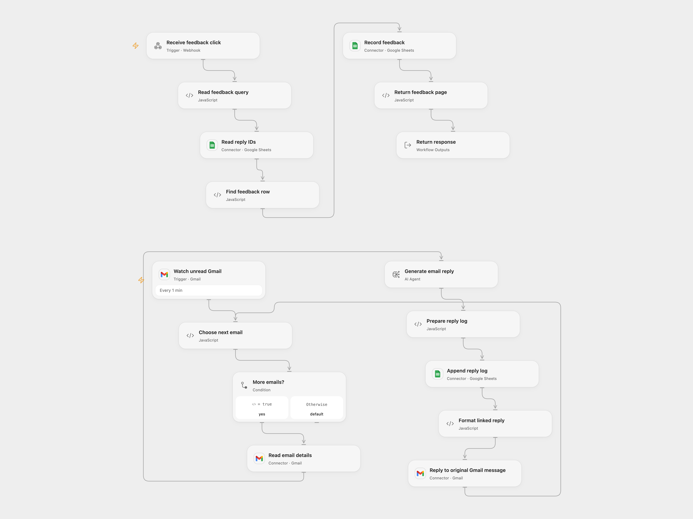

# Reply to Gmail and Record Feedback

Generate a reply to an incoming email, log it and record linked feedback.

<!-- template-actions:start -->
 
<!-- template-actions:end -->

<picture>
  <source media="(prefers-color-scheme: dark)" srcset="preview-dark.png">
  
</picture>

## Setup and use

Import the n8n workflow, configure Gmail and OpenAI credentials, set the allowed senders in **Configure**, and set a public feedback webhook URL for your n8n instance. Configure an existing spreadsheet, or allow the workflow to create one on its first run. In Open Flow, set **Find or create spreadsheet** to an existing spreadsheet ID or leave it empty to create one with a header in its default worksheet; set its feedback URL in **Format linked reply**. Set **Choose mode** to direct for n8n-only execution, or relay to use Open Flow. In relay mode set both Open Flow URLs, connect Google Sheets and Gmail on all relevant nodes, and configure the model. Activate one mode.

## Behavior

For allowed incoming messages the workflow extracts the reply text, asks the model for a response, sends a Gmail reply to the originating message and records both texts. The response includes Yes/No links; a click records feedback against the corresponding UUID. In Open Flow mode the supplied n8n workflow retains the Gmail trigger, source parser, feedback webhook and HTML response; Open Flow sends the Gmail reply. For an existing Open Flow sheet, use Sheet1 with columns ID, Initial message, Generated reply, Good response?. Initialize an empty configuration with one request before allowing simultaneous requests; automatic creation is not serialized. If creation is uncertain, inspect Google Sheets and configure the created spreadsheet ID before running again. Open Flow sends a reply using the original Gmail message ID and thread ID. The Open Flow webhook does not authenticate callers; restrict access to trusted senders. Email content is shared with the model. Lost Gmail or Sheets responses can mean a write succeeded; inspect the destination before retrying.

Inspiration &amp; credits

## Changes to the source

- Add Open Flow model, Sheets and exact-message Gmail reply while retaining the n8n Gmail trigger and feedback entry. Use the created default worksheet for the Open Flow log, log before sending the reply, correct the parser’s fragment accessor for the n8n runtime, and replace instance-specific values.

Adapted from [Send a ChatGPT email reply and save responses to Google Sheets](https://github.com/enescingoz/awesome-n8n-templates/blob/827110332c21cbe000ab13f6d292d5adb1f1f8db/Gmail_and_Email_Automation/Send%20a%20ChatGPT%20email%20reply%20and%20save%20responses%20to%20Google%20Sheets.json) in [enescingoz/awesome-n8n-templates](https://github.com/enescingoz/awesome-n8n-templates).

Source collection notice: © 2024–2026 Enes Cingoz, [CC BY 4.0](https://github.com/enescingoz/awesome-n8n-templates/blob/827110332c21cbe000ab13f6d292d5adb1f1f8db/LICENSE). The n8n parser follows [ikbelkirasan’s gist](https://gist.github.com/ikbelkirasan/2462073f6c7c760faa6fad7c6a0c4dc3), and includes [node-email-reply-parser](https://github.com/t2bot/node-email-reply-parser), [lodash](https://github.com/lodash/lodash) and [esrever](https://github.com/mathiasbynens/esrever), distributed under the MIT License. See [repository licensing](../../README.md#licensing) for the scope of OOMOL contributions and third-party material.

Copyright (c) GitHub, William Durand, Travis Ralston. Copyright OpenJS Foundation and other contributors; based on Underscore.js, copyright Jeremy Ashkenas, DocumentCloud and Investigative Reporters & Editors. Copyright Mathias Bynens.

Permission is hereby granted, free of charge, to any person obtaining a copy of this software and associated documentation files (the “Software”), to deal in the Software without restriction, including without limitation the rights to use, copy, modify, merge, publish, distribute, sublicense, and/or sell copies of the Software, and to permit persons to whom the Software is furnished to do so, subject to the following conditions:

The above copyright notice and this permission notice shall be included in all copies or substantial portions of the Software.

THE SOFTWARE IS PROVIDED “AS IS”, WITHOUT WARRANTY OF ANY KIND, EXPRESS OR IMPLIED, INCLUDING BUT NOT LIMITED TO THE WARRANTIES OF MERCHANTABILITY, FITNESS FOR A PARTICULAR PURPOSE AND NONINFRINGEMENT. IN NO EVENT SHALL THE AUTHORS OR COPYRIGHT HOLDERS BE LIABLE FOR ANY CLAIM, DAMAGES OR OTHER LIABILITY, WHETHER IN AN ACTION OF CONTRACT, TORT OR OTHERWISE, ARISING FROM, OUT OF OR IN CONNECTION WITH THE SOFTWARE OR THE USE OR OTHER DEALINGS IN THE SOFTWARE.

