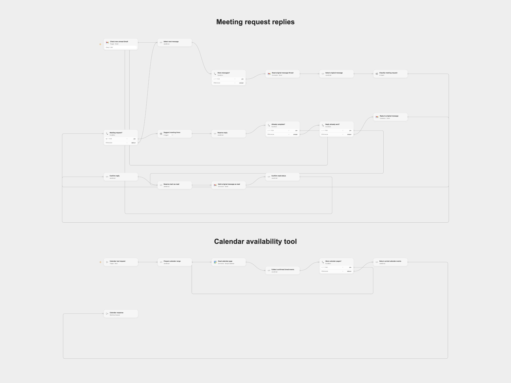

# Reply to Meeting Requests with Calendar Availability

Reply to meeting requests with suggested times based on Google Calendar.

<picture>
  <source media="(prefers-color-scheme: dark)" srcset="preview-dark.png">
  
</picture>

[Open Flow JSON](templates/reply-to-meeting-requests-with-calendar-availability.openflow.json) · [n8n JSON](templates/reply-to-meeting-requests-with-calendar-availability.n8n.json)

## Setup

Import the bundle, publish **Calendar availability tool**, refresh its interface in **Meeting request replies**, and connect Gmail and Google Calendar. Set the calendar ID if it is not primary. Configure a tool-capable AI model and enable persistent State. In n8n connect Gmail and Google Calendar, configure the calendar and a Data Table with item_key and status text columns. Use one format and avoid overlapping executions.

## Behavior

The Gmail trigger checks new unread messages every minute, excluding spam and trash. The model classifies meeting requests; other messages remain unread. For a meeting request, an Agent calls the calendar tool and drafts a reply proposing specific times with a 15-minute buffer after prior meetings. The tool reads all pages of confirmed timed events from one day before now to one month ahead. Open Flow uses UTC for the range and keeps event timestamps with their offsets. All-day events are excluded as in the source, so check them separately before relying on suggestions. The workflow suggests times and does not create a calendar event. Review model behavior before enabling automatic replies.

The reply is sent to the original message, and only after a confirmed reply is that message marked read. Each write has a separate pending checkpoint. If an outcome is unknown, inspect Gmail before resolving it; a successful reply is never resent merely because marking read needs attention. In n8n attempt records remain in the Data Table and require manual reconciliation on retry. Email snippets and calendar event details are sent to the model provider.

<details>
<summary>Inspiration &amp; credits</summary>

Adapted from [Suggest meeting slots using AI](https://github.com/enescingoz/awesome-n8n-templates/blob/827110332c21cbe000ab13f6d292d5adb1f1f8db/OpenAI_and_LLMs/Suggest%20meeting%20slots%20using%20AI.json) in [enescingoz/awesome-n8n-templates](https://github.com/enescingoz/awesome-n8n-templates).

Source collection notice: © 2024–2026 Enes Cingoz, [CC BY 4.0](https://github.com/enescingoz/awesome-n8n-templates/blob/827110332c21cbe000ab13f6d292d5adb1f1f8db/LICENSE). The source export does not identify a separate template author or license. See [repository licensing](../../README.md#licensing) for the scope of OOMOL contributions and third-party material.


Changes from the source: Added calendar pagination and separate checkpoints for replying and marking messages read; updated the model and configured UTC.

Collection license notice:

```text
Creative Commons Attribution 4.0 International License

Copyright (c) 2024-2026 Enes Cingoz

You are free to:

  Share - copy and redistribute the material in any medium or format
  Adapt - remix, transform, and build upon the material for any purpose,
  even commercially.

Under the following terms:

  Attribution - You must give appropriate credit, provide a link to the
  license, and indicate if changes were made. You may do so in any
  reasonable manner, but not in any way that suggests the licensor
  endorses you or your use.

  No additional restrictions - You may not apply legal terms or
  technological measures that legally restrict others from doing
  anything the license permits.

Notices:

  You do not have to comply with the license for elements of the
  material in the public domain or where your use is permitted by an
  applicable exception or limitation.

  No warranties are given. The license may not give you all of the
  permissions necessary for your intended use. For example, other rights
  such as publicity, privacy, or moral rights may limit how you use the
  material.

For the full license text, see:
https://creativecommons.org/licenses/by/4.0/legalcode
```

</details>
