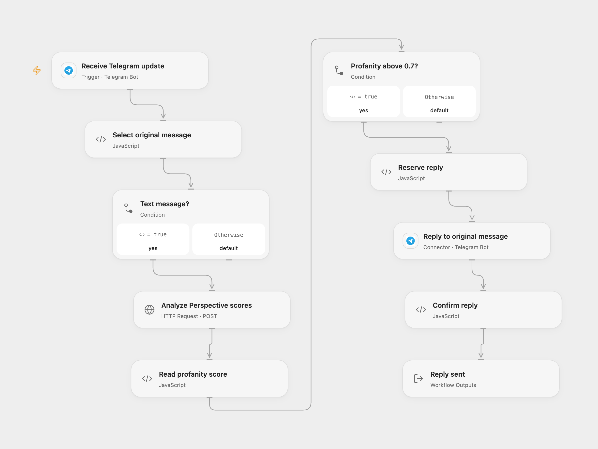

# Reply to Telegram Profanity

Score Telegram text with Perspective and reply to messages with a profanity score above 0.7.

<picture>
  <source media="(prefers-color-scheme: dark)" srcset="preview-dark.png">
  
</picture>

[Open Flow JSON](templates/reply-to-telegram-profanity.openflow.json) · [n8n JSON](templates/reply-to-telegram-profanity.n8n.json)

## Setup

Connect a Telegram bot and enable persistent State. Perspective requires existing API access: new access requests closed in February 2026 and the service ends on **December 31, 2026**. In Open Flow bind an OAuth access token from an authorized Google Cloud project to the secret Variable PERSPECTIVE_ACCESS_TOKEN. In n8n connect the Perspective OAuth credential and Telegram bot. Activate only one format.

## Behavior

For text in a new or edited message or channel post, send the text to Perspective in English and request identity attack, threat and profanity scores. Only a profanity score strictly above 0.7 triggers the fixed reply to the same chat and message. Other scores do not trigger a reply. Scores can be mistaken; review the threshold and bot permissions before use.

In Open Flow an uncertain reply remains pending in State under its Telegram update ID; inspect the chat before clearing the entry or retrying. In n8n inspect the chat before retrying an uncertain send.

Inspiration &amp; credits

## Changes to the source

Handle all four selected Telegram update types and ignore non-text updates. Protect uncertain Open Flow replies from automatic replay.

Adapted from [Detect toxic language in Telegram messages](https://github.com/enescingoz/awesome-n8n-templates/blob/827110332c21cbe000ab13f6d292d5adb1f1f8db/Telegram/Detect%20toxic%20language%20in%20Telegram%20messages.json) in [enescingoz/awesome-n8n-templates](https://github.com/enescingoz/awesome-n8n-templates).

Source collection notice: © 2024–2026 Enes Cingoz, [CC BY 4.0](https://github.com/enescingoz/awesome-n8n-templates/blob/827110332c21cbe000ab13f6d292d5adb1f1f8db/LICENSE). The source export does not identify a separate template author or license. See [repository licensing](../../README.md#licensing) for the scope of OOMOL contributions and third-party material.

