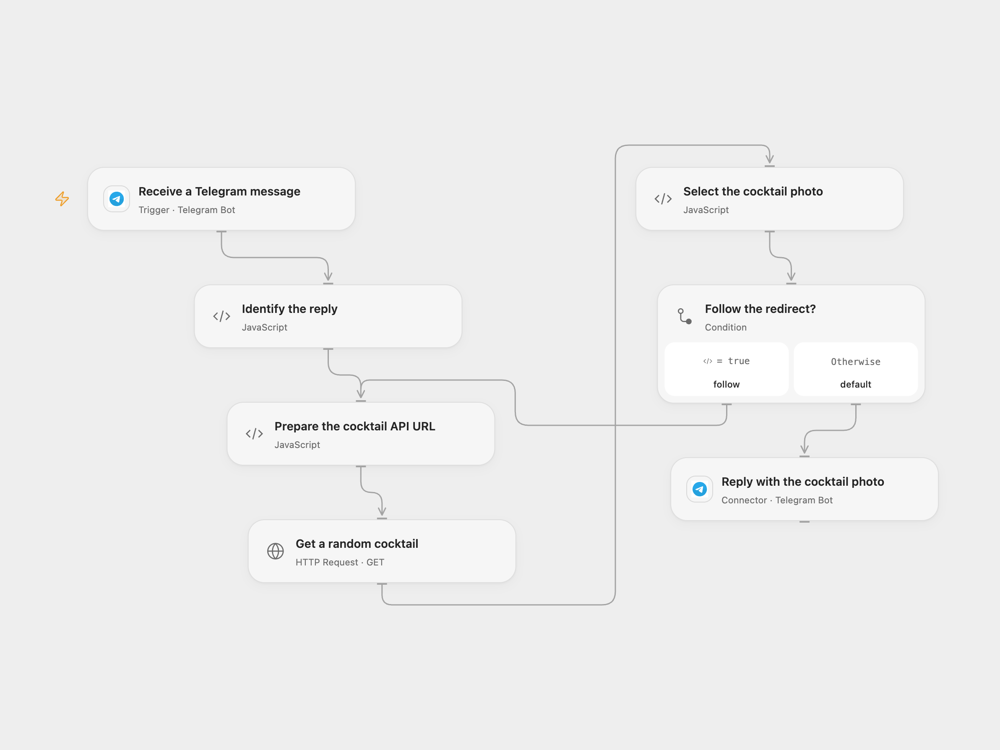

# Reply with a Random Cocktail Photo

Reply to a Telegram message with a random cocktail photo and name.

<picture>
  <source media="(prefers-color-scheme: dark)" srcset="preview-dark.png">
  
</picture>

[Open Flow JSON](templates/reply-with-a-random-cocktail-photo.openflow.json) · [n8n JSON](templates/reply-with-a-random-cocktail-photo.n8n.json)

## Setup

Connect the same Telegram bot to **Receive a Telegram message** and **Reply with the cocktail photo**. In n8n, connect the same bot to **Telegram Trigger** and **Telegram**. Enable one format and make sure users have started the bot or the bot has access to the group. A Telegram bot can have only one active webhook subscription.

The CocktailDB URL uses its public test key 1, documented for development and education. Check [CocktailDB API access](https://www.thecocktaildb.com/api.php) for your use and replace the key in **Prepare the cocktail API URL** or **HTTP Request** if needed.

## Behavior

Each received message fetches one random cocktail and replies to that message with its photo and name as the caption. The API can return the same drink again. Telegram fetches the photo URL; the workflow does not download it to a local file. The photo must be accessible to Telegram. An invalid response, missing name or photo, caption over Telegram's 1,024-character limit, failed request or failed reply stops the run. A failed or uncertain photo send may already have been delivered; check the chat before retrying.

The API request follows up to 21 redirects with a 30-second request timeout. Open Flow limits each HTTP response to 4 MiB. Use the bot in a trusted chat; any message received by the configured bot triggers a reply. Open Flow's Telegram trigger uses delivery IDs to help deduplicate webhook admission; n8n does not add the same key. Neither format promises exactly-once replies.

Inspiration &amp; credits

## Changes to the source

- Validate the incoming chat and message IDs, photo URL and caption before posting. Use configured Telegram connections and preserve the reply-to-message ID.
- Open Flow follows API redirects explicitly and checks the first cocktail; n8n uses its current HTTP request and photo nodes with a 30-second timeout.

Adapted from [Receive updates from Telegram and send an image of a cocktail](https://github.com/Zie619/n8n-workflows/blob/ae8cf6dc5b873cbb4f74587aa9180ed3a9f70682/workflows/Http/1052_HTTP_Telegram_Update_Webhook.json) in [Zie619/n8n-workflows](https://github.com/Zie619/n8n-workflows). The source export does not identify a separate template author or license.

The collection’s [MIT notice](https://github.com/Zie619/n8n-workflows/blob/94007c1445d9258a7da116646b79473e7c7c3282/LICENSE) is pinned at a later revision. This is the collection notice at that revision; it does not establish a separate original template author's license. Our changes are listed above; see [repository licensing](../../README.md#licensing).

> MIT License
>
> Copyright (c) 2025 Zie619
>
> Permission is hereby granted, free of charge, to any person obtaining a copy
> of this software and associated documentation files (the "Software"), to deal
> in the Software without restriction, including without limitation the rights
> to use, copy, modify, merge, publish, distribute, sublicense, and/or sell
> copies of the Software, and to permit persons to whom the Software is
> furnished to do so, subject to the following conditions:
>
> The above copyright notice and this permission notice shall be included in all
> copies or substantial portions of the Software.
>
> THE SOFTWARE IS PROVIDED "AS IS", WITHOUT WARRANTY OF ANY KIND, EXPRESS OR
> IMPLIED, INCLUDING BUT NOT LIMITED TO THE WARRANTIES OF MERCHANTABILITY,
> FITNESS FOR A PARTICULAR PURPOSE AND NONINFRINGEMENT. IN NO EVENT SHALL THE
> AUTHORS OR COPYRIGHT HOLDERS BE LIABLE FOR ANY CLAIM, DAMAGES OR OTHER
> LIABILITY, WHETHER IN AN ACTION OF CONTRACT, TORT OR OTHERWISE, ARISING FROM,
> OUT OF OR IN CONNECTION WITH THE SOFTWARE OR THE USE OR OTHER DEALINGS IN THE
> SOFTWARE.

