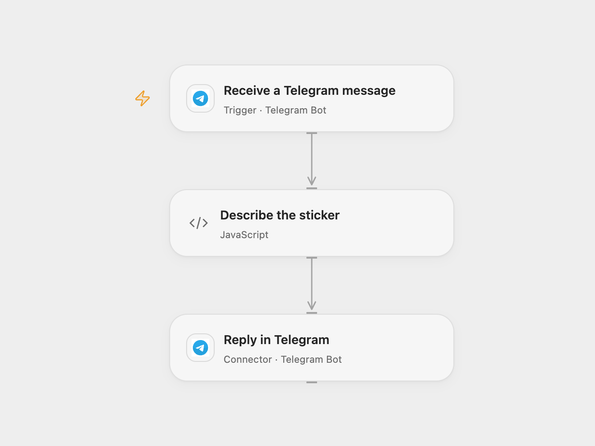

# Reply with a Telegram Sticker ID

Reply to Telegram messages with the sticker file ID and set name.

<picture>
  <source media="(prefers-color-scheme: dark)" srcset="preview-dark.png">
  
</picture>

[Open Flow JSON](templates/reply-with-telegram-sticker-id.openflow.json) · [n8n JSON](templates/reply-with-telegram-sticker-id.n8n.json)

## Setup

Connect the same Telegram bot to the message trigger and reply node. Restrict the Open Flow trigger to intended chats or users if needed. In n8n, connect the bot to the trigger and both Telegram reply nodes. A bot can have only one active webhook, so enable only one format.

## Behavior

When a message contains a sticker, reply in the same chat with its file ID and sticker-set name. For a sticker without a set name, both formats report it as not available. A message without a sticker receives a notice. Telegram file IDs can be used by bots to refer to the sticker. If a reply fails or its result is unknown, check the chat before retrying; a reply may already have arrived.

Inspiration &amp; credits

## Changes to the source

- Open Flow combines the two reply branches into one visible formatting step; both formats explicitly handle missing sticker-set names.

Adapted from [Find the ID of a Telegram sticker](https://github.com/Zie619/n8n-workflows/blob/ae8cf6dc5b873cbb4f74587aa9180ed3a9f70682/workflows/Telegram/0705_Telegram_Automate_Triggered.json) in [Zie619/n8n-workflows](https://github.com/Zie619/n8n-workflows). The source export does not identify a separate template author or license.

The collection’s [MIT notice](https://github.com/Zie619/n8n-workflows/blob/94007c1445d9258a7da116646b79473e7c7c3282/LICENSE) is pinned at a later revision. This is the collection notice at that revision; it does not establish a separate original template author's license. Our changes are listed above; see [repository licensing](../../README.md#licensing).

> MIT License
>
> Copyright (c) 2025 Zie619
>
> Permission is hereby granted, free of charge, to any person obtaining a copy
> of this software and associated documentation files (the "Software"), to deal
> in the Software without restriction, including without limitation the rights
> to use, copy, modify, merge, publish, distribute, sublicense, and/or sell
> copies of the Software, and to permit persons to whom the Software is
> furnished to do so, subject to the following conditions:
>
> The above copyright notice and this permission notice shall be included in all
> copies or substantial portions of the Software.
>
> THE SOFTWARE IS PROVIDED "AS IS", WITHOUT WARRANTY OF ANY KIND, EXPRESS OR
> IMPLIED, INCLUDING BUT NOT LIMITED TO THE WARRANTIES OF MERCHANTABILITY,
> FITNESS FOR A PARTICULAR PURPOSE AND NONINFRINGEMENT. IN NO EVENT SHALL THE
> AUTHORS OR COPYRIGHT HOLDERS BE LIABLE FOR ANY CLAIM, DAMAGES OR OTHER
> LIABILITY, WHETHER IN AN ACTION OF CONTRACT, TORT OR OTHERWISE, ARISING FROM,
> OUT OF OR IN CONNECTION WITH THE SOFTWARE OR THE USE OR OTHER DEALINGS IN THE
> SOFTWARE.

