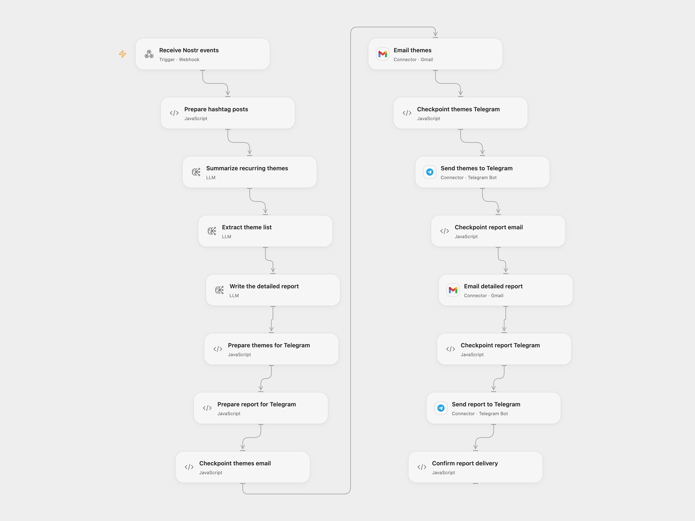

# Report Nostr Hashtag Themes

Summarize Nostr hashtag posts and send a themes overview and detailed report by email and Telegram.

<picture>
  <source media="(prefers-color-scheme: dark)" srcset="preview-dark.png">
  
</picture>

[Open Flow JSON](templates/report-nostr-hashtag-themes.openflow.json) · [n8n JSON](templates/report-nostr-hashtag-themes.n8n.json)

## Setup

Install the [Nostrobots community node](https://github.com/ocknamo/n8n-nodes-nostrobots) in n8n and configure a Nostr relay in **Nostr Read #damus**. For Open Flow, import the n8n workflow, set **Choose processing mode** to relay and enter the Open Flow webhook URL in **Forward Nostr events**. Select an AI model, connect Gmail and Telegram, and set the email and chat ID in both corresponding nodes. Enable persistent State. Restrict access to the Open Flow webhook URL.

For direct n8n processing, choose direct mode, connect the model, Gmail and Telegram credentials, and set both email recipients and chat IDs. Activate only one mode. The source queries the last 180 days of hashtag events.

## Behavior

The workflow analyzes the fetched posts, extracts themes, prepares a detailed report, and delivers both summaries to Gmail and Telegram. AI results may be inaccurate. Open Flow sends plain text and uses a configurable model; n8n preserves the source model prompts and HTML email formatting.

If a delivery fails or its result is unknown, inspect both destinations and complete the report manually before entering the pending execution ID in **Prepare hashtag posts** to acknowledge it. Do not replay the report without checking each destination. Keep runs from overlapping.

Inspiration &amp; credits

## Changes to the source

- Provide a direct n8n mode and a relay mode for Open Flow because Nostr uses WebSocket relays.
- Replace the source recipient and chat ID with configuration and guard uncertain Open Flow deliveries.

Adapted from [Report Nostr hashtag themes](https://github.com/Zie619/n8n-workflows/blob/ae8cf6dc5b873cbb4f74587aa9180ed3a9f70682/workflows/Telegram/0001_Telegram_Schedule_Automation_Scheduled.json) in [Zie619/n8n-workflows](https://github.com/Zie619/n8n-workflows). The source export does not identify a separate template author or license.

The collection’s [MIT notice](https://github.com/Zie619/n8n-workflows/blob/94007c1445d9258a7da116646b79473e7c7c3282/LICENSE) is pinned at a later revision. This is the collection notice at that revision; it does not establish a separate original template author's license. Our changes are listed above; see [repository licensing](../../README.md#licensing).

> MIT License
>
> Copyright (c) 2025 Zie619
>
> Permission is hereby granted, free of charge, to any person obtaining a copy
> of this software and associated documentation files (the "Software"), to deal
> in the Software without restriction, including without limitation the rights
> to use, copy, modify, merge, publish, distribute, sublicense, and/or sell
> copies of the Software, and to permit persons to whom the Software is
> furnished to do so, subject to the following conditions:
>
> The above copyright notice and this permission notice shall be included in all
> copies or substantial portions of the Software.
>
> THE SOFTWARE IS PROVIDED "AS IS", WITHOUT WARRANTY OF ANY KIND, EXPRESS OR
> IMPLIED, INCLUDING BUT NOT LIMITED TO THE WARRANTIES OF MERCHANTABILITY,
> FITNESS FOR A PARTICULAR PURPOSE AND NONINFRINGEMENT. IN NO EVENT SHALL THE
> AUTHORS OR COPYRIGHT HOLDERS BE LIABLE FOR ANY CLAIM, DAMAGES OR OTHER
> LIABILITY, WHETHER IN AN ACTION OF CONTRACT, TORT OR OTHERWISE, ARISING FROM,
> OUT OF OR IN CONNECTION WITH THE SOFTWARE OR THE USE OR OTHER DEALINGS IN THE
> SOFTWARE.

