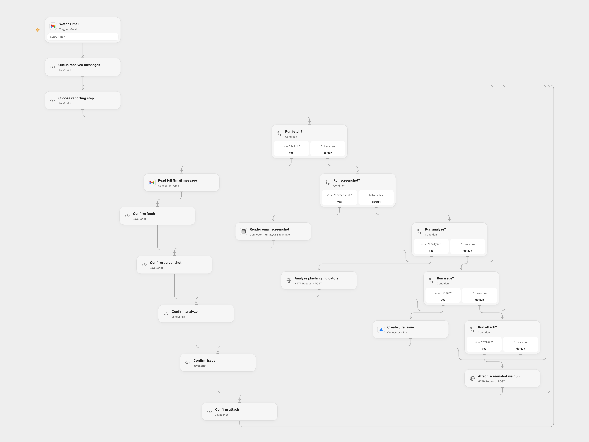

# Report Phishing Emails to Jira

Analyze incoming email screenshots and headers for phishing indicators, then create Jira issues with screenshot attachments.

<!-- template-actions:start -->
 
<!-- template-actions:end -->

<picture>
  <source media="(prefers-color-scheme: dark)" srcset="preview-dark.png">
  
</picture>

## Setup

Connect Gmail, HTML/CSS to Image and Jira. Set the Jira project and issue type in **Choose reporting step**. In the supplied n8n workflow, connect Gmail, HTML/CSS to Image, OpenAI and Jira for direct mode. Set the Jira project and issue type IDs and choose the same Data Table on all checkpoint nodes; it needs text columns item_key and status. For Open Flow, use only the n8n attachment relay: disable the n8n Gmail trigger, configure the webhook header credential with Authorization: Bearer followed by your chosen token, and connect HTML/CSS to Image and Jira for the relay. Set its production HTTPS URL in **Choose reporting step**, and bind Secret Variables `OPENAI_API_KEY` and `N8N_RELAY_TOKEN`. Enable persistent State and prevent overlapping executions. Use one format.

## Behavior

Incoming HTML emails are rendered as screenshots and analyzed with their headers. A Jira issue contains the subject, recipient, text and model analysis, with the screenshot attached through n8n. The Outlook trigger in the supplied n8n workflow remains disabled. Email content is sent to HTML/CSS to Image and OpenAI; protect execution history and review the analysis.

If screenshot, issue or attachment creation has an unknown result, inspect the corresponding service. In **Choose reporting step**, enter the pending key and set resolution to confirmed or absent; for a confirmed screenshot enter its URL and for a confirmed issue enter its key. Trigger another poll after resolving it and clear the fields. In n8n, inspect the corresponding service and reconcile the matching pending Data Table row before replay. The two webhook and poll modes must not run in parallel.

Inspiration &amp; credits

## Changes to the source

- Replace private Jira IDs with configuration, preserve full Gmail MIME and queue polled messages before writes.

Adapted from [Report phishing emails to Jira](https://github.com/Zie619/n8n-workflows/blob/ae8cf6dc5b873cbb4f74587aa9180ed3a9f70682/workflows/Code/0670_Code_Microsoftoutlook_Create_Webhook.json) in [Zie619/n8n-workflows](https://github.com/Zie619/n8n-workflows). The source export does not identify a separate template author or license.

The collection’s [MIT notice](https://github.com/Zie619/n8n-workflows/blob/94007c1445d9258a7da116646b79473e7c7c3282/LICENSE) is pinned at a later revision. This is the collection notice at that revision; it does not establish a separate original template author's license. Our changes are listed above; see [repository licensing](../../README.md#licensing).

> MIT License
>
> Copyright (c) 2025 Zie619
>
> Permission is hereby granted, free of charge, to any person obtaining a copy
> of this software and associated documentation files (the "Software"), to deal
> in the Software without restriction, including without limitation the rights
> to use, copy, modify, merge, publish, distribute, sublicense, and/or sell
> copies of the Software, and to permit persons to whom the Software is
> furnished to do so, subject to the following conditions:
>
> The above copyright notice and this permission notice shall be included in all
> copies or substantial portions of the Software.
>
> THE SOFTWARE IS PROVIDED "AS IS", WITHOUT WARRANTY OF ANY KIND, EXPRESS OR
> IMPLIED, INCLUDING BUT NOT LIMITED TO THE WARRANTIES OF MERCHANTABILITY,
> FITNESS FOR A PARTICULAR PURPOSE AND NONINFRINGEMENT. IN NO EVENT SHALL THE
> AUTHORS OR COPYRIGHT HOLDERS BE LIABLE FOR ANY CLAIM, DAMAGES OR OTHER
> LIABILITY, WHETHER IN AN ACTION OF CONTRACT, TORT OR OTHERWISE, ARISING FROM,
> OUT OF OR IN CONNECTION WITH THE SOFTWARE OR THE USE OR OTHER DEALINGS IN THE
> SOFTWARE.

