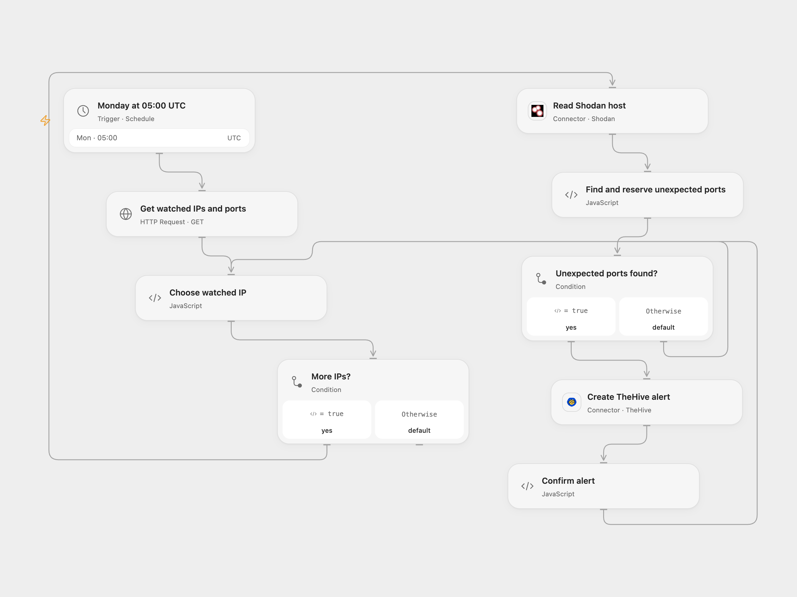

# Report Shodan Unexpected Ports to TheHive

Check a configured IP allowlist against Shodan and create TheHive alerts for unexpected ports.

<!-- template-actions:start -->
 
<!-- template-actions:end -->

<picture>
  <source media="(prefers-color-scheme: dark)" srcset="preview-dark.png">
  
</picture>

## Setup

Configure **Get watched IPs and ports** with an HTTPS endpoint returning a JSON array of objects with `ip` and `ports` (the list of allowed port numbers). Connect Shodan and TheHive 4, and enable persistent State. The schedule runs Monday at 05:00 UTC; change its timezone or expression if needed. Prevent overlapping runs.

## Behavior

For each watched IP, Shodan host data is checked against its allowed port list. An alert lists services on ports outside that list; no alert is created when all returned ports are allowed. Shodan is a third-party snapshot and does not actively scan on demand; missing or stale data is not proof a port is closed. Review service banners before sharing because they may contain sensitive data.

If alert creation is uncertain, inspect TheHive before retrying. Enter the pending key and `confirmed` or `absent` in **Find and reserve unexpected ports**, rerun, then clear those fields. TheHive source references identify the IP and week.

In n8n

Import the n8n workflow, configure **Get watched IPs & Ports**, connect Shodan and TheHive 4, and select a Data Table with `item_key` and `status` text columns in each checkpoint node.

Inspiration &amp; credits

Fixed the allowlist comparison, added native scheduled watchlist polling, and kept each IP associated with its alert.

Adapted from [Weekly Shodan query and report incidents](https://github.com/Zie619/n8n-workflows/blob/ae8cf6dc5b873cbb4f74587aa9180ed3a9f70682/workflows/Filter/1751_Filter_Schedule_Automation_Scheduled.json) in [Zie619/n8n-workflows](https://github.com/Zie619/n8n-workflows). The source export does not identify a separate template author or license.

The collection’s [MIT notice](https://github.com/Zie619/n8n-workflows/blob/94007c1445d9258a7da116646b79473e7c7c3282/LICENSE) is pinned at a later revision. This is the collection notice at that revision; it does not establish a separate original template author's license. Our changes are listed above; see [repository licensing](../../README.md#licensing).

> MIT License
>
> Copyright (c) 2025 Zie619
>
> Permission is hereby granted, free of charge, to any person obtaining a copy
> of this software and associated documentation files (the "Software"), to deal
> in the Software without restriction, including without limitation the rights
> to use, copy, modify, merge, publish, distribute, sublicense, and/or sell
> copies of the Software, and to permit persons to whom the Software is
> furnished to do so, subject to the following conditions:
>
> The above copyright notice and this permission notice shall be included in all
> copies or substantial portions of the Software.
>
> THE SOFTWARE IS PROVIDED "AS IS", WITHOUT WARRANTY OF ANY KIND, EXPRESS OR
> IMPLIED, INCLUDING BUT NOT LIMITED TO THE WARRANTIES OF MERCHANTABILITY,
> FITNESS FOR A PARTICULAR PURPOSE AND NONINFRINGEMENT. IN NO EVENT SHALL THE
> AUTHORS OR COPYRIGHT HOLDERS BE LIABLE FOR ANY CLAIM, DAMAGES OR OTHER
> LIABILITY, WHETHER IN AN ACTION OF CONTRACT, TORT OR OTHERWISE, ARISING FROM,
> OUT OF OR IN CONNECTION WITH THE SOFTWARE OR THE USE OR OTHER DEALINGS IN THE
> SOFTWARE.

