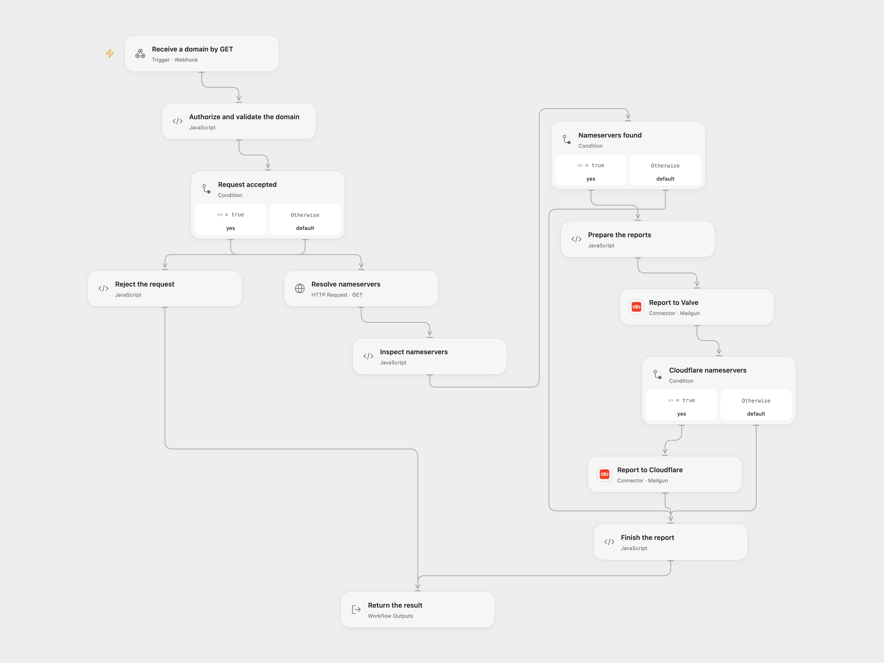

# Report Steam Phishing Domains

Send reports for a reviewed Steam phishing domain after checking its nameservers.

<picture>
  <source media="(prefers-color-scheme: dark)" srcset="preview-dark.png">
  
</picture>

[Open Flow JSON](templates/report-steam-phishing-domains.openflow.json) · [n8n JSON](templates/report-steam-phishing-domains.n8n.json)

## Setup

Only submit a domain you have independently reviewed as a Steam phishing site. DNS records do not establish phishing or prove the site's hosting provider. Connect Mailgun in both report nodes and configure the same sending domain and verified sender in each. Edit the sender signature and recipients to suit your reporting policy. Edit the signature in **Prepare the reports** (Open Flow) or **Prepare reports** (n8n). In n8n, configure the Mailgun credentials, sender and recipients.

In Open Flow create secret Variable `STEAM_REPORT_BASIC_AUTH` containing the full HTTP Basic authorization value, for example `Basic <base64 username:password>`. Configure strong credentials and keep the HTTPS webhook URL private. In n8n configure the webhook's HTTP Basic credentials. Enable only one template format. Restrict access to execution data, which can contain the incoming authorization header.

## Behavior

Send an authenticated GET request with the ASCII domain in query parameter `q`. Google Public DNS resolves NS records. If at least one is returned, the workflow emails Valve once; when an NS name ends in cloudflare.com it then emails Cloudflare once. A DNS failure stops before mail. DNS absence means no email. DNS is a point-in-time result and may differ between resolvers. The queried domain is sent to Google Public DNS. Open Flow returns a JSON report status after the mail requests, while n8n returns its last node output.

The workflow does not investigate a site, verify abuse, or deduplicate submissions. Mailgun acceptance is not proof of delivery. Check prior reports before resending after an uncertain write; duplicate requests can create duplicate emails.

## Changes to the source

- Replace shell and package installation with one public DNS-over-HTTPS lookup, validate the domain, and stop on DNS errors.
- Make webhook authorization and sender configuration explicit; remove the placeholder CC address.

Source and license

Adapted from [Steam + CF Report](https://github.com/Zie619/n8n-workflows/blob/ae8cf6dc5b873cbb4f74587aa9180ed3a9f70682/workflows/Executecommand/0097_Executecommand_Mailgun_Automation_Webhook.json) in [Zie619/n8n-workflows](https://github.com/Zie619/n8n-workflows). The matching [n8n community listing](https://n8n.io/workflows/122-report-phishing-websites-to-steam-and-cloudflare/) credits chaufnet. The original template does not state a separate license.

The collection’s [MIT notice](https://github.com/Zie619/n8n-workflows/blob/94007c1445d9258a7da116646b79473e7c7c3282/LICENSE) is pinned at a later revision. This is the collection notice at that revision; it does not establish a separate original template author's license. Our changes are listed above; see [repository licensing](../../README.md#licensing).

> MIT License
>
> Copyright (c) 2025 Zie619
>
> Permission is hereby granted, free of charge, to any person obtaining a copy
> of this software and associated documentation files (the "Software"), to deal
> in the Software without restriction, including without limitation the rights
> to use, copy, modify, merge, publish, distribute, sublicense, and/or sell
> copies of the Software, and to permit persons to whom the Software is
> furnished to do so, subject to the following conditions:
>
> The above copyright notice and this permission notice shall be included in all
> copies or substantial portions of the Software.
>
> THE SOFTWARE IS PROVIDED "AS IS", WITHOUT WARRANTY OF ANY KIND, EXPRESS OR
> IMPLIED, INCLUDING BUT NOT LIMITED TO THE WARRANTIES OF MERCHANTABILITY,
> FITNESS FOR A PARTICULAR PURPOSE AND NONINFRINGEMENT. IN NO EVENT SHALL THE
> AUTHORS OR COPYRIGHT HOLDERS BE LIABLE FOR ANY CLAIM, DAMAGES OR OTHER
> LIABILITY, WHETHER IN AN ACTION OF CONTRACT, TORT OR OTHERWISE, ARISING FROM,
> OUT OF OR IN CONNECTION WITH THE SOFTWARE OR THE USE OR OTHER DEALINGS IN THE
> SOFTWARE.

