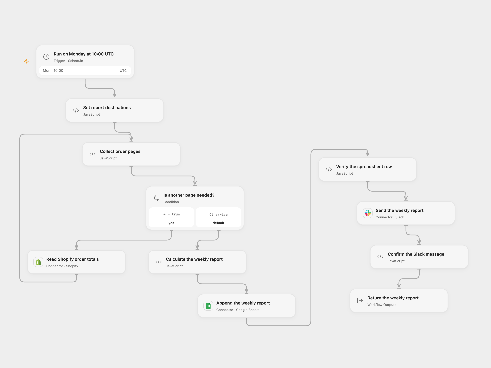

# Report Weekly Shopify Orders

Count open Shopify orders and total their prices for the preceding reporting week, then log and share the same result.

<!-- template-actions:start -->
 
<!-- template-actions:end -->

<picture>
  <source media="(prefers-color-scheme: dark)" srcset="preview-dark.png">
  
</picture>

## Setup

1. Select the Shopify connection in **Read Shopify order totals** for the shop to report on. The app needs `read_orders` and access to order totals.
2. In **Set report destinations**, enter the spreadsheet ID, A1 range and Slack channel ID. Enter these headers in the selected range: `totalOrders`, `ordersSum`, `currency`, `weekStart`, `weekEnd`. Connect Google Sheets and Slack. Give the connections permission to append to the selected range and post in the configured channel.
3. Enable the workflow to run on Mondays at 10:00 UTC. Keep the schedule and reporting boundary in UTC.

## Behavior

Each run reports the preceding seven days between Monday 10:00 UTC cutoffs. The start is included and the end is excluded. Order creation time places each order in a week. The report counts orders that are open when read, matching the original Shopify request. The workflow reads matching pages and stops before delivering a partial report if Shopify’s pagination limit is reached. It adds the Shopify total before returns, including taxes and discounts, in the shop's currency. A week with no orders reports zero. [Shopify order totals](https://shopify.dev/docs/api/admin-graphql/latest/objects/Order#field-Order.fields.totalPriceSet) · [Pagination limits](https://shopify.dev/docs/api/usage/limits#pagination-limits)

The workflow appends one summary row and checks the returned values. It sends the same count, amount, currency and dates to Slack after Sheets confirms the append. The amount is stored as decimal text to preserve precision. Shopify data errors stop the run before either write. The workflow makes no automatic write retries. If a receipt is missing, check the sheet and channel before running that week again. A separate run can write another report for the same week.

In n8n

In **Set report destinations**, also set the same shop's `.myshopify.com` hostname. Select the Shopify Access Token API credential, Google Sheets OAuth2 credential and Slack API credential on the corresponding HTTP nodes. The schedule supplies its execution timestamp in UTC. Keep the schedule and reporting boundary in UTC.

Inspiration &amp; credits

## Changes to the source

Replace the fixed August 2021 cutoff with the preceding completed weekly interval. Use the shop's actual currency instead of a fixed euro label. Send Slack after the matching spreadsheet row is confirmed.

Adapted from [Weekly Shopify order summary workflow](https://github.com/Zie619/n8n-workflows/blob/ae8cf6dc5b873cbb4f74587aa9180ed3a9f70682/workflows/Datetime/0087_Datetime_Slack_Automate_Scheduled.json) in [Zie619/n8n-workflows](https://github.com/Zie619/n8n-workflows). Attribution: Zie619 / n8n-workflows.

The collection’s [MIT notice](https://github.com/Zie619/n8n-workflows/blob/94007c1445d9258a7da116646b79473e7c7c3282/LICENSE) is pinned at a later revision. This is the collection notice at that revision; it does not establish a separate original template author's license. Our changes are listed above; see [repository licensing](../../README.md#licensing).

> MIT License
>
> Copyright (c) 2025 Zie619
>
> Permission is hereby granted, free of charge, to any person obtaining a copy
> of this software and associated documentation files (the "Software"), to deal
> in the Software without restriction, including without limitation the rights
> to use, copy, modify, merge, publish, distribute, sublicense, and/or sell
> copies of the Software, and to permit persons to whom the Software is
> furnished to do so, subject to the following conditions:
>
> The above copyright notice and this permission notice shall be included in all
> copies or substantial portions of the Software.
>
> THE SOFTWARE IS PROVIDED "AS IS", WITHOUT WARRANTY OF ANY KIND, EXPRESS OR
> IMPLIED, INCLUDING BUT NOT LIMITED TO THE WARRANTIES OF MERCHANTABILITY,
> FITNESS FOR A PARTICULAR PURPOSE AND NONINFRINGEMENT. IN NO EVENT SHALL THE
> AUTHORS OR COPYRIGHT HOLDERS BE LIABLE FOR ANY CLAIM, DAMAGES OR OTHER
> LIABILITY, WHETHER IN AN ACTION OF CONTRACT, TORT OR OTHERWISE, ARISING FROM,
> OUT OF OR IN CONNECTION WITH THE SOFTWARE OR THE USE OR OTHER DEALINGS IN THE
> SOFTWARE.

