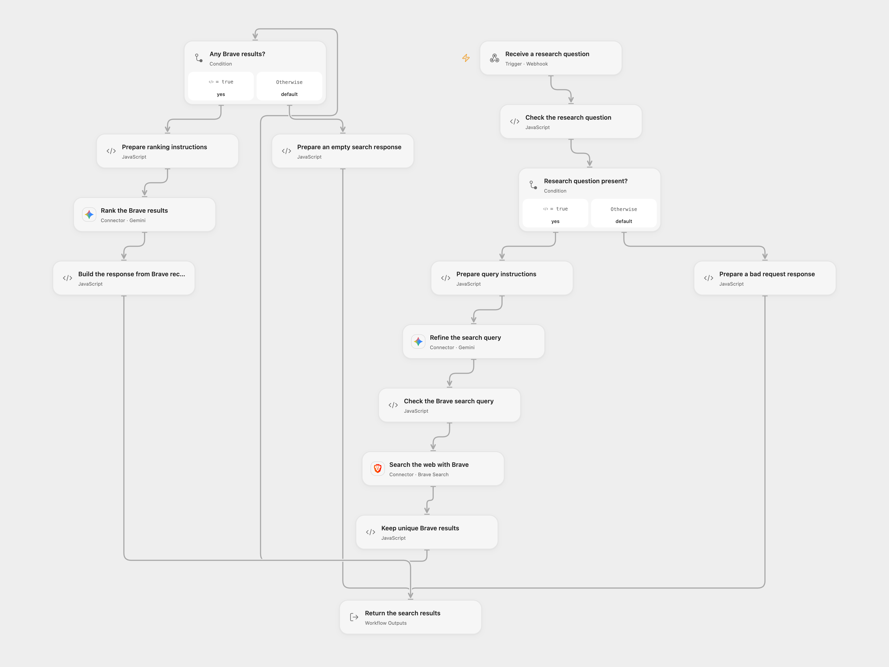

# Rerank Brave Search Results with Gemini

Refine a research question, search the web with Brave, and return up to ten ranked links with relevant snippets.

<!-- template-actions:start -->
 
<!-- template-actions:end -->

<picture>
  <source media="(prefers-color-scheme: dark)" srcset="preview-dark.png">
  
</picture>

## Setup

1. Connect Brave Search in **Search the web with Brave**.
2. Select the same Gemini connection in **Refine the search query** and **Rank the Brave results**. Allow Provider API access for Gemini 3.5 Flash-Lite.
3. Publish the workflow. Send a GET request to the webhook with one URL-encoded `Research Question` parameter. For example, append `?Research%20Question=How%20does%20rainwater%20harvesting%20work%3F`.

## Behavior

Gemini turns the original question into one concise query. Brave retrieves up to 20 web results. Gemini ranks the distinct links using the original question, the search query, today's date, titles, and snippets. The response uses Brave's original titles, links, and snippets.

The webhook returns JSON with `Highest_RANKEDURL_1` through `Highest_RANKEDURL_10`. Each rank has `title`, `link`, and `description` fields. Unfilled ranks have empty strings. `Information_extracted` contains the selected Brave snippets or `N/A`. No results returns empty ranks without another Gemini request.

A missing, blank, repeated, or oversized question returns HTTP 400. The webhook waits up to 60 seconds for results. A service error or invalid ranking fails the request.

In n8n

Assign a Header Auth credential in **Search the web with Brave** with header `X-Subscription-Token` and your Brave API key. Assign another Header Auth credential in **Refine the search query** and **Rank the Brave results** with header `x-goog-api-key` and your Gemini key. Activate the workflow and send the GET request with `Research Question` to its production webhook URL.

Inspiration &amp; credits

## Changes to the source

- Use current Gemini structured responses and the official Brave Web Search API.
- Deduplicate the retrieved links and validate rank IDs before constructing the JSON response from Brave records.
- Remove the disconnected test request and unused models.

Adapted from [Intelligent web query and semantic re-ranking flow using Brave and Google Gemini](https://github.com/enescingoz/awesome-n8n-templates/blob/827110332c21cbe000ab13f6d292d5adb1f1f8db/AI_Research_RAG_and_Data_Analysis/Intelligent%20Web%20Query%20and%20Semantic%20Re-Ranking%20Flow%20using%20Brave%20and%20Google%20Gemini.json) in [enescingoz/awesome-n8n-templates](https://github.com/enescingoz/awesome-n8n-templates).

Source collection notice: © 2024–2026 Enes Cingoz, [CC BY 4.0](https://github.com/enescingoz/awesome-n8n-templates/blob/827110332c21cbe000ab13f6d292d5adb1f1f8db/LICENSE). Original workflow by [Mind-Front](https://n8n.io/workflows/2643-intelligent-web-query-and-semantic-re-ranking-flow-using-brave-and-google-gemini/). See [repository licensing](../../README.md#licensing) for the scope of OOMOL contributions and third-party material.

