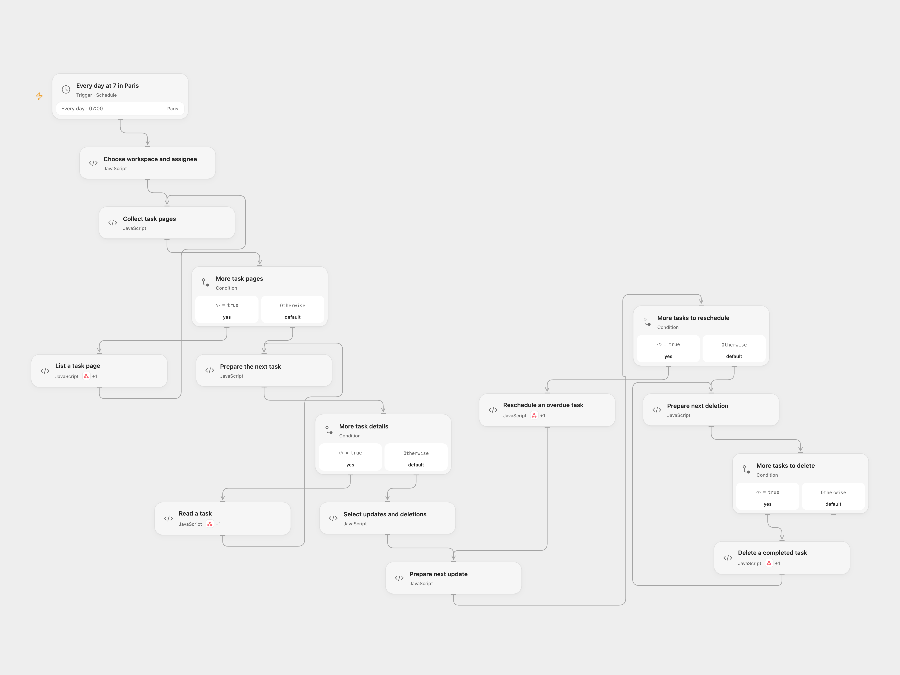

# Reschedule Overdue and Delete Completed Asana Tasks

Reschedule overdue Asana tasks and delete completed tasks returned for an assignee in a workspace.

<picture>
  <source media="(prefers-color-scheme: dark)" srcset="preview-dark.png">
  
</picture>

[Open Flow JSON](templates/reschedule-and-clean-asana-tasks.openflow.json) · [n8n JSON](templates/reschedule-and-clean-asana-tasks.n8n.json)

## Setup

**This workflow deletes tasks.** Review the assignee, workspace and completion window before enabling it. In **Choose workspace and assignee**, set the Asana IDs. Connect the same Asana account in each of the four Action nodes and grant read, update and delete access to the selected tasks. In n8n configure the same IDs and Asana credentials on the Asana nodes. Enable only one format.

The template runs daily at 7:00 in Europe/Paris. n8n schedules a fixed second within that minute; Open Flow starts at the minute boundary. Review the time zone and schedule for your account. The template uses the Paris calendar date to set due dates and queries incomplete tasks plus tasks completed since midnight in Paris on that date.

## Behavior

The workflow lists tasks for the selected workspace and assignee, reads each task, and sets an incomplete task's overdue date to today. Incomplete tasks with no due date and tasks due today or later remain unchanged. It then deletes every completed task returned by the query, regardless of its due date. Asana deletion is a real deletion, not archiving. Completed tasks outside the query window are not deleted. Changes made while a run is in progress can affect results.

Open Flow stops before writes if the task list or a detail read fails. It reads at most 100 pages of 100 tasks and fails if another page remains or a cursor repeats. The n8n format follows the source's all-results pagination. If an update or deletion fails, earlier writes remain and later ones are not attempted. An uncertain write is not automatically retried; check Asana before rerunning.

Inspiration &amp; credits

## Changes to the source

- Replace account-specific IDs and credentials with user configuration and set the minute to zero; the source leaves the minute to n8n’s stable default. Skip incomplete tasks without a due date instead of failing on the source expression.
- Preserve the Paris midnight completion filter and Paris calendar date for due dates; keep the source's deletion branch.

Adapted from [Reschedule overdue Asana tasks and clean up completed tasks](https://github.com/Zie619/n8n-workflows/blob/ae8cf6dc5b873cbb4f74587aa9180ed3a9f70682/workflows/Schedule/1629_Schedule_Stickynote_Automation_Scheduled.json) in [Zie619/n8n-workflows](https://github.com/Zie619/n8n-workflows). The matching [n8n listing](https://n8n.io/workflows/2701-reschedule-overdue-asana-tasks-and-clean-up-completed-tasks/) credits Bastien Laval. No separate original template license was found.

The collection’s [MIT notice](https://github.com/Zie619/n8n-workflows/blob/94007c1445d9258a7da116646b79473e7c7c3282/LICENSE) is pinned at a later revision. This is the collection notice at that revision; it does not establish a separate original template author's license. Our changes are listed above; see [repository licensing](../../README.md#licensing).

> MIT License
>
> Copyright (c) 2025 Zie619
>
> Permission is hereby granted, free of charge, to any person obtaining a copy
> of this software and associated documentation files (the "Software"), to deal
> in the Software without restriction, including without limitation the rights
> to use, copy, modify, merge, publish, distribute, sublicense, and/or sell
> copies of the Software, and to permit persons to whom the Software is
> furnished to do so, subject to the following conditions:
>
> The above copyright notice and this permission notice shall be included in all
> copies or substantial portions of the Software.
>
> THE SOFTWARE IS PROVIDED "AS IS", WITHOUT WARRANTY OF ANY KIND, EXPRESS OR
> IMPLIED, INCLUDING BUT NOT LIMITED TO THE WARRANTIES OF MERCHANTABILITY,
> FITNESS FOR A PARTICULAR PURPOSE AND NONINFRINGEMENT. IN NO EVENT SHALL THE
> AUTHORS OR COPYRIGHT HOLDERS BE LIABLE FOR ANY CLAIM, DAMAGES OR OTHER
> LIABILITY, WHETHER IN AN ACTION OF CONTRACT, TORT OR OTHERWISE, ARISING FROM,
> OUT OF OR IN CONNECTION WITH THE SOFTWARE OR THE USE OR OTHER DEALINGS IN THE
> SOFTWARE.

