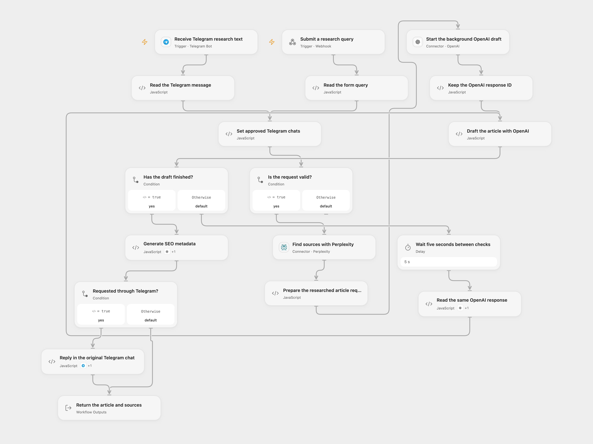

# Research and Draft SEO Articles

Research a submitted topic with Perplexity, draft an SEO article with sources, and reply to Telegram requests in the original chat.

<!-- template-actions:start -->
 
<!-- template-actions:end -->

<picture>
  <source media="(prefers-color-scheme: dark)" srcset="preview-dark.png">
  
</picture>

## Setup

1. Select a Perplexity connection in **Find sources with Perplexity** and the same OpenAI connection in **Start the background OpenAI draft**, **Read the same OpenAI response**, and **Generate SEO metadata**. Enable Provider API access for **Start the background OpenAI draft**. The workflow uses GPT-6 Luna for the article and metadata. The long draft uses OpenAI background mode, which requires provider-side response storage. [OpenAI background mode](https://developers.openai.com/api/docs/guides/background) · [Perplexity Search API](https://docs.perplexity.ai/docs/search/quickstart)
2. Publish and enable the workflow. Use the form URL from **Submit a research query**. The form confirms receipt immediately. Open the run to read the completed article, metadata, and sources. Share the form URL with approved contributors.
3. To accept Telegram requests, select the same bot connection in **Receive Telegram research text** and **Reply in the original Telegram chat**. Set the allowed chat IDs as strings in **Set approved Telegram chats**. An empty list disables Telegram requests. One bot can use one active webhook. [Telegram Bot API](https://core.telegram.org/bots/api#sendmessage)

## Behavior

Enter a research query of up to 1,200 characters in the form or send it as Telegram text. Each submission makes a separate request. Perplexity retrieves up to eight search results, and OpenAI uses their excerpts to draft an article targeting 1,500 to 2,000 words. The run includes the article, title, subtitle, hashtags, SEO title, slug, meta description, and links to the cited results. Review the claims and references before publishing.

A Telegram request receives the article and sources in the original chat and topic. Long drafts arrive in several messages with link previews disabled. A form submission creates a run result. It does not send a Telegram message.

If the search returns no usable evidence or a model response is incomplete, the run stops before delivery. The workflow checks the background response for up to 36 polls and stops if the draft remains pending. A Telegram reply with an uncertain outcome remains reserved. Check the original chat and workflow State before clearing that reservation. Replaying the same Telegram message skips delivery while its reservation exists.

In n8n

Set the chat IDs in **Set approved Telegram chats** and connect the same bot to **Receive Telegram research text** and **Reply in the original Telegram chat**. Bind a Perplexity key via HTTP Bearer Auth in **Find sources with Perplexity**. Bind an OpenAI key via HTTP Bearer Auth in **Draft the article with OpenAI** and **Generate SEO metadata**. The form acknowledges the request immediately. The final article is available in the execution result. The two OpenAI requests run synchronously with a three-minute timeout per request.

Use one production execution slot and a dedicated Data Table with text columns `key`, `status`, and `messageIds`. Select it in **Look up the previous Telegram attempt**, **Reserve the Telegram reply**, and **Record the Telegram reply**. If a delivery is uncertain, inspect the original chat and the pending row. Restart through the original trigger to honor the reservation.

Inspiration &amp; credits

Adapted from [SEO blog research and drafting workflow](https://github.com/Zie619/n8n-workflows/blob/ae8cf6dc5b873cbb4f74587aa9180ed3a9f70682/workflows/Form/1762_Form_Aggregate_Automation_Triggered.json) in [Zie619/n8n-workflows](https://github.com/Zie619/n8n-workflows). Attribution: Zie619 / n8n-workflows.

The collection’s [MIT notice](https://github.com/Zie619/n8n-workflows/blob/94007c1445d9258a7da116646b79473e7c7c3282/LICENSE) is pinned at a later revision. This is the collection notice at that revision; it does not establish a separate original template author's license. Our changes are listed above; see [repository licensing](../../README.md#licensing).

> MIT License
>
> Copyright (c) 2025 Zie619
>
> Permission is hereby granted, free of charge, to any person obtaining a copy
> of this software and associated documentation files (the "Software"), to deal
> in the Software without restriction, including without limitation the rights
> to use, copy, modify, merge, publish, distribute, sublicense, and/or sell
> copies of the Software, and to permit persons to whom the Software is
> furnished to do so, subject to the following conditions:
>
> The above copyright notice and this permission notice shall be included in all
> copies or substantial portions of the Software.
>
> THE SOFTWARE IS PROVIDED "AS IS", WITHOUT WARRANTY OF ANY KIND, EXPRESS OR
> IMPLIED, INCLUDING BUT NOT LIMITED TO THE WARRANTIES OF MERCHANTABILITY,
> FITNESS FOR A PARTICULAR PURPOSE AND NONINFRINGEMENT. IN NO EVENT SHALL THE
> AUTHORS OR COPYRIGHT HOLDERS BE LIABLE FOR ANY CLAIM, DAMAGES OR OTHER
> LIABILITY, WHETHER IN AN ACTION OF CONTRACT, TORT OR OTHERWISE, ARISING FROM,
> OUT OF OR IN CONNECTION WITH THE SOFTWARE OR THE USE OR OTHER DEALINGS IN THE
> SOFTWARE.

