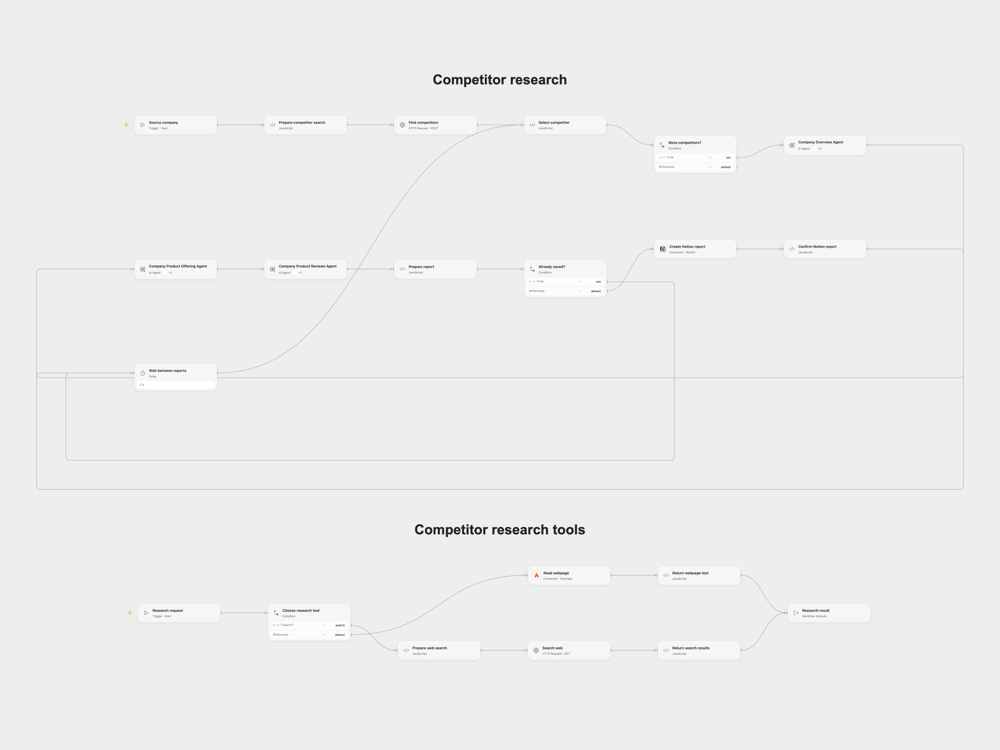

# Research Competitors into Notion

Find competitors and research their company, products and reviews in Notion.

<picture>
  <source media="(prefers-color-scheme: dark)" srcset="preview-dark.png">
  
</picture>

[Open Flow JSON](templates/research-competitors-into-notion.openflow.json) · [n8n JSON](templates/research-competitors-into-notion.n8n.json)

## Setup and use

Import **Competitor research** and **Competitor research tools**, publish the research tools workflow and refresh the tool interfaces. Configure EXA_API_KEY, SERPAPI_API_KEY, Firecrawl and Notion connections, a Notion parent page, persistent State and an available model. Run with the source company HTTPS URL. In n8n configure the Exa, SerpApi, Firecrawl, OpenAI and Notion credentials and a Notion database with a title property and rich-text properties Founded, Funding Status, Money Raised, Positive Reviews (%), Pros and Cons. Select a Data Table with item_key and status text columns for write checkpoints.

## Behavior

Exa searches for competitors, then three agents research company details, product offerings and customer reviews using web search and page text. The results are saved per company. Web pages and model output can be incomplete or inaccurate; review sources and reports before use. Inspect Notion before clearing a pending checkpoint after an uncertain write. Avoid overlapping runs.

<details>
<summary>Inspiration &amp; credits</summary>

Adapted from [Automate Competitor Research with Exa.ai, Notion and AI Agents](https://github.com/enescingoz/awesome-n8n-templates/blob/827110332c21cbe000ab13f6d292d5adb1f1f8db/Notion/Automate%20Competitor%20Research%20with%20Exa.ai%2C%20Notion%20and%20AI%20Agents.json) in [enescingoz/awesome-n8n-templates](https://github.com/enescingoz/awesome-n8n-templates).

Source collection notice: © 2024–2026 Enes Cingoz, [CC BY 4.0](https://github.com/enescingoz/awesome-n8n-templates/blob/827110332c21cbe000ab13f6d292d5adb1f1f8db/LICENSE). The source export does not identify a separate template author or license. See [repository licensing](../../README.md#licensing) for the scope of OOMOL contributions and third-party material.


Changes from source: Recover the complete JSON document before trailing repeated title text, replace deprecated Exa findSimilar with search, update Firecrawl and model, add write checkpoints and use a parent-page report in Open Flow.

Collection license notice:

```text
Creative Commons Attribution 4.0 International License

Copyright (c) 2024-2026 Enes Cingoz

You are free to:

  Share - copy and redistribute the material in any medium or format
  Adapt - remix, transform, and build upon the material for any purpose,
  even commercially.

Under the following terms:

  Attribution - You must give appropriate credit, provide a link to the
  license, and indicate if changes were made. You may do so in any
  reasonable manner, but not in any way that suggests the licensor
  endorses you or your use.

  No additional restrictions - You may not apply legal terms or
  technological measures that legally restrict others from doing
  anything the license permits.

Notices:

  You do not have to comply with the license for elements of the
  material in the public domain or where your use is permitted by an
  applicable exception or limitation.

  No warranties are given. The license may not give you all of the
  permissions necessary for your intended use. For example, other rights
  such as publicity, privacy, or moral rights may limit how you use the
  material.

For the full license text, see:
https://creativecommons.org/licenses/by/4.0/legalcode

```

</details>
