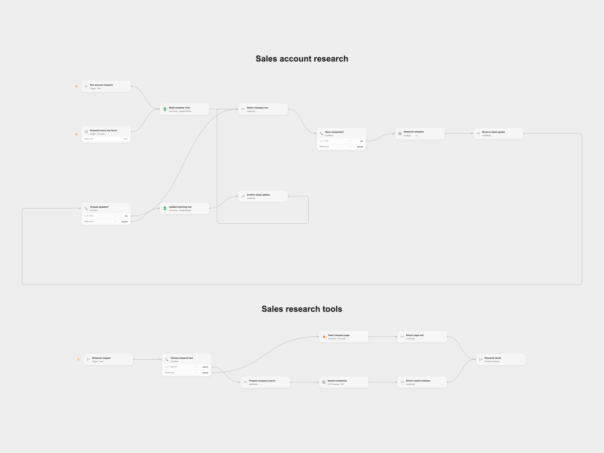

# Research Sales Accounts in Google Sheets

Research companies on the web and update their matching spreadsheet rows.

<!-- template-actions:start -->
[](https://openflow.run/templates/research-sales-accounts-in-sheets/) [](templates/research-sales-accounts-in-sheets.n8n.json)
<!-- template-actions:end -->

<picture>
  <source media="(prefers-color-scheme: dark)" srcset="preview-dark.png">
  
</picture>

## Setup and use

Import **Sales account research** and **Sales research tools**, publish the research tool and refresh the agent tools. Configure Google Sheets, Firecrawl, a tool-capable model and SERPAPI_API_KEY. Set the spreadsheet and worksheet and create columns input, enrichment_status, domain, linkedinUrl, market, cheapest_plan, has_entreprise_plan, has_API, has_free_trial, integrations and last_case_study_link. Enable persistent State and do not reorder rows or overlap runs while processing. Run manually or use the built-in two-hour UTC schedule. Inspect a pending row before retrying an uncertain write. Research results require human review.

<details>
<summary>In n8n</summary>

In n8n configure the same sheet, model, SerpAPI, website tool and a Data Table with item_key and status columns.

</details>

<details>
<summary>Inspiration &amp; credits</summary>

Adapted from [AI web researcher for sales](https://github.com/enescingoz/awesome-n8n-templates/blob/827110332c21cbe000ab13f6d292d5adb1f1f8db/OpenAI_and_LLMs/AI%20web%20researcher%20for%20sales.json) in [enescingoz/awesome-n8n-templates](https://github.com/enescingoz/awesome-n8n-templates).

Source collection notice: © 2024–2026 Enes Cingoz, [CC BY 4.0](https://github.com/enescingoz/awesome-n8n-templates/blob/827110332c21cbe000ab13f6d292d5adb1f1f8db/LICENSE). The source export does not identify a separate template author or license. See [repository licensing](../../README.md#licensing) for the scope of OOMOL contributions and third-party material.


Original workflow by lempire. Changes: use Firecrawl for page text, repair structured outputs and row association, and add update checkpoints.

Collection license notice:

```text
Creative Commons Attribution 4.0 International License

Copyright (c) 2024-2026 Enes Cingoz

You are free to:

  Share - copy and redistribute the material in any medium or format
  Adapt - remix, transform, and build upon the material for any purpose,
  even commercially.

Under the following terms:

  Attribution - You must give appropriate credit, provide a link to the
  license, and indicate if changes were made. You may do so in any
  reasonable manner, but not in any way that suggests the licensor
  endorses you or your use.

  No additional restrictions - You may not apply legal terms or
  technological measures that legally restrict others from doing
  anything the license permits.

Notices:

  You do not have to comply with the license for elements of the
  material in the public domain or where your use is permitted by an
  applicable exception or limitation.

  No warranties are given. The license may not give you all of the
  permissions necessary for your intended use. For example, other rights
  such as publicity, privacy, or moral rights may limit how you use the
  material.

For the full license text, see:
https://creativecommons.org/licenses/by/4.0/legalcode
```

</details>
