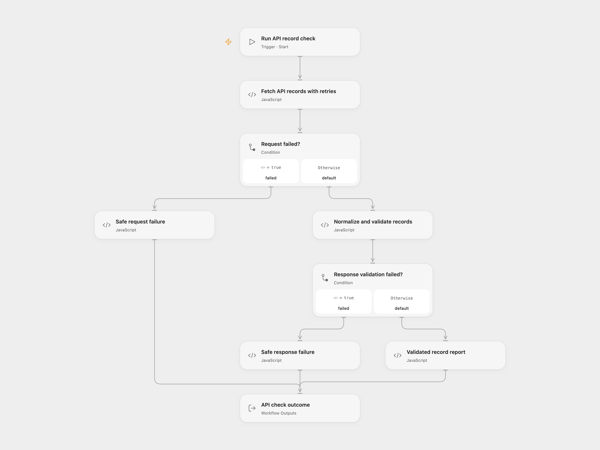

# Resilient API Record Validator

Read records from a public JSON endpoint, normalize names and emails, and identify missing fields. A handled request or response failure returns a short failure record.

<picture>
  <source media="(prefers-color-scheme: dark)" srcset="preview-dark.png">
  
</picture>

[Open Flow JSON](templates/resilient-api-record-validator.openflow.json) · [n8n JSON](templates/resilient-api-record-validator.n8n.json)

## Setup and use

The included [JSONPlaceholder users endpoint](https://jsonplaceholder.typicode.com/users) is a public demo and needs no account. Run the workflow manually. The required fields default to `id,name,email`.

In Open Flow, edit the URL in **Fetch API records with retries** and the comma-separated fields in **Normalize and validate records**. If you choose another public HTTPS API, update the read step's allowed HTTP host to match. In n8n, edit `request_url` and `required_fields` in **Set Demo Configuration**.

The workflow reads one response and does not paginate or write to a destination. To use an authenticated service, configure its platform connector and preserve that service's own request contract.

## Results

Open Flow returns `outcome`. A completed check has `status: "completed"` and a `records` array. In n8n, **Validated Records** emits one item per record. Each record has its original `source_index`, `record_id`, trimmed `name`, lowercase trimmed `email`, `validation_status`, `missing_fields`, and source `website` value as `source_domain`.

A required field is missing when it is absent from the record, null, or empty after string conversion and trimming. Zero and false count as supplied values. Missing fields mark individual records `invalid`; those records remain in the report. This is a presence check and basic normalization, without email or domain verification.

An empty array, unsupported response shape, or empty field configuration returns a failure record. Failed requests use `upstream_request_failed`; response and configuration failures have separate codes. Messages are fixed text and omit the raw request error, response body, URL, and credentials. Open Flow puts this record in `outcome`; n8n emits it through **Failure Record**.

## Requests and failures

Both formats make at most three GET attempts, with three seconds between failed attempts and a ten-second timeout for each attempt. This is three total attempts, including the first request. A successful request is not repeated to repair invalid records. Redirects are rejected. Open Flow's HTTP runtime limits each response to 1 MiB, and the complete read step has a 45-second execution budget. n8n uses its configured HTTP and execution limits.

Open Flow uses its public HTTP capability to apply the timeout separately to each attempt; a node timeout alone would include the entire retry sequence. Cancelling the Open Flow run stops requests or waiting without creating a successful failure report. A handled failure completes the workflow and returns a failure record for inspection. `retryable` is true for exhausted request attempts and false for response/configuration failures. No later rerun, notification, checkpoint, or synchronization write is configured.

Inspiration &amp; credits

## Changes to the source

- Preserve empty arrays as a full HTTP response so validation can report them instead of receiving no items.
- Check only fields actually present on each record and reject an empty required-field configuration.
- Return fixed failure messages instead of attempting to scrub arbitrary error text with credential patterns.
- Distinguish response/configuration failures from request failures, and make redirects and retry counts explicit.

Adapted from [Resilient REST API Sync with Retries, Validation, and Sanitized Errors](https://github.com/enescingoz/awesome-n8n-templates/blob/827110332c21cbe000ab13f6d292d5adb1f1f8db/Other_Integrations_and_Use_Cases/Resilient%20REST%20API%20Sync%20with%20Retries%2C%20Validation%2C%20and%20Sanitized%20Errors.json) in [enescingoz/awesome-n8n-templates](https://github.com/enescingoz/awesome-n8n-templates).

Source collection notice: © 2024–2026 Enes Cingoz, [CC BY 4.0](https://github.com/enescingoz/awesome-n8n-templates/blob/827110332c21cbe000ab13f6d292d5adb1f1f8db/LICENSE). The source export does not identify a separate template author or license. This adaptation includes the changes above; see [repository licensing](../../README.md#licensing) for OOMOL contributions and third-party material.

