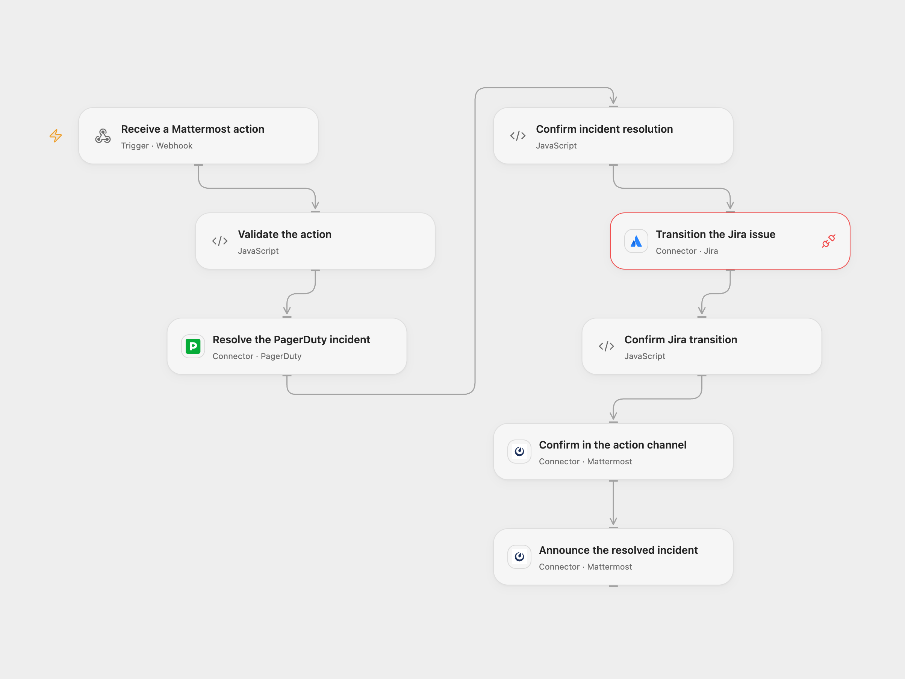

# Resolve PagerDuty and Jira from Mattermost

Resolve a PagerDuty incident and transition a Jira issue from a Mattermost action, then notify two channels.

<picture>
  <source media="(prefers-color-scheme: dark)" srcset="preview-dark.png">
  
</picture>

[Open Flow JSON](templates/resolve-pagerduty-and-jira-from-mattermost.openflow.json) · [n8n JSON](templates/resolve-pagerduty-and-jira-from-mattermost.n8n.json)

## Setup

Connect PagerDuty, Jira and Mattermost. The PagerDuty user must be allowed to resolve incidents. Jira needs permission to transition the issue and Provider API Request access; for Jira Cloud OAuth, grant the required write scope. In **Validate the action**, set the PagerDuty user email, the Jira transition ID that moves the issue to a closed or resolved status, and the announcement channel ID. Check the available transitions for the issue in Jira and select the ID of the transition whose destination is closed or resolved. The workflow checks that the ID is numeric but does not verify its destination; another transition can make the closure message inaccurate. The original transition ID and channel were account-specific.

Create a secret Variable named MATTERMOST_ACTION_SECRET with at least 24 unpredictable characters and bind it to **Validate the action**. Configure a Mattermost interactive message button using the webhook URL and context keys pagerduty_incident, jira_key and action_secret. Set action_secret to the same secret. Mattermost forwards the context and action channel ID. Restrict who can read the button integration context, webhook URL and workflow history. Use HTTPS and restrict network access where possible. Open Flow’s webhook body fields cover the Mattermost v11.11.1 button request; add any extra fields sent by your server to the webhook definition.

In n8n, connect all three services, set the email, transition ID and announcement channel in **Validate the action**, and make MATTERMOST_ACTION_SECRET available as an environment variable to the Code node. Self-hosted n8n may require enabling node environment access. Configure the button with that same secret and the n8n webhook URL. Enable one format.

## Behavior

A click immediately receives HTTP 200 with an empty JSON object. The workflow validates the shared secret, resolves the PagerDuty incident, transitions the Jira issue, posts confirmation in the action channel, and then announces the incident in the configured channel. The immediate receipt confirms receipt only; it does not mean the actions have completed.

Each step stops on error. PagerDuty may already be resolved when Jira fails; both may have changed when a post fails. A failed or uncertain write may have succeeded. Inspect PagerDuty, Jira and both channels before retrying. The shared secret is a bearer capability and does not identify individual users; repeated requests are not deduplicated.

Inspiration &amp; credits

## Changes to the source

- Replace account-specific email, transition ID and announcement channel with configuration; validate a shared action secret before writing.
- Return valid JSON to the Mattermost action immediately. Open Flow checks PagerDuty’s returned incident ID and status, uses the Jira Provider API to perform the transition, and checks its HTTP 204 response. The n8n Jira node also sends an issue update after transitioning, which can fail after the transition succeeds.

Adapted from [Resolve a PagerDuty incident and Jira issue from Mattermost](https://github.com/Zie619/n8n-workflows/blob/ae8cf6dc5b873cbb4f74587aa9180ed3a9f70682/workflows/Mattermost/0857_Mattermost_Webhook_Automate_Webhook.json) in [Zie619/n8n-workflows](https://github.com/Zie619/n8n-workflows). The source export does not identify a separate template author or license.

The collection’s [MIT notice](https://github.com/Zie619/n8n-workflows/blob/94007c1445d9258a7da116646b79473e7c7c3282/LICENSE) is pinned at a later revision. This is the collection notice at that revision; it does not establish a separate original template author's license. Our changes are listed above; see [repository licensing](../../README.md#licensing).

> MIT License
>
> Copyright (c) 2025 Zie619
>
> Permission is hereby granted, free of charge, to any person obtaining a copy
> of this software and associated documentation files (the "Software"), to deal
> in the Software without restriction, including without limitation the rights
> to use, copy, modify, merge, publish, distribute, sublicense, and/or sell
> copies of the Software, and to permit persons to whom the Software is
> furnished to do so, subject to the following conditions:
>
> The above copyright notice and this permission notice shall be included in all
> copies or substantial portions of the Software.
>
> THE SOFTWARE IS PROVIDED "AS IS", WITHOUT WARRANTY OF ANY KIND, EXPRESS OR
> IMPLIED, INCLUDING BUT NOT LIMITED TO THE WARRANTIES OF MERCHANTABILITY,
> FITNESS FOR A PARTICULAR PURPOSE AND NONINFRINGEMENT. IN NO EVENT SHALL THE
> AUTHORS OR COPYRIGHT HOLDERS BE LIABLE FOR ANY CLAIM, DAMAGES OR OTHER
> LIABILITY, WHETHER IN AN ACTION OF CONTRACT, TORT OR OTHERWISE, ARISING FROM,
> OUT OF OR IN CONNECTION WITH THE SOFTWARE OR THE USE OR OTHER DEALINGS IN THE
> SOFTWARE.

