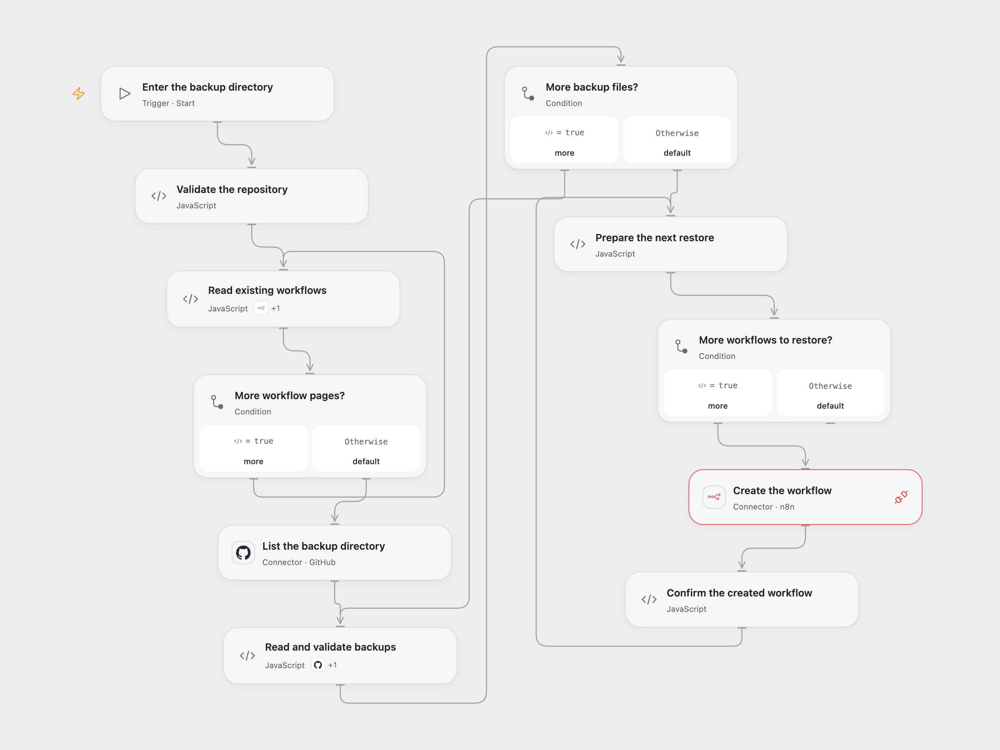

# Restore n8n Workflows from GitHub

Restore missing n8n workflows from JSON backups in a GitHub directory.

<picture>
  <source media="(prefers-color-scheme: dark)" srcset="preview-dark.png">
  
</picture>

[Open Flow JSON](templates/restore-n8n-workflows-from-github.openflow.json) · [n8n JSON](templates/restore-n8n-workflows-from-github.n8n.json)

## Setup

Connect GitHub with read access to the repository and n8n with workflow read/create permissions. In Open Flow, permit the n8n Provider API Request and run with the repository owner, name and existing directory path (without leading or trailing slash). In n8n, configure the same repository in **Configure the backup directory** and connect GitHub and n8n. Run one format.

## Behavior

The workflow reads the current n8n workflows and JSON files in the specified GitHub directory. It creates a workflow for each backup whose workflow name is not already present. Backups must be valid workflow JSON objects with unique names, and the directory must contain only such files; directories with 1,000 or more entries stop because GitHub's directory listing can be incomplete. Review the restored workflows and reconnect credentials before enabling them. Backups can contain sensitive workflow data; use a private repository and appropriate access controls.

Earlier creates remain if a later create fails. A lost response may mean a workflow was created; inspect n8n before rerunning. Other users creating workflows concurrently may still cause duplicate names. No writes are automatically retried.

## Changes to the source

- Compare the workflow name inside each backup with existing names, rather than assuming the filename is the workflow name; reject duplicate backup names.
- Replace repository defaults, validate backups and keep only fields accepted by the n8n create API. Open Flow uses the n8n Provider API Request because the catalog has no create-workflow Action.

Source and license

Adapted from [Restore Backups](https://github.com/Zie619/n8n-workflows/blob/ae8cf6dc5b873cbb4f74587aa9180ed3a9f70682/workflows/Github/1988_GitHub_Manual_Automate_Triggered.json) in [Zie619/n8n-workflows](https://github.com/Zie619/n8n-workflows). The matching [n8n community listing](https://n8n.io/workflows/2289-restore-backed-up-workflows-from-github-to-n8n/) credits Agent Studio. The original template does not state a separate license.

The collection’s [MIT notice](https://github.com/Zie619/n8n-workflows/blob/94007c1445d9258a7da116646b79473e7c7c3282/LICENSE) is pinned at a later revision. This is the collection notice at that revision; it does not establish a separate original template author's license. Our changes are listed above; see [repository licensing](../../README.md#licensing).

> MIT License
>
> Copyright (c) 2025 Zie619
>
> Permission is hereby granted, free of charge, to any person obtaining a copy
> of this software and associated documentation files (the "Software"), to deal
> in the Software without restriction, including without limitation the rights
> to use, copy, modify, merge, publish, distribute, sublicense, and/or sell
> copies of the Software, and to permit persons to whom the Software is
> furnished to do so, subject to the following conditions:
>
> The above copyright notice and this permission notice shall be included in all
> copies or substantial portions of the Software.
>
> THE SOFTWARE IS PROVIDED "AS IS", WITHOUT WARRANTY OF ANY KIND, EXPRESS OR
> IMPLIED, INCLUDING BUT NOT LIMITED TO THE WARRANTIES OF MERCHANTABILITY,
> FITNESS FOR A PARTICULAR PURPOSE AND NONINFRINGEMENT. IN NO EVENT SHALL THE
> AUTHORS OR COPYRIGHT HOLDERS BE LIABLE FOR ANY CLAIM, DAMAGES OR OTHER
> LIABILITY, WHETHER IN AN ACTION OF CONTRACT, TORT OR OTHERWISE, ARISING FROM,
> OUT OF OR IN CONNECTION WITH THE SOFTWARE OR THE USE OR OTHER DEALINGS IN THE
> SOFTWARE.

