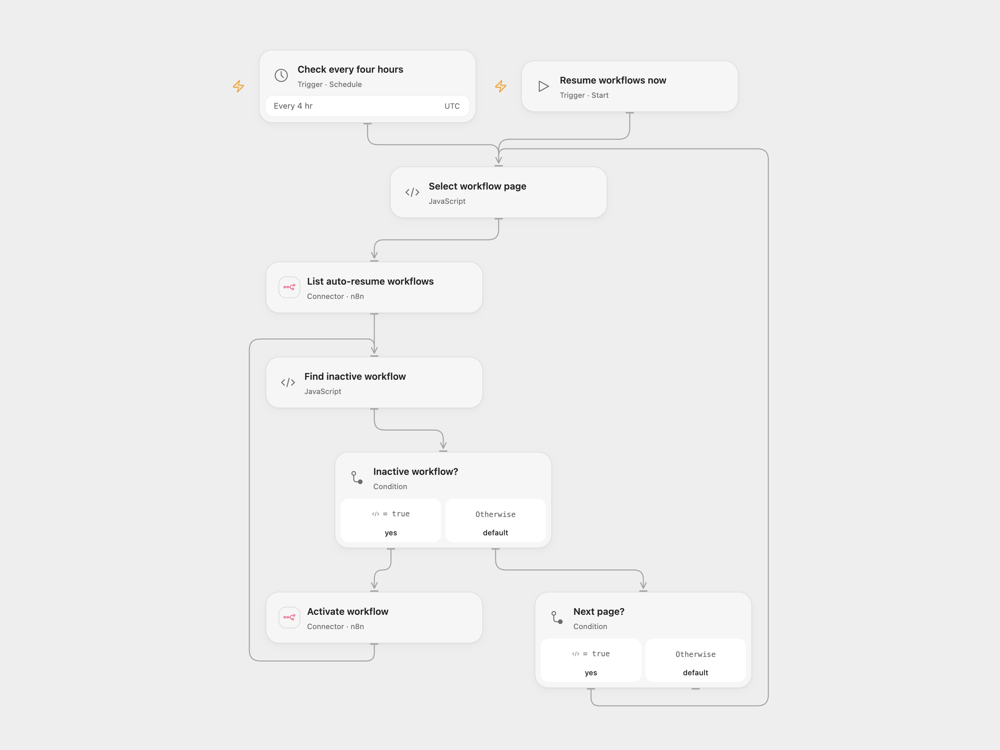

# Resume Tagged n8n Workflows Every Four Hours

Reactivate inactive n8n workflows tagged auto_resume:true.

<picture>
  <source media="(prefers-color-scheme: dark)" srcset="preview-dark.png">
  
</picture>

[Open Flow JSON](templates/resume-tagged-n8n-workflows-every-four-hours.openflow.json) · [n8n JSON](templates/resume-tagged-n8n-workflows-every-four-hours.n8n.json)

## Setup and use

Connect n8n with an API key allowed to list and activate workflows. Add the exact tag auto_resume:true to workflows you want this automation to manage. Run manually or enable the four-hour schedule; Open Flow uses UTC. Configure the n8n credential in the n8n format and use one format.

## Behavior

Each run lists all pages of workflows with the tag and activates those reported inactive. Activation can start their triggers and real downstream actions. After an uncertain activation, inspect the workflow; a later scheduled run checks its active state again.

Inspiration &amp; credits

## Changes to the source

- Open Flow follows the n8n cursor and uses a UTC four-hour schedule.

Adapted from [Automatically resume tagged n8n workflows](https://github.com/Zie619/n8n-workflows/blob/ae8cf6dc5b873cbb4f74587aa9180ed3a9f70682/workflows/Manual/1901_Manual_Filter_Automate_Scheduled.json) in [Zie619/n8n-workflows](https://github.com/Zie619/n8n-workflows). The source export does not identify a separate template author or license.

The collection’s [MIT notice](https://github.com/Zie619/n8n-workflows/blob/94007c1445d9258a7da116646b79473e7c7c3282/LICENSE) is pinned at a later revision. This is the collection notice at that revision; it does not establish a separate original template author's license. Our changes are listed above; see [repository licensing](../../README.md#licensing).

> MIT License
>
> Copyright (c) 2025 Zie619
>
> Permission is hereby granted, free of charge, to any person obtaining a copy
> of this software and associated documentation files (the "Software"), to deal
> in the Software without restriction, including without limitation the rights
> to use, copy, modify, merge, publish, distribute, sublicense, and/or sell
> copies of the Software, and to permit persons to whom the Software is
> furnished to do so, subject to the following conditions:
>
> The above copyright notice and this permission notice shall be included in all
> copies or substantial portions of the Software.
>
> THE SOFTWARE IS PROVIDED "AS IS", WITHOUT WARRANTY OF ANY KIND, EXPRESS OR
> IMPLIED, INCLUDING BUT NOT LIMITED TO THE WARRANTIES OF MERCHANTABILITY,
> FITNESS FOR A PARTICULAR PURPOSE AND NONINFRINGEMENT. IN NO EVENT SHALL THE
> AUTHORS OR COPYRIGHT HOLDERS BE LIABLE FOR ANY CLAIM, DAMAGES OR OTHER
> LIABILITY, WHETHER IN AN ACTION OF CONTRACT, TORT OR OTHERWISE, ARISING FROM,
> OUT OF OR IN CONNECTION WITH THE SOFTWARE OR THE USE OR OTHER DEALINGS IN THE
> SOFTWARE.

