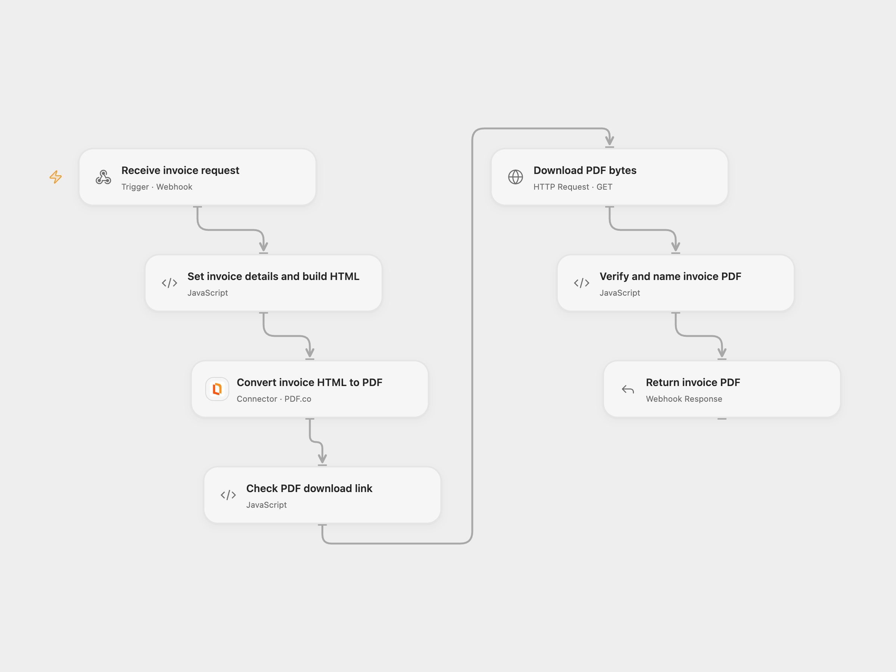

# Return an Invoice PDF from a Webhook

Generate an invoice from configured line items and return the PDF in the HTTP response.

<!-- template-actions:start -->
 
<!-- template-actions:end -->

<picture>
  <source media="(prefers-color-scheme: dark)" srcset="preview-dark.png">
  
</picture>

## Setup

1. Connect PDF.co in **Convert invoice HTML to PDF**.
2. Edit the invoice number, billing and sender addresses, contact email, and line items in **Set invoice details and build HTML**. Prices are in US dollars. Use whole-number quantities.
3. Deploy the workflow and send a GET request to the production webhook URL. A browser can download the invoice directly.

## Behavior

The workflow calculates each line total and the invoice total from the configured prices and quantities. The GET request uses the invoice details stored in the workflow.

PDF.co renders the HTML. The workflow downloads and checks the PDF before returning HTTP 200 with `Content-Type: application/pdf` and the filename `output.pdf`. A conversion or download error fails the request. The webhook waits up to 60 seconds for the response.

In n8n

Install `@custom-js/n8n-nodes-pdf-toolkit` on a self-hosted instance and connect a CustomJS API credential in **HTML to PDF**. The verified package version is `1.58.0`. Edit the invoice data in **Set invoice details and build HTML**, activate the workflow, and use **Webhook**'s production GET URL to download `output.pdf`.

Inspiration &amp; credits

## Changes to the source

- Use PDF.co for the Open Flow conversion and return a checked PDF artifact in the same HTTP request.
- Use fictional invoice data, escape user-editable text in HTML, and calculate prices to the cent.
- The [original n8n listing](https://n8n.io/workflows/3333-generate-pdf-invoices-with-customjs-api/) credits CustomJS.

Adapted from [Generate PDF invoices with CustomJS API](https://github.com/Zie619/n8n-workflows/blob/ae8cf6dc5b873cbb4f74587aa9180ed3a9f70682/workflows/Webhook/0813_Webhook_Respondtowebhook_Process_Webhook.json) in [Zie619/n8n-workflows](https://github.com/Zie619/n8n-workflows). Attribution: CustomJS (original workflow); Zie619 / n8n-workflows (collection).

The collection’s [MIT notice](https://github.com/Zie619/n8n-workflows/blob/94007c1445d9258a7da116646b79473e7c7c3282/LICENSE) is pinned at a later revision. This is the collection notice at that revision; it does not establish a separate original template author's license. Our changes are listed above; see [repository licensing](../../README.md#licensing).

> MIT License
>
> Copyright (c) 2025 Zie619
>
> Permission is hereby granted, free of charge, to any person obtaining a copy
> of this software and associated documentation files (the "Software"), to deal
> in the Software without restriction, including without limitation the rights
> to use, copy, modify, merge, publish, distribute, sublicense, and/or sell
> copies of the Software, and to permit persons to whom the Software is
> furnished to do so, subject to the following conditions:
>
> The above copyright notice and this permission notice shall be included in all
> copies or substantial portions of the Software.
>
> THE SOFTWARE IS PROVIDED "AS IS", WITHOUT WARRANTY OF ANY KIND, EXPRESS OR
> IMPLIED, INCLUDING BUT NOT LIMITED TO THE WARRANTIES OF MERCHANTABILITY,
> FITNESS FOR A PARTICULAR PURPOSE AND NONINFRINGEMENT. IN NO EVENT SHALL THE
> AUTHORS OR COPYRIGHT HOLDERS BE LIABLE FOR ANY CLAIM, DAMAGES OR OTHER
> LIABILITY, WHETHER IN AN ACTION OF CONTRACT, TORT OR OTHERWISE, ARISING FROM,
> OUT OF OR IN CONNECTION WITH THE SOFTWARE OR THE USE OR OTHER DEALINGS IN THE
> SOFTWARE.

