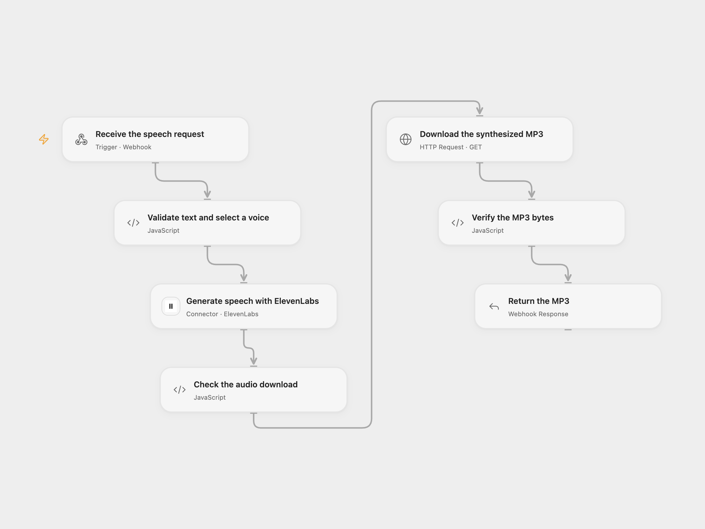

# Return Speech as an MP3 from a Webhook

Send text to a webhook and get an AI-generated ElevenLabs MP3 in the same HTTP response.

<!-- template-actions:start -->
 
<!-- template-actions:end -->

<picture>
  <source media="(prefers-color-scheme: dark)" srcset="preview-dark.png">
  
</picture>

## Setup

1. Connect ElevenLabs in **Generate speech with ElevenLabs**. Add **Eldrin – Crisp British Baritone** to your ElevenLabs voice library. To use another voice from your library, paste its ID in **Validate text and select a voice**. [ElevenLabs voice library](https://elevenlabs.io/docs/overview/capabilities/voices)
2. In **Receive the speech request**, set **Header** authentication with header name `X-Speech-Webhook-Key` and bind a secret Variable. Publish with **Enable Calls** off and check that a request without the key returns HTTP 401. Turn **Enable Calls** on in **Validate text and select a voice** and publish again.
3. Send a POST with the webhook key header, `Content-Type: application/json`, and a body such as `{"text_to_convert":"Your table is ready."}`.

## Behavior

Send up to 4,096 characters of text. The request waits up to 60 seconds and returns HTTP 200 with an `audio/mpeg` body and the download name `speech.mp3`. The MP3 may be up to 8 MiB. Invalid input or a failed synthesis or download returns an error. The workflow sends the text to ElevenLabs. Tell listeners that the resulting voice is AI-generated.

In n8n

Bind a **Header Auth** credential named `X-Speech-Webhook-Key` to **Receive the speech request**. In **Generate speech with ElevenLabs**, attach a separate **Header Auth** credential with the name `xi-api-key` and your ElevenLabs API key as its value. Edit the voice ID in **Validate text and select a voice** if needed. Activate the workflow and call the production POST URL with the same JSON body and webhook header. The ElevenLabs request times out after 55 seconds.

Inspiration &amp; credits

Adapted from [Generate audio from text using OpenAI and Webhook](https://github.com/enescingoz/awesome-n8n-templates/blob/827110332c21cbe000ab13f6d292d5adb1f1f8db/OpenAI_and_LLMs/Generate%20audio%20from%20text%20using%20OpenAI%20and%20Webhook%20_%20Text%20to%20Speech%20Workflow.json) in [enescingoz/awesome-n8n-templates](https://github.com/enescingoz/awesome-n8n-templates).

Source collection notice: © 2024–2026 Enes Cingoz, [CC BY 4.0](https://github.com/enescingoz/awesome-n8n-templates/blob/827110332c21cbe000ab13f6d292d5adb1f1f8db/LICENSE). The [original n8n template](https://n8n.io/workflows/2386-generate-audio-from-text-using-openai-and-webhook-or-text-to-speech-workflow/) credits Ayoub. See [repository licensing](../../README.md#licensing) for the scope of OOMOL contributions and third-party material.

## Changes to the source

ElevenLabs Multilingual v2 and the Eldrin voice replace OpenAI TTS-1 and Fable. OpenAI has scheduled TTS-1 for retirement on January 6, 2027. The webhook still returns MP3 audio in the same request. [OpenAI model deprecations](https://developers.openai.com/api/docs/deprecations)

