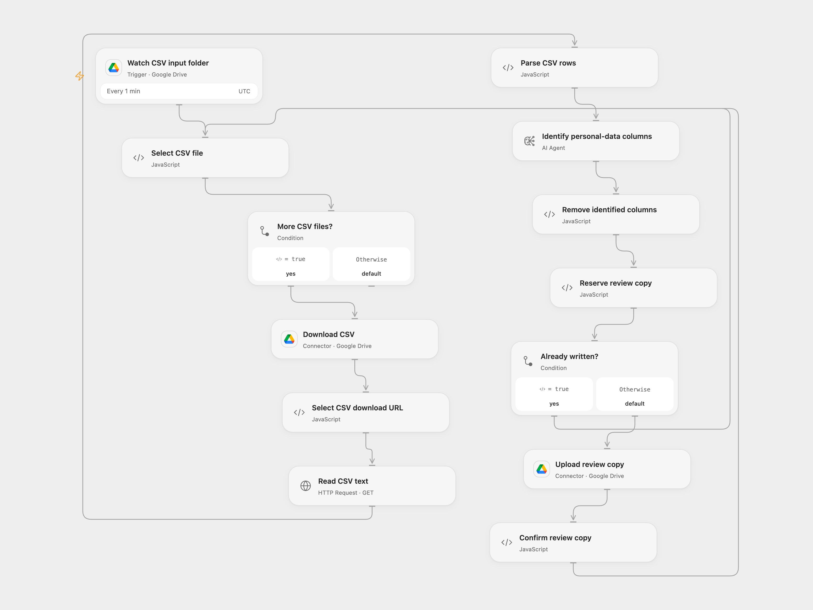

# Review and Remove CSV Personal Columns

Identify likely personal-data columns in new CSV files and write a review copy without those columns.

<picture>
  <source media="(prefers-color-scheme: dark)" srcset="preview-dark.png">
  
</picture>

[Open Flow JSON](templates/review-and-remove-csv-personal-columns.openflow.json) · [n8n JSON](templates/review-and-remove-csv-personal-columns.n8n.json)

## Setup and use

Connect Google Drive and a model. Set separate input and output folders and enable persistent State. In n8n configure the same folders, model and a Data Table with item_key and status columns. Use one format at a time and avoid overlapping runs.

For each new CSV, the workflow sends the headers and first two rows to the configured model, removes the columns it identifies and uploads a review copy. It preserves all rows in the remaining columns. **Review the result before sharing:** model identification can miss personal information, including information in later rows or unexpected columns. The first two rows are sent to the model provider. Open Flow intermediate data is subject to its 4 MiB execution limit; larger files need another processing method. If an upload has an uncertain result, inspect the output folder before clearing its pending checkpoint.

<details>
<summary>Inspiration &amp; credits</summary>

Adapted from [Remove Personally Identifiable Information (PII) from CSV Files with OpenAI](https://github.com/enescingoz/awesome-n8n-templates/blob/827110332c21cbe000ab13f6d292d5adb1f1f8db/PDF_and_Document_Processing/Remove%20Personally%20Identifiable%20Information%20(PII)%20from%20CSV%20Files%20with%20OpenAI.json) in [enescingoz/awesome-n8n-templates](https://github.com/enescingoz/awesome-n8n-templates).

Source collection notice: © 2024–2026 Enes Cingoz, [CC BY 4.0](https://github.com/enescingoz/awesome-n8n-templates/blob/827110332c21cbe000ab13f6d292d5adb1f1f8db/LICENSE). The source export does not identify a separate template author or license. See [repository licensing](../../README.md#licensing) for the scope of OOMOL contributions and third-party material.


Changes: process each file independently, preserve all data rows and CSV quoting, validate model-selected headers and guard uncertain uploads.

```text
Creative Commons Attribution 4.0 International License

Copyright (c) 2024-2026 Enes Cingoz

You are free to:

  Share - copy and redistribute the material in any medium or format
  Adapt - remix, transform, and build upon the material for any purpose,
  even commercially.

Under the following terms:

  Attribution - You must give appropriate credit, provide a link to the
  license, and indicate if changes were made. You may do so in any
  reasonable manner, but not in any way that suggests the licensor
  endorses you or your use.

  No additional restrictions - You may not apply legal terms or
  technological measures that legally restrict others from doing
  anything the license permits.

Notices:

  You do not have to comply with the license for elements of the
  material in the public domain or where your use is permitted by an
  applicable exception or limitation.

  No warranties are given. The license may not give you all of the
  permissions necessary for your intended use. For example, other rights
  such as publicity, privacy, or moral rights may limit how you use the
  material.

For the full license text, see:
https://creativecommons.org/licenses/by/4.0/legalcode
```

</details>
