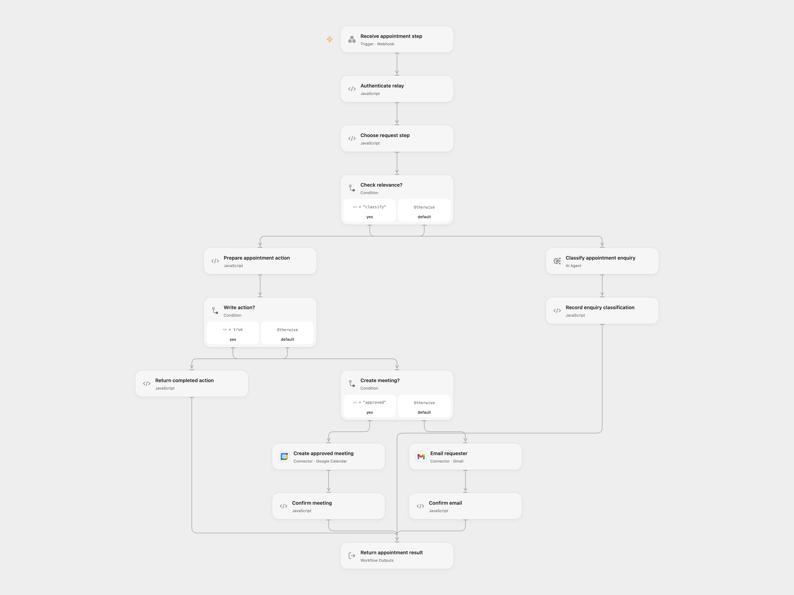

# Review Form Appointment Requests with Google Calendar

Qualify appointment requests, obtain a human decision and create a calendar meeting or send a rejection.

<picture>
  <source media="(prefers-color-scheme: dark)" srcset="preview-dark.png">
  
</picture>

[Open Flow JSON](templates/review-form-appointment-requests-with-calendar.openflow.json) · [n8n JSON](templates/review-form-appointment-requests-with-calendar.n8n.json)

## Setup

Import the n8n form and approval workflow, configure Gmail and the model, administrator address, calendar, workflow timezone, form terms and decline-page contact address. Select the same Data Table with item_key and status text columns in every checkpoint node. Use direct mode for n8n or set **Choose processing mode** to relay for Open Flow. Connect Gmail, Google Calendar and an AI model in Open Flow; set the calendar ID in **Prepare appointment action** and enable persistent State. Configure the n8n relay with the Open Flow webhook URL and HTTP Basic Auth, and bind the full matching Authorization header as secret Variable APPOINTMENT_RELAY_AUTH. Prevent overlapping executions for the same submission.

## Behavior

The form accepts a name, email and enquiry. Relevant enquiries proceed to terms and a choice of weekday and time. A receipt acknowledges the request; an administrator approves or declines it by email. Approval creates a 30-minute event with Google Meet and the requester as an attendee. Decline sends a rejection email. The classifier and summary can be wrong; the administrator makes the final decision. Request data is sent to the model and stored in execution history.

If a write outcome is unknown, inspect Gmail or Calendar before retrying. Enter the pending key and confirmed if the action happened or absent if it did not in **Prepare appointment action**, replay the same request, then clear those fields. In n8n inspect each pending Data Table row and the corresponding Gmail message or Calendar event. Mark it done if the action happened, or delete it only if absent. An approval email remains pending while awaiting the administrator; never clear it while its response is outstanding. If that waiting execution is lost after delivery, obtain the administrator’s decision separately and complete the calendar event or rejection manually before marking its checkpoint done.

Inspiration &amp; credits

Retain the form and human approval in n8n and use the approved decision to trigger the matching Open Flow action. Include the year and timezone in selected dates and correct the meeting duration to 30 minutes.

Adapted from [Appointment request with AI qualification and human approval](https://github.com/Zie619/n8n-workflows/blob/ae8cf6dc5b873cbb4f74587aa9180ed3a9f70682/workflows/Googlecalendar/1620_GoogleCalendar_Form_Automation_Triggered.json) in [Zie619/n8n-workflows](https://github.com/Zie619/n8n-workflows). The source export does not identify a separate template author or license.

The collection’s [MIT notice](https://github.com/Zie619/n8n-workflows/blob/94007c1445d9258a7da116646b79473e7c7c3282/LICENSE) is pinned at a later revision. This is the collection notice at that revision; it does not establish a separate original template author's license. Our changes are listed above; see [repository licensing](../../README.md#licensing).

> MIT License
>
> Copyright (c) 2025 Zie619
>
> Permission is hereby granted, free of charge, to any person obtaining a copy
> of this software and associated documentation files (the "Software"), to deal
> in the Software without restriction, including without limitation the rights
> to use, copy, modify, merge, publish, distribute, sublicense, and/or sell
> copies of the Software, and to permit persons to whom the Software is
> furnished to do so, subject to the following conditions:
>
> The above copyright notice and this permission notice shall be included in all
> copies or substantial portions of the Software.
>
> THE SOFTWARE IS PROVIDED "AS IS", WITHOUT WARRANTY OF ANY KIND, EXPRESS OR
> IMPLIED, INCLUDING BUT NOT LIMITED TO THE WARRANTIES OF MERCHANTABILITY,
> FITNESS FOR A PARTICULAR PURPOSE AND NONINFRINGEMENT. IN NO EVENT SHALL THE
> AUTHORS OR COPYRIGHT HOLDERS BE LIABLE FOR ANY CLAIM, DAMAGES OR OTHER
> LIABILITY, WHETHER IN AN ACTION OF CONTRACT, TORT OR OTHERWISE, ARISING FROM,
> OUT OF OR IN CONNECTION WITH THE SOFTWARE OR THE USE OR OTHER DEALINGS IN THE
> SOFTWARE.

