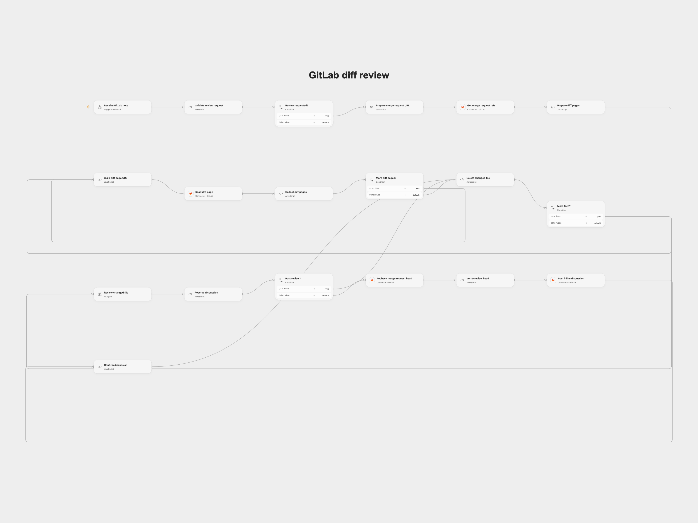

# Review GitLab Merge Request Diffs

Review changed merge request files when a GitLab note requests a review.

<!-- template-actions:start -->
[](https://openflow.run/templates/review-gitlab-merge-request-diffs/) [](templates/review-gitlab-merge-request-diffs.n8n.json)
<!-- template-actions:end -->

<picture>
  <source media="(prefers-color-scheme: dark)" srcset="preview-dark.png">
  
</picture>

## Setup and use

Import **GitLab diff review**, publish it and refresh its interface after changes. Configure a GitLab project note-event webhook, and restrict it with an authenticated gateway or private network. Configure a GitLab API token, AI model and persistent State. Connect GitLab in Open Flow. In n8n configure the GitLab HTTP Header Auth credential and Data Table with item_key and status columns. Send a note containing exactly +0 on a merge request.

The workflow reads all diff pages and posts actionable review comments as inline discussions. Renamed and deleted files are skipped as in the source; omitted or truncated diff responses stop processing. It checks the merge request head again before posting. After an uncertain discussion creation, inspect GitLab before clearing the pending checkpoint. Avoid overlapping runs for the same note. Diff content is sent to the model; review its findings.

<details>
<summary>Inspiration &amp; credits</summary>

Adapted from [ChatGPT Automatic Code Review in Gitlab MR](https://github.com/enescingoz/awesome-n8n-templates/blob/827110332c21cbe000ab13f6d292d5adb1f1f8db/Other_Integrations_and_Use_Cases/ChatGPT%20Automatic%20Code%20Review%20in%20Gitlab%20MR.json) in [enescingoz/awesome-n8n-templates](https://github.com/enescingoz/awesome-n8n-templates).

Source collection notice: © 2024–2026 Enes Cingoz, [CC BY 4.0](https://github.com/enescingoz/awesome-n8n-templates/blob/827110332c21cbe000ab13f6d292d5adb1f1f8db/LICENSE). The source export does not identify a separate template author or license. See [repository licensing](../../README.md#licensing) for the scope of OOMOL contributions and third-party material.


Changes: use the paginated diffs API, anchor changed lines, remove scores, check the head and guard uncertain posts.

Collection license notice:

```text
Creative Commons Attribution 4.0 International License

Copyright (c) 2024-2026 Enes Cingoz

You are free to:

  Share - copy and redistribute the material in any medium or format
  Adapt - remix, transform, and build upon the material for any purpose,
  even commercially.

Under the following terms:

  Attribution - You must give appropriate credit, provide a link to the
  license, and indicate if changes were made. You may do so in any
  reasonable manner, but not in any way that suggests the licensor
  endorses you or your use.

  No additional restrictions - You may not apply legal terms or
  technological measures that legally restrict others from doing
  anything the license permits.

Notices:

  You do not have to comply with the license for elements of the
  material in the public domain or where your use is permitted by an
  applicable exception or limitation.

  No warranties are given. The license may not give you all of the
  permissions necessary for your intended use. For example, other rights
  such as publicity, privacy, or moral rights may limit how you use the
  material.

For the full license text, see:
https://creativecommons.org/licenses/by/4.0/legalcode
```

</details>
