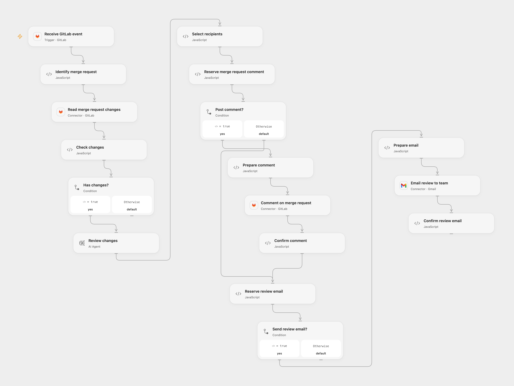

# Review GitLab Merge Requests and Notify

Review GitLab merge request changes and send the findings to the merge request and team.

<!-- template-actions:start -->
 
<!-- template-actions:end -->

<picture>
  <source media="(prefers-color-scheme: dark)" srcset="preview-dark.png">
  
</picture>

## Setup

Connect GitLab, an AI model and Gmail. Use one mode and restrict access to the relay webhook. Enable TLS verification on the registered GitLab webhook. Protect execution history, which may contain the GitLab webhook token, source code and report.

## Behavior

A merge request event fetches its changes. Empty changes produce no report. The AI report includes risks, recommendations, issues, a diff table and QA test cases. It is sent to the merge request and configured team, including the last commit author when supplied. Review the analysis before acting; the model does not execute tests. Source code is sent to the model. The changes and each Code input/output must fit 1 MiB. Open Flow checkpoints by project, merge request, commit and operation; repeated events for the same commit are not re-posted.

If a comment or email outcome is unknown, inspect GitLab or Gmail. In the corresponding Open Flow reserve node, enter the pending key and confirmed or absent, replay the event and clear both fields. Prevent overlapping runs for the same merge request.

In n8n

Import n8n and connect GitLab, an AI model and Gmail. Set the GitLab project and team recipients, then choose a Data Table with item_key and status text columns. For Open Flow, choose relay mode in n8n, set its deployed webhook URL, connect GitLab and Gmail, select an AI model, configure project-specific and global recipients in **Select recipients**, and enable persistent State. In n8n mark the pending Data Table row done only after confirmation, or delete it only after confirming no write.

Inspiration &amp; credits

Remove the duplicated trigger merge, configure recipients and checkpoint both writes.

Adapted from [CodeSnape GitLab merge request review](https://github.com/Zie619/n8n-workflows/blob/ae8cf6dc5b873cbb4f74587aa9180ed3a9f70682/workflows/Gitlab/1895_Gitlab_Code_Automation_Webhook.json) in [Zie619/n8n-workflows](https://github.com/Zie619/n8n-workflows). The source export does not identify a separate template author or license.

The collection’s [MIT notice](https://github.com/Zie619/n8n-workflows/blob/94007c1445d9258a7da116646b79473e7c7c3282/LICENSE) is pinned at a later revision. This is the collection notice at that revision; it does not establish a separate original template author's license. Our changes are listed above; see [repository licensing](../../README.md#licensing).

> MIT License
>
> Copyright (c) 2025 Zie619
>
> Permission is hereby granted, free of charge, to any person obtaining a copy
> of this software and associated documentation files (the "Software"), to deal
> in the Software without restriction, including without limitation the rights
> to use, copy, modify, merge, publish, distribute, sublicense, and/or sell
> copies of the Software, and to permit persons to whom the Software is
> furnished to do so, subject to the following conditions:
>
> The above copyright notice and this permission notice shall be included in all
> copies or substantial portions of the Software.
>
> THE SOFTWARE IS PROVIDED "AS IS", WITHOUT WARRANTY OF ANY KIND, EXPRESS OR
> IMPLIED, INCLUDING BUT NOT LIMITED TO THE WARRANTIES OF MERCHANTABILITY,
> FITNESS FOR A PARTICULAR PURPOSE AND NONINFRINGEMENT. IN NO EVENT SHALL THE
> AUTHORS OR COPYRIGHT HOLDERS BE LIABLE FOR ANY CLAIM, DAMAGES OR OTHER
> LIABILITY, WHETHER IN AN ACTION OF CONTRACT, TORT OR OTHERWISE, ARISING FROM,
> OUT OF OR IN CONNECTION WITH THE SOFTWARE OR THE USE OR OTHER DEALINGS IN THE
> SOFTWARE.

