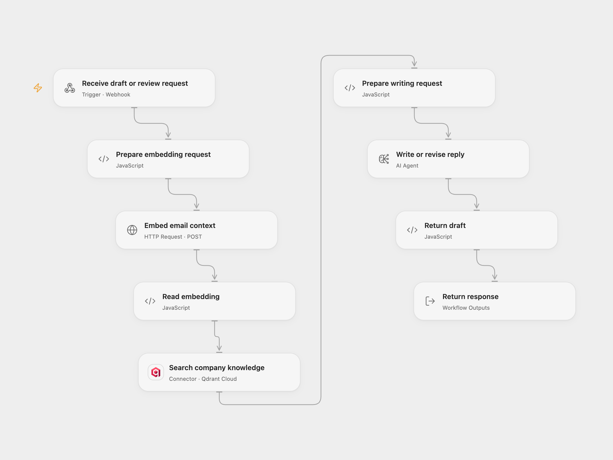

# Review Knowledge-Grounded Email Replies

Draft knowledge-grounded email replies and revise them with human feedback before sending.

<picture>
  <source media="(prefers-color-scheme: dark)" srcset="preview-dark.png">
  
</picture>

[Open Flow JSON](templates/review-knowledge-grounded-email-replies.openflow.json) · [n8n JSON](templates/review-knowledge-grounded-email-replies.n8n.json)

## Setup and use

Import the supplied n8n workflow and configure IMAP, SMTP, Gmail approval, OpenAI, DeepSeek, Google Drive and Qdrant credentials. Set the reviewer address in **Gmail**, the Drive folder and collection. Set the collection URLs in **Create collection**, **Check collection exists**, and **Refresh collection**, and configure their Header Auth credentials with the api-key header. Run **Create collection once** for a new collection, then **Refresh knowledge base** to clear and rebuild it from the folder. These operations affect the entire collection; dedicate it to this workflow.

For Open Flow mode set **Open Flow mode** to true and set the deployed webhook URL in both forwarding nodes. Bind OPENAI_API_KEY as a secret, connect a Qdrant Cloud cluster (official cloud.qdrant.io hostname with a public IPv4 address), set the same collection and configure the model. For n8n-only mode leave the mode false. Activate one mode. The supplied n8n workflow continues to run the IMAP input, knowledge base refresh, human approval and SMTP send in both modes.

## Behavior

Incoming HTML email is converted to Markdown and summarized. The workflow searches the company knowledge base and drafts a concise response. The reviewer can approve it or supply feedback; feedback produces another draft and another review cycle. Approval sends the latest draft by SMTP to the original sender. The approval process can wait independently for each email. Data is shared with configured models and services. The Open Flow webhook does not authenticate callers; restrict access.

Refresh deletes all points before reindexing; a failure can leave the collection empty or partial. Do not run overlapping refreshes or process email during refresh. A lost SMTP response may represent a completed send; inspect the mailbox before retrying.

Inspiration &amp; credits

## Changes to the source

- Add Open Flow relay mode for Qdrant retrieval and drafting; retain the n8n input, review loop and SMTP send. Fix the summarizer's text input and separate collection creation from refresh with an existence check before deletion.

Adapted from [Effortless Email Management with AI-Powered Summarization & Review](https://github.com/enescingoz/awesome-n8n-templates/blob/827110332c21cbe000ab13f6d292d5adb1f1f8db/Gmail_and_Email_Automation/Effortless%20Email%20Management%20with%20AI-Powered%20Summarization%20%26%20Review.json) in [enescingoz/awesome-n8n-templates](https://github.com/enescingoz/awesome-n8n-templates).

Source collection notice: © 2024–2026 Enes Cingoz, [CC BY 4.0](https://github.com/enescingoz/awesome-n8n-templates/blob/827110332c21cbe000ab13f6d292d5adb1f1f8db/LICENSE). The source export does not identify a separate template author or license. See [repository licensing](../../README.md#licensing) for the scope of OOMOL contributions and third-party material.

