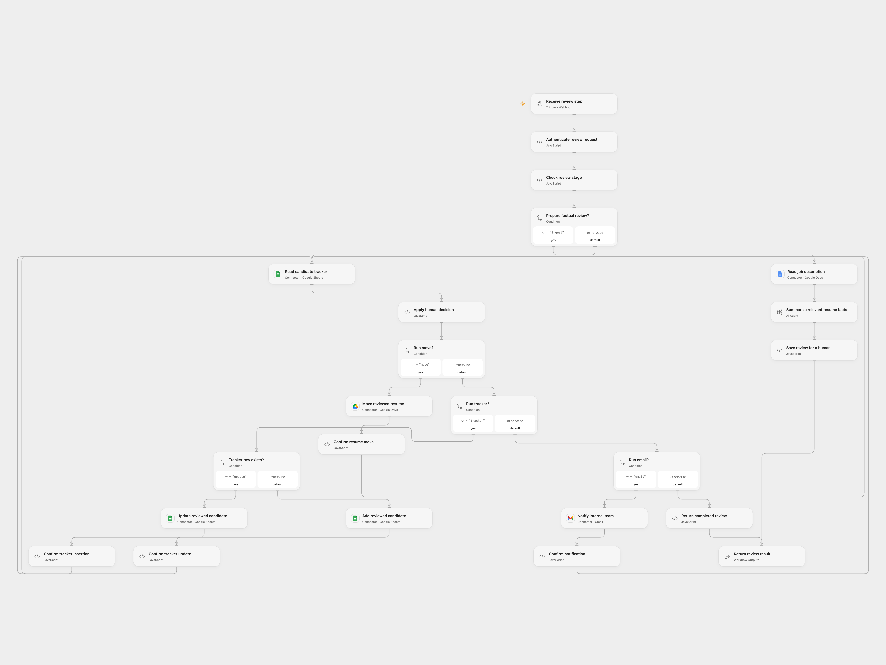

# Review Resumes Before Hiring Decisions

Prepare factual resume summaries and let a human decide how each application is handled.

<picture>
  <source media="(prefers-color-scheme: dark)" srcset="preview-dark.png">
  
</picture>

[Open Flow JSON](templates/review-resumes-before-hiring-decisions.openflow.json) · [n8n JSON](templates/review-resumes-before-hiring-decisions.n8n.json)

## Setup and review

Configure the n8n Drive trigger, PDF extraction, job description document, four Drive folders, candidate tracker and internal notification recipient. Use a private Data Table with item_key, status and payload text columns. Set a secret Header Auth credential on the reviewer webhook and restrict access to authorized reviewers. For Open Flow set both **Choose processing mode** and **Choose decision mode** to relay, configure the Open Flow webhook URL and bearer Header Auth on both relay nodes, bind REVIEW_AUTH to the exact Authorization header value, connect Google Docs, Drive, Sheets and Gmail, and enable persistent State. Set the same job document ID in **Read job description**, the four folder IDs in **Apply human decision**, the same spreadsheet ID in both tracker nodes, and the internal email in **Apply human decision**. In n8n direct mode set the three destination folder IDs in **Move reviewed resume**, and configure the spreadsheet and internal email on their nodes. The Candidates sheet must start with File ID, Candidate Name, Human Verdict, Human Reason and Review Summary columns in that order. Prevent concurrent processing of the same file and concurrent tracker edits.

A new resume PDF is extracted and summarized against the job description. The summary contains factual information for a reviewer; it does not choose, score or rank a candidate. An authorized person inspects the original resume, job description and the Data Table row with status review and its payload, independently selects REJECTED, KIV or SHORTLISTED, and sends the file ID, decision and reason to the authenticated reviewer webhook. For example:

    {"fileId":"DRIVE_FILE_ID","decision":"KIV","reason":"Human reviewer reason"}

The webhook acknowledges receipt; inspect the execution and tracker for completion. No folder move, tracker update or notification occurs until that decision. The decision then moves the same Drive file, upserts its File ID row and sends a notification to the configured internal address. The source used an AI-generated decision and matched rows by candidate name; this version requires human judgment and uses the stable file ID. The source's notification was addressed to a fixed internal mailbox, not dynamically to the candidate.

PDFs must contain extractable text; scans require OCR. Open Flow Code inputs and outputs must fit 1 MiB. Review records and workflow history contain sensitive personal data and require restricted access. If a move, tracker write or email result is unknown, inspect the service before retrying. In Open Flow set the pending key and confirmed or absent in **Apply human decision**; clear the fields after recovery. In n8n inspect the pending Data Table row. If the operation is confirmed, set pending-move to ready-tracker, pending-tracker to ready-email, or pending-email to done. If absent, set them to ready-move, ready-tracker, or ready-email respectively. Then resubmit the same decision. Do not change a recorded decision during recovery.

Inspiration &amp; credits

The source setup references [n8n-ai-agent-screening](https://github.com/dragonjump/n8n-ai-agent-screening).

Adapted from [AI-Agent: Automated CV Resume Screening Evaluate Rating System](https://github.com/Zie619/n8n-workflows/blob/ae8cf6dc5b873cbb4f74587aa9180ed3a9f70682/workflows/Googledocs/1287_Googledocs_Googledrivetool_Monitor_Triggered.json) in [Zie619/n8n-workflows](https://github.com/Zie619/n8n-workflows). The source export does not identify a separate template author or license.

The collection’s [MIT notice](https://github.com/Zie619/n8n-workflows/blob/94007c1445d9258a7da116646b79473e7c7c3282/LICENSE) is pinned at a later revision. This is the collection notice at that revision; it does not establish a separate original template author's license. Our changes are listed above; see [repository licensing](../../README.md#licensing).

> MIT License
>
> Copyright (c) 2025 Zie619
>
> Permission is hereby granted, free of charge, to any person obtaining a copy
> of this software and associated documentation files (the "Software"), to deal
> in the Software without restriction, including without limitation the rights
> to use, copy, modify, merge, publish, distribute, sublicense, and/or sell
> copies of the Software, and to permit persons to whom the Software is
> furnished to do so, subject to the following conditions:
>
> The above copyright notice and this permission notice shall be included in all
> copies or substantial portions of the Software.
>
> THE SOFTWARE IS PROVIDED "AS IS", WITHOUT WARRANTY OF ANY KIND, EXPRESS OR
> IMPLIED, INCLUDING BUT NOT LIMITED TO THE WARRANTIES OF MERCHANTABILITY,
> FITNESS FOR A PARTICULAR PURPOSE AND NONINFRINGEMENT. IN NO EVENT SHALL THE
> AUTHORS OR COPYRIGHT HOLDERS BE LIABLE FOR ANY CLAIM, DAMAGES OR OTHER
> LIABILITY, WHETHER IN AN ACTION OF CONTRACT, TORT OR OTHERWISE, ARISING FROM,
> OUT OF OR IN CONNECTION WITH THE SOFTWARE OR THE USE OR OTHER DEALINGS IN THE
> SOFTWARE.

