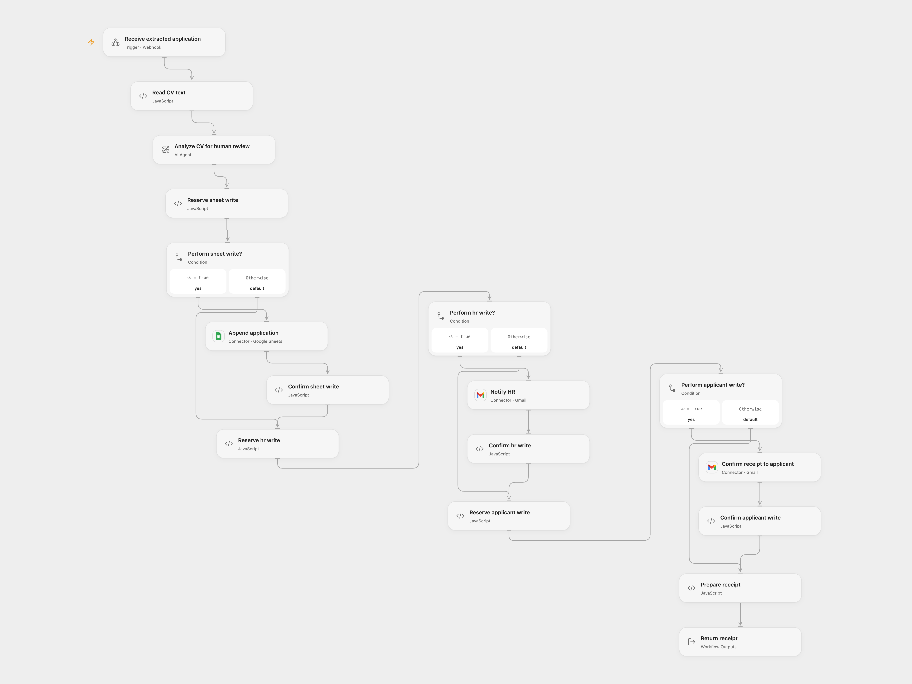

# Review Software Engineer Applications

Collect a PDF application, prepare an advisory assessment for HR, and send a receipt to the applicant.

<!-- template-actions:start -->
 
<!-- template-actions:end -->

<picture>
  <source media="(prefers-color-scheme: dark)" srcset="preview-dark.png">
  
</picture>

## Setup

Import the n8n workflow. Configure a Google Sheet with columns CV, Full Name, E-mail, Expectation, Linkedin, AI Rating; connect Gmail, Google Sheets and Gemini. Set the HR recipient and choose a Data Table with item_key and status text columns. Prevent overlapping submissions.

For Open Flow select relay mode in **Prepare application**, configure its webhook URL, connect Google Sheets and Gmail, set the spreadsheet ID, range and HR email in each reserve node, and enable persistent State. Restrict the webhook to trusted n8n. The default direct mode runs entirely in n8n.

## Behavior

A PDF with extractable text is assessed for the Software Engineer role. The sheet and HR message contain an advisory score and rationale; a person must evaluate the application and make any hiring decision. The applicant receives a receipt. Model output can be wrong. Scanned PDFs need OCR. Extracted text and enclosing data must fit the 1 MiB Code input/output limit in Open Flow. Personal information is sent to the configured AI provider and stored in the sheet and execution history; restrict access and set retention.

Each external write is reserved before execution. If a result is unknown, inspect the sheet or Gmail before retrying. In Open Flow enter the pending key and confirmed or absent in the corresponding reserve node, replay the same submission, then clear the fields. In n8n inspect pending Data Table rows, complete missing actions manually, mark done after confirmation, or delete only when no write occurred.

Inspiration &amp; credits

Add a PDF relay and per-write checkpoints, replace private destinations, and retain human review.

Adapted from [AI CV Screening Workflow](https://github.com/Zie619/n8n-workflows/blob/ae8cf6dc5b873cbb4f74587aa9180ed3a9f70682/workflows/Form/1649_Form_Extractfromfile_Automate_Triggered.json) in [Zie619/n8n-workflows](https://github.com/Zie619/n8n-workflows). The source export does not identify a separate template author or license.

The collection’s [MIT notice](https://github.com/Zie619/n8n-workflows/blob/94007c1445d9258a7da116646b79473e7c7c3282/LICENSE) is pinned at a later revision. This is the collection notice at that revision; it does not establish a separate original template author's license. Our changes are listed above; see [repository licensing](../../README.md#licensing).

> MIT License
>
> Copyright (c) 2025 Zie619
>
> Permission is hereby granted, free of charge, to any person obtaining a copy
> of this software and associated documentation files (the "Software"), to deal
> in the Software without restriction, including without limitation the rights
> to use, copy, modify, merge, publish, distribute, sublicense, and/or sell
> copies of the Software, and to permit persons to whom the Software is
> furnished to do so, subject to the following conditions:
>
> The above copyright notice and this permission notice shall be included in all
> copies or substantial portions of the Software.
>
> THE SOFTWARE IS PROVIDED "AS IS", WITHOUT WARRANTY OF ANY KIND, EXPRESS OR
> IMPLIED, INCLUDING BUT NOT LIMITED TO THE WARRANTIES OF MERCHANTABILITY,
> FITNESS FOR A PARTICULAR PURPOSE AND NONINFRINGEMENT. IN NO EVENT SHALL THE
> AUTHORS OR COPYRIGHT HOLDERS BE LIABLE FOR ANY CLAIM, DAMAGES OR OTHER
> LIABILITY, WHETHER IN AN ACTION OF CONTRACT, TORT OR OTHERWISE, ARISING FROM,
> OUT OF OR IN CONNECTION WITH THE SOFTWARE OR THE USE OR OTHER DEALINGS IN THE
> SOFTWARE.

