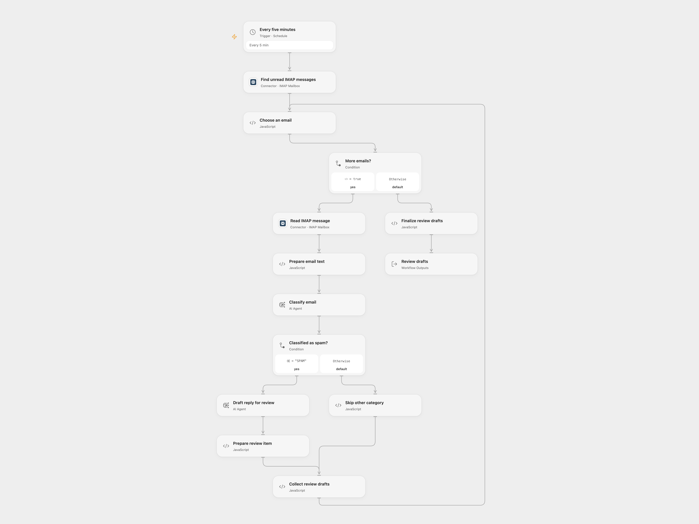

# Review Unread Spam Email Drafts

Classify incoming email and prepare review-only replies for messages classified as spam.

<picture>
  <source media="(prefers-color-scheme: dark)" srcset="preview-dark.png">
  
</picture>

[Open Flow JSON](templates/review-unread-spam-email-drafts.openflow.json) · [n8n JSON](templates/review-unread-spam-email-drafts.n8n.json)

## Setup

Connect the same IMAP mailbox to both Open Flow Actions and configure an AI model. For n8n install the self-hosted community node n8n-nodes-imap version 3.0.1, connect an IMAP credential and configure both AI models. Use one format.

## Behavior

Every five minutes, retrieve up to ten unread inbox messages. The source passes only messages classified as SPAM to its drafting step, so this template retains that condition. Other categories are skipped. The result contains sender, subject, category and a review draft; no reply is sent and messages remain unread, so later runs can process them again. Email text is sent to the configured model. Inspect execution results for drafts.

Inspiration &amp; credits

## Changes to the source

Replace the source unsupported scheduled IMAP trigger operation with scheduled IMAP search Actions and the n8n community IMAP node; use a configurable model.

Adapted from [AI Email Auto-Responder with Ollama](https://github.com/enescingoz/awesome-n8n-templates/blob/827110332c21cbe000ab13f6d292d5adb1f1f8db/Gmail_and_Email_Automation/AI%20Email%20Auto-Responder%20with%20Ollama.json) in [enescingoz/awesome-n8n-templates](https://github.com/enescingoz/awesome-n8n-templates).

Source collection notice: © 2024–2026 Enes Cingoz, [CC BY 4.0](https://github.com/enescingoz/awesome-n8n-templates/blob/827110332c21cbe000ab13f6d292d5adb1f1f8db/LICENSE). The source export does not identify a separate template author or license. See [repository licensing](../../README.md#licensing) for the scope of OOMOL contributions and third-party material.

