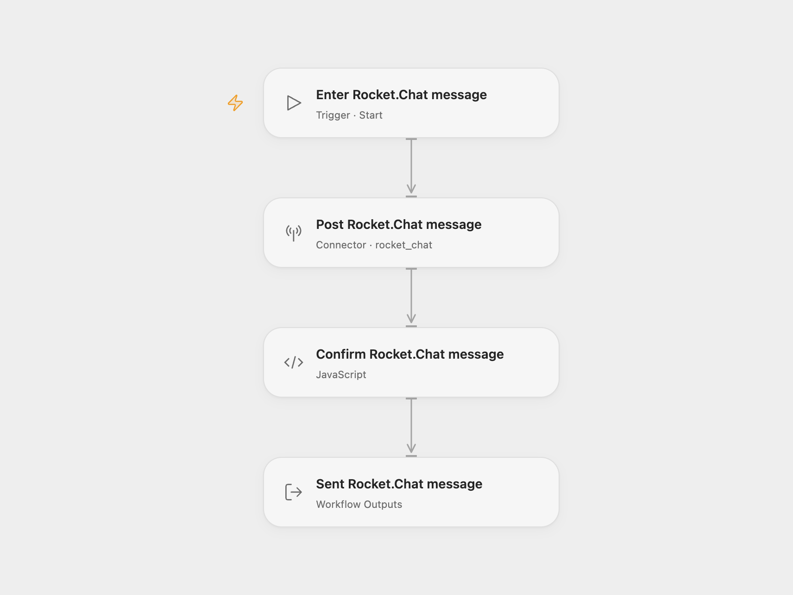

# Rocket.Chat Message Sender

Post one text message to a Rocket.Chat room, channel or user and return the created message record.

<picture>
  <source media="(prefers-color-scheme: dark)" srcset="preview-dark.png">
  
</picture>

[Open Flow JSON](templates/rocketchat-message-sender.openflow.json) · [n8n JSON](templates/rocketchat-message-sender.n8n.json)

## Setup

Select your Rocket.Chat account in **Post Rocket.Chat message** and allow `rocket_chat.post_message`. Configure the workspace URL, user ID and auth token in the connection. Run with **Room Id** and **Text**. The target can be a room ID, a channel name with `#`, or a username with `@`. The connected user must be able to post to that target.

In n8n, select Rocket API credentials in **RocketChat** and replace its channel and text. The credential’s domain is your workspace URL; its auth key is the user’s auth token.

Each run posts one message as the connected user. It adds no attachment, alias, avatar, thread reply or custom field. URL previews follow Rocket.Chat’s default behavior. Open Flow returns the complete created message record, including its ID, room ID and any extra message properties. n8n retains the API response wrapper around that record. The result does not confirm that anyone has read the message.

A rejected post, missing message ID or request failure stops the run. Each run can post another message; no duplicate check or automatic retry is configured. Check the room before repeating an uncertain request.

Inspiration &amp; credits

## Changes to the source

- Replace example room and text values with user configuration.
- Check the API’s success flag and message identifiers in both formats.
- Expose the created message record in Open Flow.

Adapted from [Rocket.Chat message workflow](https://github.com/Zie619/n8n-workflows/blob/ae8cf6dc5b873cbb4f74587aa9180ed3a9f70682/workflows/Manual/1189_Manual_Rocketchat_Send_Triggered.json) in [Zie619/n8n-workflows](https://github.com/Zie619/n8n-workflows). The source export does not identify a separate template author or license.

The collection’s [MIT notice](https://github.com/Zie619/n8n-workflows/blob/94007c1445d9258a7da116646b79473e7c7c3282/LICENSE) is pinned at a later revision. This is the collection notice at that revision; it does not establish a separate original template author's license. Our changes are listed above; see [repository licensing](../../README.md#licensing).

> MIT License
>
> Copyright (c) 2025 Zie619
>
> Permission is hereby granted, free of charge, to any person obtaining a copy
> of this software and associated documentation files (the "Software"), to deal
> in the Software without restriction, including without limitation the rights
> to use, copy, modify, merge, publish, distribute, sublicense, and/or sell
> copies of the Software, and to permit persons to whom the Software is
> furnished to do so, subject to the following conditions:
>
> The above copyright notice and this permission notice shall be included in all
> copies or substantial portions of the Software.
>
> THE SOFTWARE IS PROVIDED "AS IS", WITHOUT WARRANTY OF ANY KIND, EXPRESS OR
> IMPLIED, INCLUDING BUT NOT LIMITED TO THE WARRANTIES OF MERCHANTABILITY,
> FITNESS FOR A PARTICULAR PURPOSE AND NONINFRINGEMENT. IN NO EVENT SHALL THE
> AUTHORS OR COPYRIGHT HOLDERS BE LIABLE FOR ANY CLAIM, DAMAGES OR OTHER
> LIABILITY, WHETHER IN AN ACTION OF CONTRACT, TORT OR OTHERWISE, ARISING FROM,
> OUT OF OR IN CONNECTION WITH THE SOFTWARE OR THE USE OR OTHER DEALINGS IN THE
> SOFTWARE.

