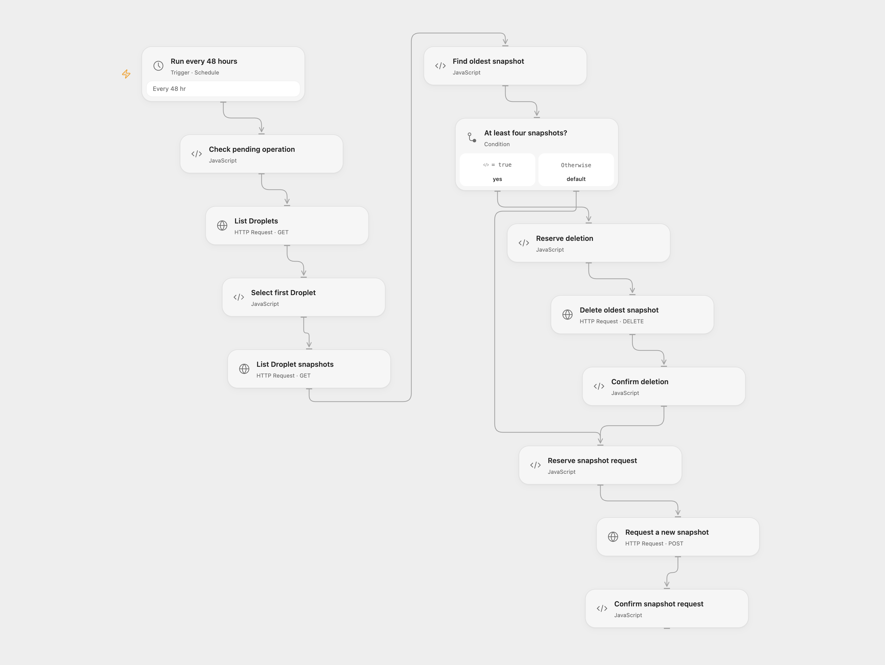

# Rotate the First DigitalOcean Droplet Snapshot

Periodically request a snapshot of the first DigitalOcean Droplet and remove its oldest snapshot when four already exist.

<picture>
  <source media="(prefers-color-scheme: dark)" srcset="preview-dark.png">
  
</picture>

[Open Flow JSON](templates/rotate-first-digitalocean-droplet-snapshot.openflow.json) · [n8n JSON](templates/rotate-first-digitalocean-droplet-snapshot.n8n.json)

## Setup and use

Bind secret Variable DIGITALOCEAN_TOKEN to each HTTP node. The token needs Droplet read and update, and snapshot read and delete permissions. In n8n configure HTTP Bearer Auth on the requests. Enable persistent State and prevent overlapping runs. In n8n create a Data Table with text columns operation and status and select it in the five checkpoint nodes. Activate one format. This changes snapshots.

## Behavior

Every 48 hours, the workflow selects the first Droplet returned on the first page, lists its snapshots, removes the oldest when at least four exist, then requests a new snapshot. Fewer than four snapshots are retained and a new one is requested. The 200-item snapshot listing must contain the complete list or the run stops before writing. Configure the provider account accordingly. A successful creation request starts an asynchronous action; inspect DigitalOcean for its completion. Each write is marked pending before it is sent. If a run stops with a pending operation, later runs stop before writing. Inspect the account and action history. In Open Flow, enter the exact pending ID shown in the error in Check pending operation → acknowledge. That run immediately starts a new rotation, so confirm only when another deletion and snapshot request are appropriate; then clear acknowledge. In n8n, mark the pending Data Table row resolved after inspection. The next scheduled run starts a new rotation, so resolve only when another deletion and snapshot request are appropriate. Deletion is permanent and occurs before the new snapshot completes.

Inspiration &amp; credits

## Changes to the source

- Make creation run below the threshold too, select the oldest by creation time, and reject an incomplete snapshot listing. The source itself selects the first Droplet despite its note describing all Droplets.

Adapted from [Automate Droplet Snapshot Management on DigitalOcean](https://github.com/Zie619/n8n-workflows/blob/ae8cf6dc5b873cbb4f74587aa9180ed3a9f70682/workflows/Http/0611_HTTP_Filter_Automation_Scheduled.json) in [Zie619/n8n-workflows](https://github.com/Zie619/n8n-workflows). The source credits [Optimus Agency](https://optimus01.co.za/) for the Let’s Automate It Community. No separate original template license was found.

The collection’s [MIT notice](https://github.com/Zie619/n8n-workflows/blob/94007c1445d9258a7da116646b79473e7c7c3282/LICENSE) is pinned at a later revision. This is the collection notice at that revision; it does not establish a separate original template author's license. Our changes are listed above; see [repository licensing](../../README.md#licensing).

> MIT License
>
> Copyright (c) 2025 Zie619
>
> Permission is hereby granted, free of charge, to any person obtaining a copy
> of this software and associated documentation files (the "Software"), to deal
> in the Software without restriction, including without limitation the rights
> to use, copy, modify, merge, publish, distribute, sublicense, and/or sell
> copies of the Software, and to permit persons to whom the Software is
> furnished to do so, subject to the following conditions:
>
> The above copyright notice and this permission notice shall be included in all
> copies or substantial portions of the Software.
>
> THE SOFTWARE IS PROVIDED "AS IS", WITHOUT WARRANTY OF ANY KIND, EXPRESS OR
> IMPLIED, INCLUDING BUT NOT LIMITED TO THE WARRANTIES OF MERCHANTABILITY,
> FITNESS FOR A PARTICULAR PURPOSE AND NONINFRINGEMENT. IN NO EVENT SHALL THE
> AUTHORS OR COPYRIGHT HOLDERS BE LIABLE FOR ANY CLAIM, DAMAGES OR OTHER
> LIABILITY, WHETHER IN AN ACTION OF CONTRACT, TORT OR OTHERWISE, ARISING FROM,
> OUT OF OR IN CONNECTION WITH THE SOFTWARE OR THE USE OR OTHER DEALINGS IN THE
> SOFTWARE.

