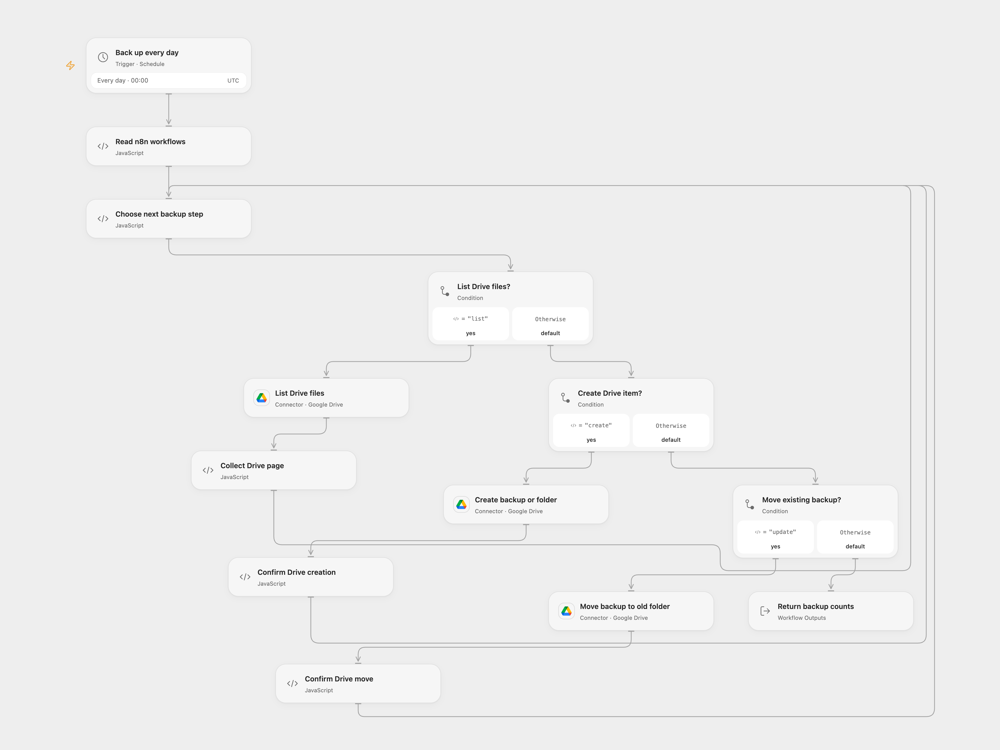

# Rotate n8n Workflow Backups in Google Drive

Move previous workflow backups to an old folder and save current n8n workflows in Google Drive.

<!-- template-actions:start -->
 
<!-- template-actions:end -->

<picture>
  <source media="(prefers-color-scheme: dark)" srcset="preview-dark.png">
  
</picture>

## Setup

Connect Google Drive with access to My Drive and enable persistent State. Set the n8n HTTPS URL in **Read n8n workflows**, add its hostname to that node's HTTP allowlist, and bind Secret Variable N8N_API_KEY. In n8n connect the n8n and Drive credentials and select a Data Table with text columns item_key and status on all checkpoint nodes. Enable one format and prevent overlapping runs.

## Behavior

At 00:00 UTC each day, list n8n workflows, find or create the root folders n8n_backups and n8n_old, move existing JSON backups into n8n_old and write current workflow JSON into n8n_backups.  Duplicate folder names stop the Open Flow run for manual resolution. Workflow definitions may contain sensitive operational information; protect State, the Drive folders and execution history.

Each Drive write is checkpointed before it is attempted. If an outcome is unknown, inspect the relevant Drive file or folder before clearing the pending State entry in Open Flow or resolving the pending Data Table row in n8n. Earlier writes remain. Runs must not overlap.

The source includes an unconnected 30-day cleanup chain. It is not scheduled here.

Inspiration &amp; credits

## Changes to the source

- Fix the folder association, use the current n8n HTTP API in Open Flow, paginate reads, and add write checkpoints. Set the schedule to UTC.

Adapted from [Back up n8n workflows to Google Drive](https://github.com/Zie619/n8n-workflows/blob/ae8cf6dc5b873cbb4f74587aa9180ed3a9f70682/workflows/Code/0605_Code_Itemlists_Create_Scheduled.json) in [Zie619/n8n-workflows](https://github.com/Zie619/n8n-workflows). The source credits Nuntius Creative Hub. No separate original template license is stated.

The collection’s [MIT notice](https://github.com/Zie619/n8n-workflows/blob/94007c1445d9258a7da116646b79473e7c7c3282/LICENSE) is pinned at a later revision. This is the collection notice at that revision; it does not establish a separate original template author's license. Our changes are listed above; see [repository licensing](../../README.md#licensing).

> MIT License
>
> Copyright (c) 2025 Zie619
>
> Permission is hereby granted, free of charge, to any person obtaining a copy
> of this software and associated documentation files (the "Software"), to deal
> in the Software without restriction, including without limitation the rights
> to use, copy, modify, merge, publish, distribute, sublicense, and/or sell
> copies of the Software, and to permit persons to whom the Software is
> furnished to do so, subject to the following conditions:
>
> The above copyright notice and this permission notice shall be included in all
> copies or substantial portions of the Software.
>
> THE SOFTWARE IS PROVIDED "AS IS", WITHOUT WARRANTY OF ANY KIND, EXPRESS OR
> IMPLIED, INCLUDING BUT NOT LIMITED TO THE WARRANTIES OF MERCHANTABILITY,
> FITNESS FOR A PARTICULAR PURPOSE AND NONINFRINGEMENT. IN NO EVENT SHALL THE
> AUTHORS OR COPYRIGHT HOLDERS BE LIABLE FOR ANY CLAIM, DAMAGES OR OTHER
> LIABILITY, WHETHER IN AN ACTION OF CONTRACT, TORT OR OTHERWISE, ARISING FROM,
> OUT OF OR IN CONNECTION WITH THE SOFTWARE OR THE USE OR OTHER DEALINGS IN THE
> SOFTWARE.

